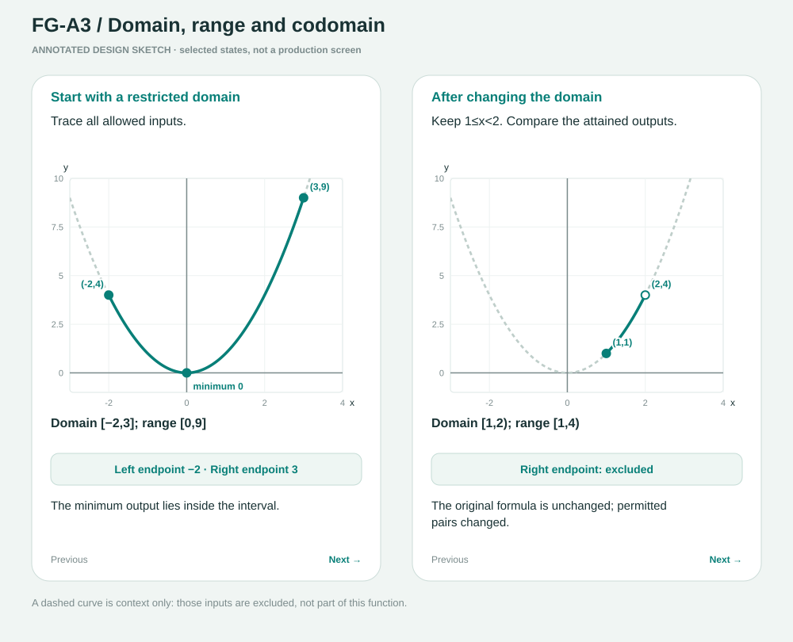
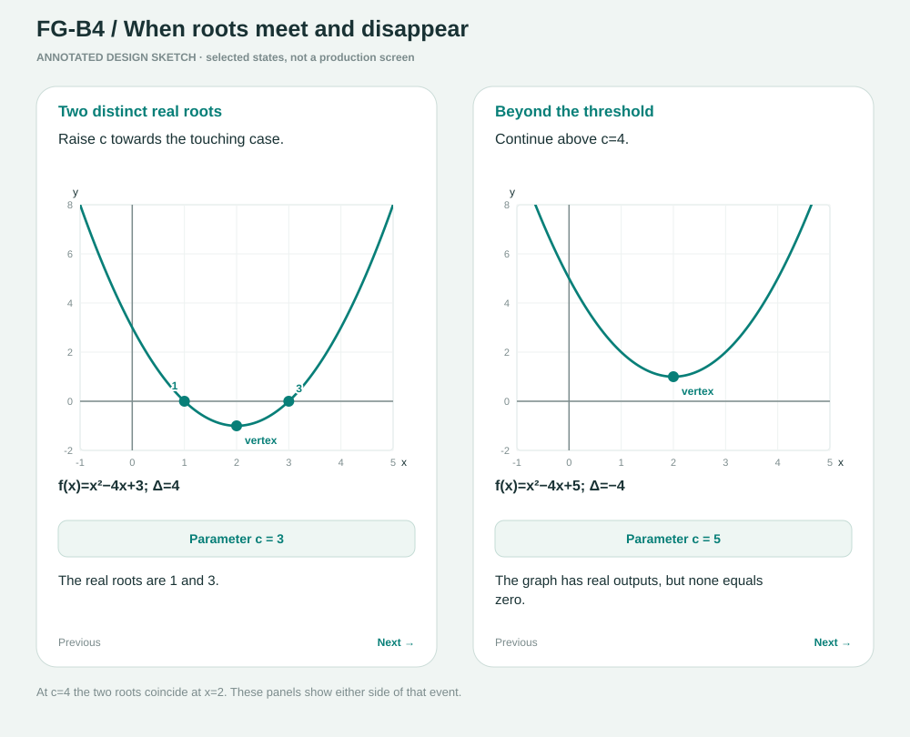
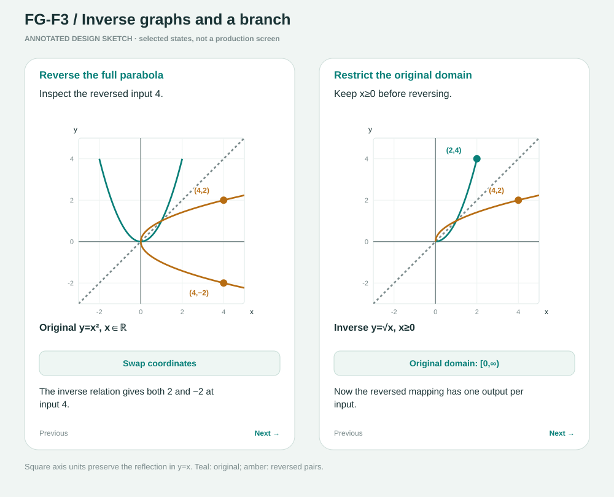
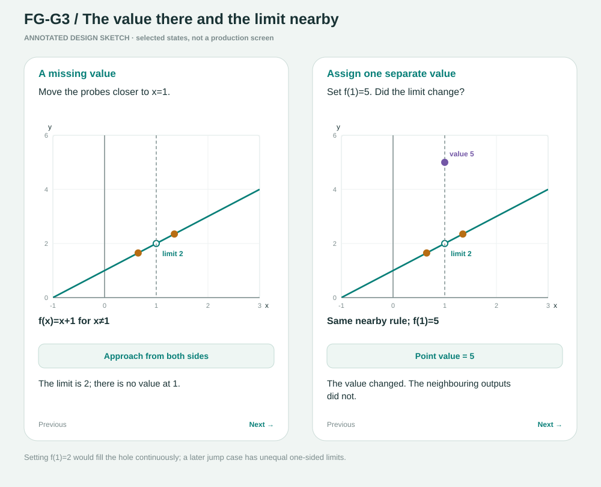
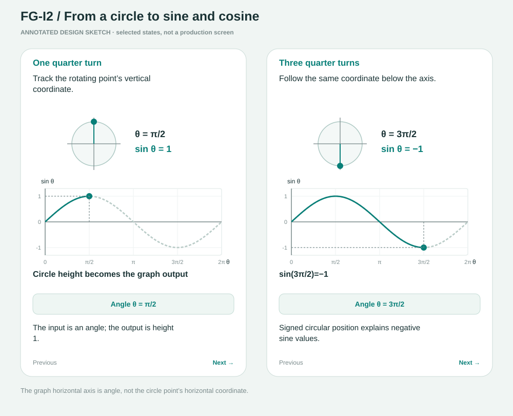
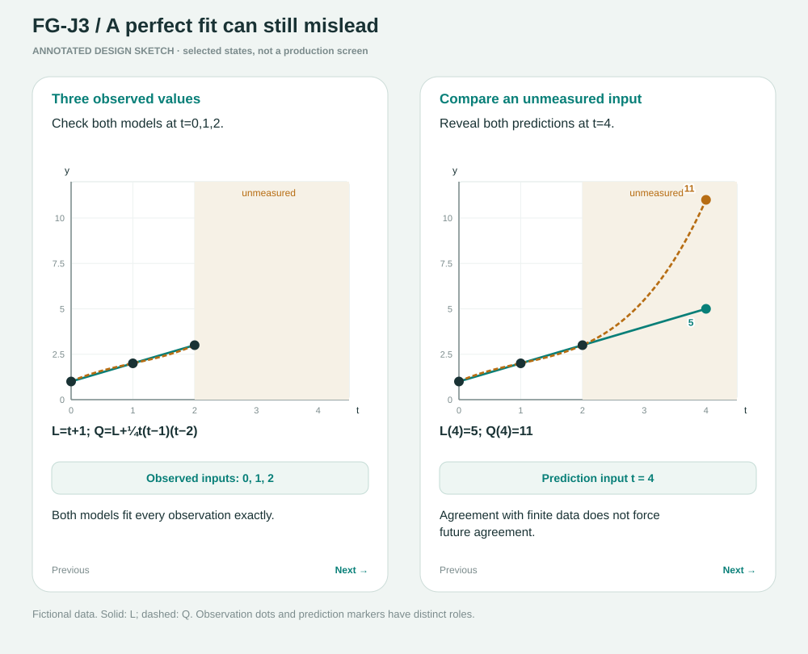
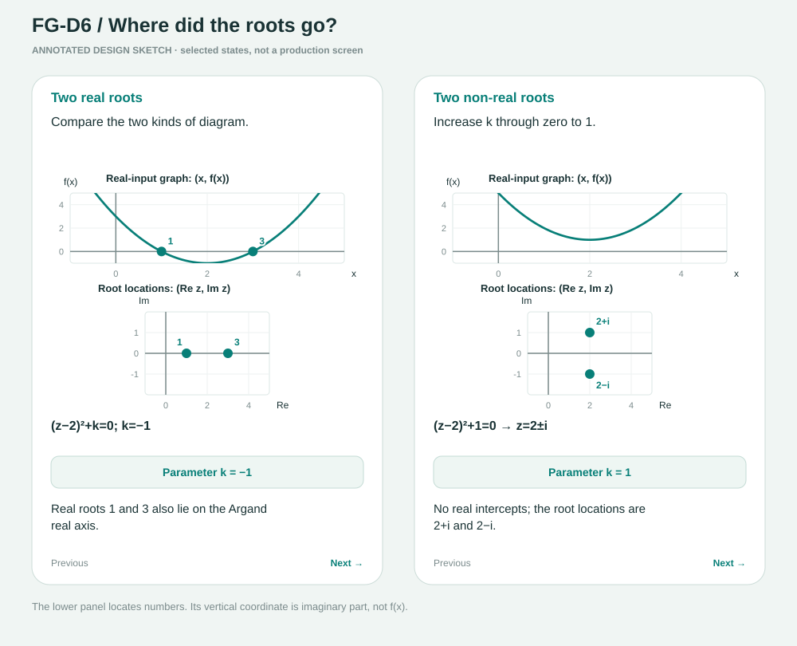

# Functions and Graphs — annotated visual sketches

**[Open the complete 35-page storyboard PDF](visual-storyboards.pdf).** Individual vector sketches are linked below.

These 35 SVG plates accompany the [learning plan](../learning-plan.md) and [framework](../Functions-Graphs-Framework-v2.md). Each shows two selected mathematical states, the main control, and the intended conclusion. They are static, mathematically plotted design sketches—not working activities or verified phone layouts. The learning plan specifies the full stage sequence, prediction masking, Rewind, accessible alternatives and transfer.

The comparison panels may show different functions where explicitly labelled. Colours are reinforced by expressions, labels and line styles. A dashed original graph is a comparison reference, not an extra permitted part of a restricted function. Open circles denote excluded points; coloured bands denote the input set described in the card.

Eight Step 2 video cards (B3, D3, D4, D5, F4, H3, H4, J2) intentionally have no interactive mock. Their recording visuals and pad calculations are described in the learning plan.

| Item | Sketch | Main visual |
| --- | --- | --- |
| FG-A1 | [One input, one output](fg-a1.svg) | Mapping arrows: shared outputs versus an input with two assignments. |
| FG-A2 | [From a rule to a graph](fg-a2.svg) | Vertical input tracing versus horizontal output tracing. |
| FG-A3 | [Domain, range and codomain](fg-a3.svg) | A restricted parabola with included and excluded endpoints. |
| FG-A4 | [Reading change, signs and extremes](fg-a4.svg) | One local valley viewed nearby and within a wider window. |
| FG-A5 | [Lines: a constant rate](fg-a5.svg) | Rise/run triangles before and after changing the intercept. |
| FG-B1 | [Roots, factors and intercepts](fg-b1.svg) | Moving a root changes a factor and the vertical intercept. |
| FG-B2 | [The vertex tells the shape](fg-b2.svg) | Symmetric points at one and two units from the vertex. |
| FG-B4 | [When roots meet and disappear](fg-b4.svg) | A parameter moves the vertex through the real-root threshold. |
| FG-C1 | [Equal outputs: intersections](fg-c1.svg) | Two output markers coincide at a shared input. |
| FG-C2 | [Inequalities: whole intervals](fg-c2.svg) | Shaded input intervals distinguish superiority from equality. |
| FG-C3 | [Absolute value is distance](fg-c3.svg) | A V-shaped distance graph and an open interval of nearby inputs. |
| FG-C4 | [Candidates are not yet solutions](fg-c4.svg) | Original and squared equations have different intersections. |
| FG-D1 | [Cubics and the ends of a graph](fg-d1.svg) | Cubics with three real intercepts and with one. |
| FG-D2 | [Crossing, touching and repeated roots](fg-d2.svg) | The same root crosses or touches as its multiplicity changes. |
| FG-D6 | [Where did the roots go?](fg-d6.svg) | A real-input graph above a separately labelled Argand root plot. |
| FG-E1 | [Translations and their direction](fg-e1.svg) | An asymmetric graph and its corresponding translated point. |
| FG-E2 | [Reflections and scaling](fg-e2.svg) | Input scaling changes horizontal coordinates reciprocally. |
| FG-E3 | [Combined transformations](fg-e3.svg) | One tracked point and all endpoints follow the same coordinate rule. |
| FG-E4 | [Two meanings of absolute value](fg-e4.svg) | Folding outputs upward versus mirroring nonnegative inputs. |
| FG-F1 | [Composition: output becomes input](fg-f1.svg) | A visible intermediate value either passes or fails the next domain. |
| FG-F2 | [One-to-one, onto and bijective](fg-f2.svg) | Removing an unused codomain element leaves every arrow unchanged. |
| FG-F3 | [Inverse graphs and a branch](fg-f3.svg) | Coordinate reversal before and after restricting the parabola. |
| FG-G1 | [Piecewise functions and boundaries](fg-g1.svg) | Two rules meet, then form a jump with separate endpoint markers. |
| FG-G2 | [Rational graphs: holes and asymptotes](fg-g2.svg) | An uncancelled pole compared with a removable hole. |
| FG-G3 | [The value there and the limit nearby](fg-g3.svg) | Approaching a hole while changing only the value at that input. |
| FG-G4 | [Long-run behaviour and asymptotes](fg-g4.svg) | A shrinking gap and a different graph that crosses its asymptote. |
| FG-G5 | [Rational inequalities and signs](fg-g5.svg) | A denominator boundary, a zero and their solution intervals. |
| FG-H1 | [Exponentials: equal ratios](fg-h1.svg) | Linear versus exponential growth, then decay above a baseline. |
| FG-H2 | [Logarithms reverse exponentials](fg-h2.svg) | Swapped exponential/logarithmic points on equal-scale axes. |
| FG-I1 | [Periodicity beyond sine waves](fg-i1.svg) | A triangular wave overlaps at one pair or across a whole pattern. |
| FG-I2 | [From a circle to sine and cosine](fg-i2.svg) | A rotating point's height traces a sine wave against angle. |
| FG-I3 | [Reading and building a wave](fg-i3.svg) | Doubling the input coefficient halves the period. |
| FG-I4 | [Tangent: a periodic graph with gaps](fg-i4.svg) | Opposite signs on the two sides of an excluded angle. |
| FG-J1 | [Build a function from clues](fg-j1.svg) | A family sharing one vertex narrows to a curve through a given point. |
| FG-J3 | [A perfect fit can still mislead](fg-j3.svg) | Models agree at all three observations, then predict different futures. |

## Representative plates

The complete linked set above covers every proposed interactive card. These previews sample the main visual families.

### Domain and range

### Discriminant and roots

### Inverse graph and branch

### Limit versus value

### Circle to wave

### Model evidence

### Complex-root epilogue

