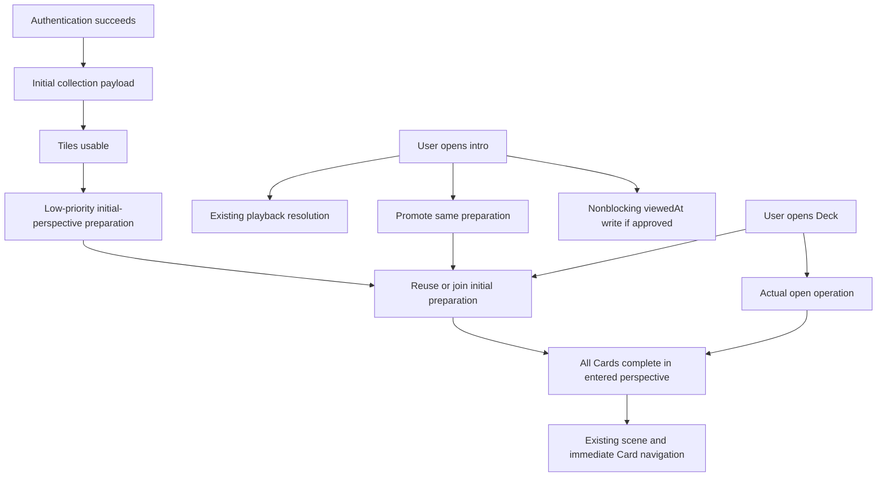
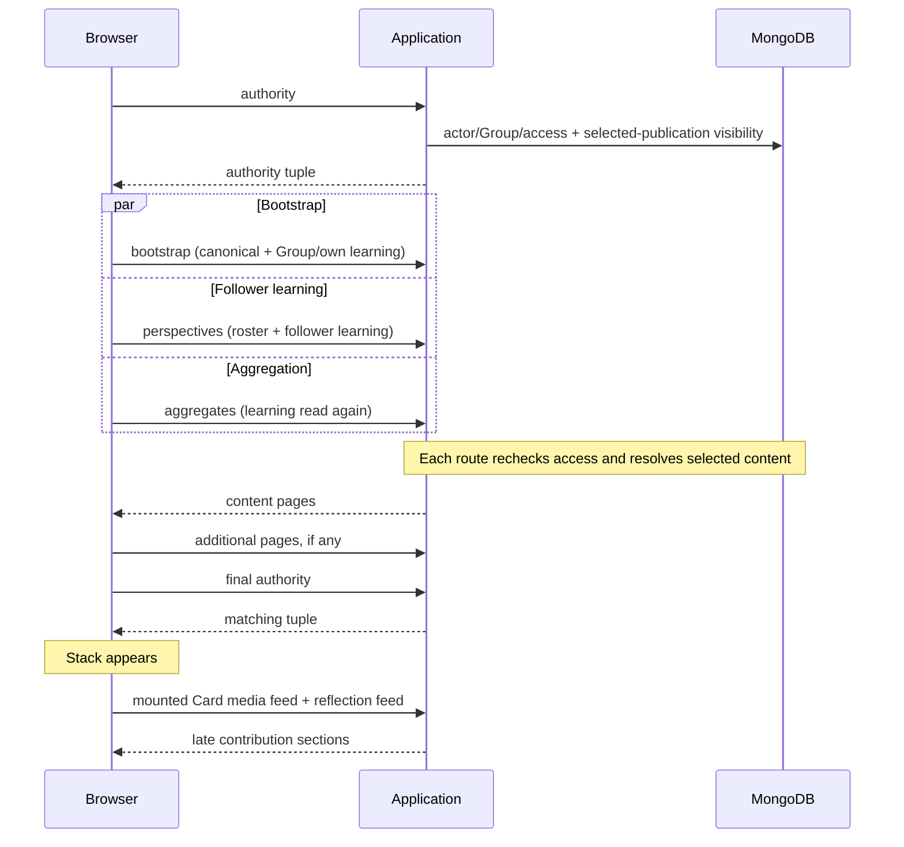

# Loading architecture V2 — performance, immersion and safeguarding

Date: 7 November 2026. Status: **finalised engineering plan for independent review**. The staged Group-loading product direction is agreed; implementation remains unauthorised. Section J distinguishes agreed requirements, outstanding architectural/product approvals, measurement gates and ordinary implementation choices.

Scope: Personal and Group Deck entry, preparation, Card continuity, collection browsing, introduction playback, session retention and refresh. Preserve existing media-security architecture, Organisations/Info Card boundaries, Card geometry, motion and gestures. The four accepted iPhone corrections in baseline `feat/group-experience`, `202f909`, remain intact.

Evidence categories: **current-code fact**, **previous hosted measurement**, **disposable local measurement**, **estimate**, and **proposed implementation**. Proposed endpoints/queries are not existing functionality. The earlier lifecycle investigation records current problems; the V1/product proposals supply research and reasoning, not overriding specifications.

Inputs: [V1](loading-architecture-engineering-plan.md), [product proposals](proposed-loading-architecture.md), [lifecycle investigation](group-experience-loading-lifecycle-investigation.md), and the focused Group preparation/aggregation investigation whose findings are integrated in C, D3 and H2. V1 and the supporting documents are preserved unchanged.

## A. Executive recommendation

Prepare **every Card and both faces in the perspective being entered**, then retain complete data for the authenticated session. Swiping, flipping and prepared perspective selection have no metadata-request prerequisite. Full Gallery resources/video streams remain on demand; image bytes may load into reserved thumbnail positions.

The agreed Group sequence is:

1. **Initial perspective:** preserve authorised saved/Progress-return selection before Admin→Group / follower→Me defaults. Prepare that perspective across all Cards. A restored follower requires that subject only.
2. **Other primary view:** once entry is usable, prepare Group behind Me; prepare Me behind Group only for followers. For a restored foreign view, Group follows first, then Me if applicable. Reuse completed work.
3. **All followers:** on selection, immediately open the existing unfocused list or focused grid. Its blank content says “Loading followers…” until all selectable follower perspectives are complete. Retain them for immediate future selection/navigation.

Composed protected readers share authority/publications and batched database helpers within each operation. Remove client authority bookends, not server authorisation. Group aggregates are computed from narrow current learning fields; they require neither full follower perspectives nor stored derived values. They remain part of complete Group presentation.

Reuse the Personal store, Group resource and media/reflection controllers under session lifetime. Keep account/source scopes, optimistic saves and denial handling. Tiles render independently; viewport/intro preparation targets the likely initial perspective, never all followers automatically. The 8-Deck/48-Card/512-KiB budgets remain provisional engineering values, not caps.

Compared with earlier plans, this withdraws both V1's wait at an unprepared Card and earlier V2's entire-follower-set entry gate. It retains compact server-rendered tiles, background refresh of mutable visible data and the existing bounded video preparation. Session-marker/offline policy choices remain pending in J.

Aim for approximately 1–2 seconds for normal complete opening where achievable; investigate results approaching 3–4 seconds before broad extension. Six seconds is not acceptable routinely. These are expectations, not V2 measurements or permission to weaken completeness, navigation or safeguarding.

## B. User-journey design

| Stage | What the user sees | Work and retention | What can block? |
|---|---|---|---|
| Login | Existing authentication | Establish identity/session; destination navigation starts collection/entry work after authentication. Do not launch a duplicate AuthScreen collection fetch. | Authentication only. |
| My Decks / Library | Existing tiles and intro controls | Render their own compact/available collection payload; retain exact-version metadata; start useful deeper preparation afterwards. | Tile data, never Card-contribution preparation. |
| Introduction | Existing embedded/expanded player | Begin required playback resolution, promote that Deck's initial-perspective preparation, record the actual view asynchronously. | Existing playback requirements; neither preparation nor timestamp write. |
| Personal open | Existing Deck scene | Join complete metadata and perform actual-open/date initialisation. Retain all Cards. | Missing complete data and required first-open initialisation. |
| Group open | Existing authorised restored/default view | Prepare all Cards in **that perspective only**; retain shared canonical data and perform genuine open bookkeeping. | Missing initial-perspective data; no unrelated follower preparation or client authority bookends. |
| Background primary preparation | Same complete active Card | Me→Group; Group→Me only for followers; restored foreign→Group then Me if applicable. | Nothing in current Card interaction. |
| Early Group selection | Current Card stays visible | Promote/join Group work; show minimal “Loading…” inside the existing picker; switch once complete. | A one-off pending Group preparation, explicitly agreed. |
| All followers | Existing unfocused list / focused grid immediately opens | Blank follower-content area says “Loading followers…” until the entire permitted selectable follower set is ready. | First unprepared follower-set population only. |
| Select prepared follower / swipe / focus / flip | Existing interaction and animation | Select complete retained projections; persist navigation asynchronously. | No new metadata wait. |
| Gallery / Step playback | Existing viewers | Fetch full resources/pages/playback on demand; preserve immediate seeded Gallery opening. | Requested resource loading, not Card navigation. |
| Return to prepared view / Deck | Complete retained content | Subscribe to existing resources; coalesce background refresh. | No fresh read prerequisite for valid retained content. |
| Safari resume, live page | Same Card and content | Check session identity; coalesce refresh; restrict only relevant uncertain editing. | No routine display clearance. Offline/identity policies follow G/J. |
| Safari process discard / reload | Normal new entry | Memory no longer exists; use efficient authenticated initial read. | Genuine initial loading; no persistent private cache. |

### Selection, background priority and approved preparation surfaces

Resolve selection before requesting its contribution projection: existing authorised Progress-return selection when supplied, otherwise authorised saved perspective, otherwise current role default. Client hints/return parameters never grant access; the server validates them and returns the effective selection explicitly. Invalid/removed subjects use existing authorised fallback behaviour, not a wrong-subject cache key. Preserve the same selected Card and return geometry where valid.

A follower who has saved Group enters Group; an Admin who has saved a particular follower enters that follower. Do not reset either to a role default to make staged preparation easier. An Admin who is also a follower has one Me identity keyed by their user ID. An Admin without follower enrolment has no Me perspective.

After entry, priority is: active saves/playback and explicit navigation/perspective requests; requested All followers preparation; the other primary view; speculative collection preparation. Explicitly selecting Group promotes its background request. Low-priority work must not hold foreground operations behind a queue; completed/in-flight work is shared by scope. Do not prefetch all followers from a routine idle callback after Group opens.

**Early Group selection:** keep the current view and selected source active until Group is complete. Within the existing picker, use a small “Loading…” below the Group name if it fits without a layout redesign; otherwise temporarily replace the requested Group name with “Loading…”. Label the pending target, not the current Card as if the switch succeeded. On success commit selection/presentation once, then persist it. A newer selection or closing/cancelling the pending intent must prevent a late response from switching the user unexpectedly; completed data can still be retained. A failure uses the existing error/retry treatment and keeps the current complete Card.

**Early Me selection is not implicitly covered by that approval.** It can occur for a dual-role Admin or a restored foreign view. Section J10 proposes the same restrained picker treatment, but leaves it awaiting explicit approval. Do not conceal Me, frontload both primary views or add a different waiting interaction to resolve this silently.

**All followers:** `PerspectivePicker.tsx` currently uses an expanded list when unfocused; `GroupExperienceDeck.tsx` and `PerspectiveGrid.tsx` use the existing comparison panel when focused. Preserve those surfaces, their opening/closing behaviour and focused Card node identity. Opening or moving between those surfaces subscribes to one shared preparation operation; it does not restart work. Preserve existing comparison layout/motion; only its follower-content area receives the agreed loading/error/readiness treatment.

When unprepared, show no partially ready follower entries. Keep headers/collapse controls and the underlying Card stable, provide “Loading followers…” as a restrained status, and use an understandable error with the existing retry pattern on failure. Once all selectable follower projections are complete, publish the set together. Reopening a prepared set shows it immediately; ordinary content refresh must not blank it. Group/Me entries that the existing surface includes retain their roles and cannot be treated as complete merely because the follower set is complete.

Closing the surface releases its preparation interest. Stop queued/unneeded continuation work where useful, retaining complete perspectives and resumable coverage; submitted saves and foreground subscribers continue. Reopening joins an in-flight operation or requests only missing compatible windows. Membership/adoption changes are reconciled under G, rather than marking stale partial results ready.

### Introduction interactions and timestamps

Current `DeckGrid.tsx` uses a shared HLS player: tile tap activates/toggles a playable intro; title tap clears it and opens the Deck. A tile without a playable intro opens the Deck directly. Preserve those interactions. No current intro-triggered Deck preparation or persisted intro-view timestamp exists.

For non-Personal published playback, `publishedVideoGuard` calls `/api/library/media/stream-status` to authorise the exact published reference and check provider readiness. Processing assets poll when selected; preparation checks once. `CloudflareHlsVideoPlayer`/`cloudflareStreamPlayback.ts` retain existing playback resolution/delivery. Do not remove genuine playback checks or speculate signed playback resources for every Deck; the separate media-security project is unchanged.

Recommend optional `introduction: { viewedAt: Date }` on the user's **DeckData** and equivalent per-member **GroupMember**, separate from canonical introduction content. Both currently have `openedAt`; neither has this intro timestamp. Keep latest server timestamps, not arrays; use monotonic/atomic latest updates against delayed requests. No backfill is needed.

The Group repository and `/api/group-experiences/[experienceId]/open` route already implement actual opening, but the inspected UI path does not call it. Wire genuine entry to that operation, preserving active-Card/per-member openedAt and active follower Personal-learning initialisation with experience scheduling. Personal `openWorkingDeck` still performs its existing date initialisation. Preparation performs neither operation. Serialize open/navigation effects or use intent generations so a delayed opening acknowledgement cannot reset a subsequently selected Card.

Proposed `viewedAt` event: actual user opening of an available intro viewer, once per opening, including subsequent playback failure; not preparation, pause/resume or remount. Record through an authorised nonblocking backend request; a timestamp failure must not delay/reject playback. J6 leaves the exact event/model recommendation pending approval. J7 recommends not fabricating DeckData for Library-only viewers; defer those events to separate analytics unless approved otherwise. No durable analytics/retry infrastructure is proposed.



`Open → Ready` blocks only required visible first-open initialisation, not every warm visit's timestamp update. Direct Deck entry bypasses collection work (E2).

## C. Existing-behaviour investigation

### Why twelve sparse Personal Cards can be browsed immediately

`src/lib/cards/readModels.ts` builds the working Deck with the entire selected Card set and Personal learning data. `src/lib/cards/repository.ts::openWorkingDeck` resolves the selected Cards and initialises missing dates in the real open transaction. `AppShell`, `useWorkingDeck` and `workingCardStore` receive/retain that data before browsing. Swiping selects from an existing array; it does not request the next canonical Card.

`src/components/decks/CardStack.tsx` maps the full Deck. `FUTURE_READABLE_COUNT = 3` in `src/constants/cardStack.ts` controls visual stack presentation, not a three-Card network cache. `DeckCard` selectively prepares/mounts readable content and keeps previously prepared content. Preserve these geometry and rendering rules. Supplying all metadata does not require mounting every expensive video player or interactive visual.

What remains incomplete today is the separate contribution lifecycle. Media and reflections can fetch on component mount/perspective activation after the working Deck already exists. An empty component-local feed can therefore override the impression of a fully loaded Card. Sparse-media browsing succeeds because most navigation data is already in memory and little additional contribution work is noticeable. It is not evidence that media-rich Cards are fully prepared today.

### Current Group switching

`groupResource.ts` loads authority, then bootstrap/perspectives/aggregates concurrently, their additional pages, and final authority. It obtains all selected Card structure and permitted follower learning pages, rather than fetching an entire follower's signals on each selector tap. This explains responsive signal/progress switching. Media and reflection controllers remain scoped to their mounted context; switching can still load those sections later. Final V2 preserves immediate browsing by preparing complete follower data at the All followers boundary, and retaining it afterwards, rather than requiring every follower learning page before initial entry.


### Group aggregate reads and picker coupling

`src/lib/groupExperiences/presentationReads.ts::cardAggregates` is a separate current request. It repeats actor membership/Group reads and selected publication resolution, loads active follower IDs, calls `personalLearningForUsers` and reads collective Group learning. `learningReads.ts` projects only Card IDs, Step IDs/statuses and readings; it excludes dates, media, reflections, tests and private history. Existing helpers batch up to 100 users/Card IDs internally; those are query chunk sizes, not product limits. Missing rows trigger an additional validity query where needed to distinguish Group defaults from corrupted ordinary Personal data.

`readModels.ts::aggregateLearning` keeps collective metrics separate from follower summaries at Deck/Card/Step level. Progress uses exact eligible completion states, treating skipped Steps neutrally; an all-skipped scope is not a completed follower. Confidence aggregates valid raw non-null readings and rounds once, independently of skipped progress. Preserve these existing semantics. `groupPresentation.ts` attaches aggregate results only for `perspective === "group"`; Me and inspected-follower Card presentation need no aggregate response.

The current picker derives available identities from the loaded follower-learning array and returns a static display when `choices.length === 1`. That coupling must change: known inspection capability and a not-yet-loaded roster are distinct from a genuinely single-choice view. Authorised All followers remains reachable before any foreign perspective has been prepared. Server `canInspectPeers` remains authoritative: Admins can inspect; ordinary followers require the existing Shared inspection policy. A Private-mode follower receives no peer preparation payload.

### Causes of lost continuity to retain in the design

* `GroupExperienceDeck` owns a resource per mount and independent full-data/authority refresh schedules; leaving the Deck discards that resource.
* `useMediaCollection` owns a component-lifetime controller. It is disposed on unmount/context replacement; ordinary request errors can clear its page.
* `ReflectionArea` owns its feed and refresh triggers. It can remount empty even though Personal signals survive in the working store.
* Group/foreign contribution contexts become unavailable during expired/unverified authority; child sections disappear even when the Card node remains mounted. The accepted out-of-order renewal fix prevents an older failure defeating a newer valid grant; it does not itself make the resource session-lived or distinguish every temporary failure from denial.
* Personal owner learning has stronger retention through `workingCardStore`; that store must not become a storage location for another member's private data.

Sources: `src/components/group-experiences/GroupExperienceDeck.tsx`, `src/components/group-experiences/groupResource.ts`, `src/components/media/useMediaCollection.ts`, `src/components/reflections/ReflectionArea.tsx`, `src/lib/cards/workingCardStore.ts`, and the detailed lifecycle investigation.

## D. Loading and batching alternatives

### D1. What “complete” means

A complete Card projection contains: exact canonical Card/Step structure and instructional media identities; progress/confidence values; permitted date state; the current-context reflection (including a known-empty editable slot); for the Group Card, collective reflection and the permitted member carousel; newest **five** permitted back-media identities in stable order, total count, source identities, visibility indicators and presentation references. Include any existing visible assessment/count summaries needed by that face. Preserve full-history APIs for deliberate history/management actions; do not silently remove functionality from their contracts.

For reflection text, the simplest first implementation returns the current-context text and Group carousel entries with source revisions, not the author's other-context history. Text can currently be long (up to 20,000 characters), so do not assume every reflection is nine words. A later compact preview/full-text split could save payload, but would add an editor read and require exact truncation semantics. **Do not introduce that new wait in V2 by default.** Member carousel text is kept locally so advancing remains immediate.

| Category | Fetch/retain for complete presentation | Defer |
|---|---|---|
| CardTemplate instruction | Exact version, Step IDs/order, rich text/interactive descriptors, image/video identities and poster references | Video manifests/segments, expensive viewer initialisation; preserve existing preparation where it already helps |
| Personal back | Top five across the owner's existing reusable history sources, total, stable source/attachment IDs and references | Older Gallery/Media Centre pages; never copy Group contributions into CardData |
| Group / inspected back | Top five/count per Card for the requested Group or subject projection; share compatible source records | Original bytes, provider verification/status unless actual viewing requires it |
| Owner inside Group | Owner-visible top five and total across history sources, including private/hidden/other-origin items; current-Group visibility per source | Never place these private rows in the Group/follower response map |
| Individual reflection | Current context's text, exact source, revision and capabilities; known empty is explicit | Cross-context history, retained through existing retrieval API |
| Group reflection areas | Collective text/revision and all currently visible carousel contributions, author names inline | Deferred moderation UI; no timer carousel |

Group media source records should appear once in the response with perspective lists referencing their IDs. A Group top-five list can be derived from the union of per-author newest-five lists **only if all eligible authors and the identical ordering/tie-break rules are included**. Removed members' still-shared contributions and Admin-authored contributions must not disappear because the selectable follower roster excludes them. For Group preparation, query the Group window directly rather than fetching all per-author windows to derive it. For All followers preparation, query permitted per-subject windows explicitly and deduplicate records already held under compatible authorisation. Owner history/fork lineage needs its existing separate resolution; it cannot be inferred from the Group list.

### D2. Card preparation alternatives

| Alternative | Advantage | Cost / consequence | Recommendation |
|---|---|---|---|
| Complete all Card metadata before opening | Immediate traversal in both directions, no sliding readiness state | Larger initial response; retain all lightweight data | **Default**, including normal six-Card and twelve-Card Decks |
| First six complete; remaining prepared behind navigation | Shorter initial wait when a Deck is large | A fast user can overtake preparation; either pause or show incomplete Card | **Not approved and not recommended as default** |
| All canonical/learning, delayed contribution metadata | Matches much of current implementation | Reproduces media/reflection pop-in | Reject |
| Complete metadata for all, bounded image/video-byte preparation | Stable layout plus manageable decoding/bandwidth | Some imagery appears inside its already reserved frame | **Combine with the first option**; expressly permitted resource-loading distinction |

Do not cap uploads or Deck size to enforce a preparation budget. A large Deck can be prepared alone, with an opening delay rather than hidden mid-Deck pauses. Aim for approximately 1–2 seconds for a normal complete opening where reasonably achievable; investigate results approaching 3–4 seconds before extending the approach. Six seconds is not an acceptable routine standard-Deck result. These are product expectations, not measured outcomes or content limits. If measurements expose a trade-off with completeness, return for approval rather than introducing navigation waits or progressively assembling Cards.

### D3. Staged Group perspectives and aggregation

#### Preparation scopes and required data

| Scope | Required complete data across all Cards | Deliberately outside this scope |
|---|---|---|
| Initial/selected Me | Canonical structure, owner's reusable learning/date, current-Group individual reflection, owner-visible top-five media/counts and Group-relative visibility | Other followers' perspectives, collective Group aggregate response and Group carousel |
| Initial/selected Group | Collective learning, follower aggregate summaries, collective reflection, currently Group-visible member reflection carousel, Group top-five media/counts and other existing visible summaries | Complete individual follower Cards and owner-private histories |
| Initial restored/selected follower | That active permitted subject's learning, current-Group visible reflection and shared top-five media/counts | Their private dates, hidden contributions, other-origin history and all other follower perspectives |
| All followers set | Each currently permitted selectable follower's complete projection across every Card, reusing Me for the viewer and any already prepared follower | Unauthorised subjects, foreign private history and full Gallery/video resources |

Share canonical Card content once per selected version. Server authority is still current for each operation; reusing a client version reference does not skip authorisation/publication eligibility. The All followers reader accepts the already known manifest identity, validates it once, and need not retransmit unchanged canonical descriptions/media descriptors. Same-Card owner continuity remains separate from Group/foreign presentation.

For Group media/carousel, include still-visible contributions from Admins and former members according to existing rules, even if those authors are absent from the selectable active-follower roster. Group membership does not redefine author ownership or automatically hide their contributions. The viewer's Me projection can reuse their existing private owner history; a foreign subject's projection cannot.

#### Alternatives and chosen strategy

| Strategy | Initial opening | First All followers use | Work / complexity | Decision |
|---|---|---|---|---|
| Complete all followers upfront | Waits for unrelated perspectives; work increases with roster | Immediate if all remain valid | Transfers/retains unused content; couples entry to entire roster | Superseded |
| Prepare followers on All followers | Only requested initial view blocks entry | One explicit list/grid loading boundary | One coordinated batch with scoped readiness | Agreed |
| Automatically prepare all followers after entry | Initial view can open first | May reduce first grid wait | Consumes bandwidth/CPU even when unused and competes with primary preparation | Not the default; requires measured justification before adding |
| On-demand preparation plus retained reuse | Focused initial entry | One-off on first unprepared use; prepared return immediate | Uses the same registry, deduplication and reader helpers | **Agreed preferred strategy** |

Apply the same principle for 16 followers and approximately 100 members. One logical preparation can use several batched queries and bounded transport pages. There is no fixed user-visible follower batch size and no per-member full bootstrap. Complete all relevant projections before publishing selectable entries; do not make selecting the first person start the batch. Later prepared follower changes/swipes use memory immediately.

For a restored foreign view, prepare that one subject first; Group follows in the background, then Me if applicable and missing. This exception does not prepare the remaining set until All followers intent. There is no unapproved new first-presentation exception for media/reflections or aggregate values.

#### Aggregation recommendation

Compute summaries from **current narrow learning records**, using the existing projection/default/validation and `aggregateLearning` semantics. Within the composed Group operation, read authority/publications once, fetch active follower IDs and their relevant learning once, and read collective learning once. Calculate aggregates without building individual media/reflection perspectives. Return compact summaries, not the full follower matrix solely because it was read to compute them.

A later All followers request may freshly read the same narrow learning values. This is an intentional scope/freshness boundary, not justification for retaining server-side per-user matrices between requests or transferring them on every initial Group opening. Reuse any already held **authorised client projections** and share the batch's own query results. Me entry does not invoke aggregate calculation unless some independent existing visible requirement is demonstrated; no such requirement exists in the inspected Card presentation.

Do not maintain stored derived aggregates. They would need correct updates for membership/removal, skipped/unskipped Steps, confidence edits, accepted versions/Step changes, concurrent saves and the same Personal CardData changing through another Deck or Group. The measured arithmetic cost does not justify this fan-out and consistency machinery. Ephemeral calculated summaries retained in session memory are ordinary read results, not a new persisted aggregate source.

Do not fade or insert aggregates after a Group Card appears. They are part of Group readiness. A substantial hosted aggregate bottleneck, if later measured, must return with alternatives for approval. Refresh summaries through the active coordinator after relevant learning/membership/adoption changes, without fetching media histories, rebuilding canonical content or completing dormant follower perspectives.

#### Background priority and collection preparation

Collection/intro preparation of a Group targets its likely authorised **initial perspective only** (saved/restored hint or role default validated server-side). It does not label the entire Group “ready” or trigger all followers. The other-primary preparation begins once the Group is actually open and initial content is usable. Already completed Group/Me/follower projections from an earlier session visit are reused; no duplicate work is required.

Group background work must yield to foreground playback, saves and explicit perspective/navigation intent. All followers selection promotes its coordinated request above speculative work; it does not have to await an unrelated queued primary request. Identical compatible in-flight work can be shared, with response acceptance still protected by scope/generation.

### D4. Collection batching

The one-Deck limit was precautionary, not supported by measured capacity. Combining eight HTTP responses is also insufficient if the handler still executes hundreds of per-Card reads.

| Approach | Benefit | Cost / assessment |
|---|---|---|
| Fixed eight Decks | Simple, few batches | A heavy Group can dominate; count alone ignores scope |
| Byte/Card budget alone | Bounds broad work | Exact bytes initially unknown; does not prioritise visible choices |
| Viewport window + soft budget | Prepares nearby choices and promotes user intent | Small queue/budget bookkeeping; **recommended** |

Start with visible tiles plus approximately one viewport ahead, up to **eight Decks / 48 canonical Cards / 512 KiB uncompressed prepared metadata** per speculative batch. These are provisional engineering constants, not measured optima, response validity limits or content caps. A larger single initial-perspective job runs alone and completes, using bounded transport if necessary. Group follower-set work is not included automatically. Measure transferred bytes, wasted speculation and foreground contention before tuning.

Allow one speculative batch and an independent foreground lane. Explicit opening/intro intent promotes or joins compatible work, never waits behind queued speculation. If a large in-flight batch holds a needed result, cancelling/reissuing its still-needed read-only scope as foreground work is an acceptable controlled duplication; cancellation cannot guarantee the server stops work. Avoid introducing a streaming batch protocol merely for promotion.

Batch compatible server scopes: resolve viewer once, relevant memberships/owner fields once, exact canonical versions in batches, then necessary contribution/count/name projections. Each Group retains separate authorisation. Do not send the full user document per Deck or call existing complete bootstraps in a loop.

**Library:** its default 20-Deck page already contains canonical Card content and instructional-media references. Seed exact-version data directly; do not fetch it again for nearby tiles or fetch owner/Group history because a template ID matches. Viewer action/membership status is separate; its existing creator checks are not free. Prepare nearby status and selected playback readiness without altering publication rules, ordering or More Decks semantics.

### D5. Scroll scheduling and pagination

Use IntersectionObserver on tile identities/the next preparation boundary, scoped to the actual scrolling container. Start with a look-ahead distance of one **current viewport height**, recalculated on resize/orientation change; this is more useful on iPhone than a fixed pixel distance. When the observer boundary enters that band, queue the next display-order window. If all currently visible/nearby tiles are ready and the user stays, use idle time for the next window, subject to the same budget. Tiles never await this work.

Rapid scrolling promotes the new visible window and drops unstarted distant work. Reversing direction reuses completed or in-flight keys. Filtering/reordering recalculates priority by stable Deck identity/version, not list index; removed tiles release speculative interest without deleting legitimate visited data. Leaving the collection cancels queued work and unneeded speculative reads, but not a foreground subscriber's shared request or completed snapshots.

Preserve Library's **More Decks** interaction. Near its sentinel, prefetch only the next existing cursor page, retain it without appending, and reveal it when the user presses More Decks. This avoids a new automatic-scroll experience. If not ready, retain existing page-loading behaviour; do not hide visible tiles. A collection revision/filter change invalidates the cursor lineage, not unrelated exact-version Card metadata. Library current pagination is publication-date/ID based; do not replace it with offset pagination or alter ordering.

### D6. Thumbnail bytes and memory

Keep all visible media positions and counts known, but separate metadata retention from decoded image lifetime. `DeckVideoPreparationProvider` already uses Context and external-store subscriptions; `deckVideoPreparation.ts` warms a seven-Card introduction window with two jobs, waits for the active thumbnail, and suspends neighbours during video playback. This is genuine bounded thumbnail/grant preparation, **not** canonical Card batching or eager Step-video streaming. Reuse it; do not widen to all videos in all prepared Decks.

For back thumbnails, do not assume a “thumbnail” URL is a small object. R2 image delivery can serve the original image through the contextual route. Do not download hundreds of photographs during collection browsing. Use existing visible image loading and, where an actual bounded thumbnail resource exists, low-priority nearby warming. No new image transformation service is proposed. Gallery originals remain on demand.

The local metadata rows fit in hundreds of KiB to low MiB of JSON, but parsed-object memory and decoded imagery are different. One 4000×3000 RGBA decode is about 46 MiB before browser overhead. Therefore retain session metadata, not unlimited Image/canvas/video resources. No fixed private-content cache eviction should make a visited Deck progressively reconstruct; release speculative/unvisited work first. Measure iPhone heap/termination behaviour before inventing a hard session cache cap.

## E. Proposed request architecture

### E1. Current versus proposed Group entry

Current, with no retained Group resource:



Proposed staged Group entry and follower preparation:

```mermaid
sequenceDiagram
  participant UI as Session registry / existing scene
  participant API as Scoped composed Group reader
  participant DB as MongoDB
  UI->>API: initial preparation (restoration hint or default)
  API->>DB: authorise viewer and resolve effective selection/publications
  API->>DB: all Cards for that perspective; aggregates only for Group
  API-->>UI: scope envelope + complete initial perspective
  Note over UI: Publish initial view; all its Cards freely navigable
  UI->>API: genuine open bookkeeping (never speculative)
  opt Other primary perspective is permitted and missing
    UI->>API: background Group or Me preparation
    API->>DB: authorise and batch missing projection data
    API-->>UI: complete retained primary perspective
  end
  Note over UI: All followers selected; open existing list/grid immediately
  alt Complete permitted follower set retained
    Note over UI: Show ready entries immediately; refresh without blanking
  else Followers not yet prepared
    Note over UI: Blank follower-content area: Loading followers…
    UI->>API: coordinated followers preparation + known manifest/coverage
    API->>DB: authorise inspection once; permitted roster + batched learning/contributions
    API-->>UI: compatible subject/Card windows; bounded continuations if needed
    Note over UI: Publish selectable follower set when all required windows complete
  end
  Note over UI: Prepared switches/swipes/flips need no metadata wait
```

Implement each normal scope as a composed read using shared internal context/session, not HTTP self-calls or per-member bootstraps. Every later stage remains server-authorised. Keep operations sequential inside a MongoDB transaction ([driver contract](https://www.mongodb.com/docs/drivers/node/current/crud/transactions/)); concurrency belongs between independent operations. A coherent scoped response replaces client authority bookends; saves and background checks handle changes after it was read.

### Scoped reader contracts

Use one reusable Group preparation reader/route family with these explicit purposes; final route names are implementation details:

| Purpose | Input / authority | Result / readiness |
|---|---|---|
| `initial` | Experience, optional authorised return/requested selection and target Card; otherwise server restoration/default | Exact composition, capability summary and one effective complete perspective across all Cards |
| `perspective` | Explicit Group, Me or one permitted subject; known manifest identity and compatible coverage hints | Complete requested perspective, omitting unchanged canonical payload where safe; no other-subject preparation |
| `followers` | Explicit All followers intent; current experience/manifest; server checks inspection and active subjects | Permitted target subject set plus complete missing Card windows; set becomes selectable only when all targets are covered |
| Mutable refresh | Current visible scope, requested sections and known composition | Updated learning/aggregate/preview sections, using the same authorisation/projection helpers without reconstructing canonical content |

A normal opening does not chain `initial` to `followers`. Names/roles/inspection capability may be known before follower data. The initial response needs only the identities necessary for the entered view, current controls and any Group carousel; it need not enumerate complete foreign learning projections to establish those controls.

For each scope, use existing concrete canonical/learning/media/reflection types in a response envelope with: effective selection, manifest, authority/capabilities, complete Card projections, covered Card/subject IDs, continuation information and source revisions. No `allFollowersReady` is inferred from request completion or roster availability. A client coverage hint avoids repeated payload only if retained sources are complete and compatible; the server independently validates current permitted subjects/composition. Wrong account/scope or incompatible revision responses cannot fill gaps.

Restore a saved follower using `initial` or the same single-subject helper. Keep all Cards complete in that one perspective, without treating this as All followers intent. Separate actual-open/navigation writes from preparation: background reads never initialise CardData/dates, record openedAt/viewedAt, change selection or make a read grant into a write grant.

### Exceptional response sizes: transport bounds, not product caps

A normal Deck should fit one composed response. However, Vercel documents a **4.5 MB buffered function request/response limit**; arbitrary numbers of full-length reflections or large canonical descriptors cannot safely be put into an unlimited JSON response. Compression estimates must not be used as permission to exceed this limit. [Vercel function limits](https://vercel.com/docs/functions/limitations).

Recommend a conservative approximately **2 MiB uncompressed transport-page target**, separate from the 512 KiB speculative batch target. Split unusually large preparation into complete Card/subject windows using the existing pagination approach, preserving source IDs and a response manifest. Authorise every continuation and require matching actor/access/composition/adoption scope. Merge all required windows for the requested perspective before its first presentation, or for the requested follower set before publishing its entries; ordinary source-value updates between pages can be reconciled afterwards, but incompatible permission/version scopes must not be combined. No final authority HTTP bookend is added.

The one-snapshot guarantee above applies to a single response. Multi-page exceptional reads have coherent **scope and composition**, not a falsely claimed cross-request MongoDB snapshot. On a conflicting adoption, retain the prior complete authorised scene read-only if available and re-request affected windows; on confirmed access loss withdraw them. This is a bounded extension of existing pagination, not new persistent snapshot storage or a streaming protocol. It adds preparation time at the relevant initial-perspective or All followers boundary for exceptional data, never a new pause inside prepared Card navigation or a cap on member uploads. Test full-length reflection payloads as well as short fixture text.

### E2. Request inventory

Names below are proposed contracts, not existing routes that have been implemented. Prefer extending existing route families to adding parallel APIs for the same resource.

| Request | Proposed role | Blocking policy / reuse |
|---|---|---|
| Login/session creation | Retain; return minimal verified actor/session identity and expiry | Login only; do not include preparation work |
| My Decks collection | Replace deep sequential SSR work with a compact authenticated reader; adopt its initial server payload into the registry; share subsequent client refresh promises | Blocks tiles only; direct Deck URL bypasses irrelevant collection loading; no additional initial browser fetch |
| Library collection/detail | Retain existing publication policy, cursor and canonical DTOs; seed retained exact-version data | First page blocks its tiles; cached detail can be shown under retained authority while refreshed |
| Read-only metadata batch | New composition around existing readers, accepting ordered Deck identities/scopes; bounded output by complete Deck | Background only; no open/view/date writes; per-Deck result/error so one unavailable Deck does not poison others |
| Personal complete metadata read | Working structure/learning plus owner top-five/count and current Personal reflection | Blocks cold Deck if missing; reuse batch result |
| Personal actual open | Retain existing POST semantics; reuse resolved read helpers and return necessary initialisation/result deltas | First-date initialisation blocks complete first presentation; warm open write need not block stable cached content |
| Group initial preparation | Composes the effective initial perspective only; includes aggregates/Group carousel only for Group | Blocks that initial perspective if unknown; unrelated followers are deferred |
| Other-primary preparation | Reuses canonical content and completes Group behind Me, or Me behind Group where permitted | Background after entry; an early Group selection promotes it and uses the approved picker Loading state |
| All followers preparation | Batch permitted missing subject/Card projections under a shared authority/publication context | Runs on All followers selection; blocks follower-content population, never the underlying Card |
| Group actual open | Wire the existing `GroupExperienceRepository.open` command to genuine UI entry, preserving per-member timestamps/active Card, follower-record initialisation and authority checks | Never called by preparation; background for already prepared authorised view, reconcile any conflict |
| Introduction-view mutation | Small authorised latest-timestamp update for existing user membership record | Never delays playback; separate from actual open |
| Per-Card preview GETs | Stop automatically firing after a complete snapshot seeds the media/reflection controller | Retain for deliberate standalone/history paths and targeted repair; no duplicate initial fetch |
| Authority bookends and repeated `/auth/me` after protected data responses | Remove from normal composed/identity-bound reads | Use verified response actor/session identity; legacy-session fallback described below |
| Narrow active-Group authority refresh | Retain/adapt existing narrow authority reader | Background; never empties UI on timeout alone |
| Active mutable-content refresh | Batched current learning/aggregate/preview sections, not full canonical reconstruction | Background; never materialises unrelated unprepared perspectives or resets prepared readiness |
| Gallery pages/playback/downloads | Retain existing authorised mechanisms | Seeded Gallery opens immediately; full resources can load on demand |
| Saves, settings and Update | Retain current permission, revision, retry and idempotency mechanisms | Writes are authorised at the server; no new permission-preflight request |

`src/app/decks/page.tsx` currently reads Personal memberships, then Group tiles/pages before returning AppShell. This makes a direct Group URL pay for My Decks it may not use. V2 should route the requested destination after minimal session authentication, without first assembling every collection.

For ordinary login → My Decks, **retain a compact initial Server Component collection response** and adopt that payload into the session registry. Login itself still returns without this work; destination navigation starts it afterwards. Do not simultaneously run an identical fetch in AuthScreen. A browser-side collection reader is useful for subsequent refreshes/in-app collection visits, with one shared in-flight promise, but should not automatically run again on hydration. This changes V1's blanket thin-shell recommendation: moving the same work to a new browser HTTP request is not inherently faster and can add latency. Keep initial server reads request-scoped; the browser registry must never be a process-global server cache of private user data.

Direct Deck URLs use their dedicated authorised complete read rather than loading My Decks first. An in-app title tap reuses the retained preparation; it must not force an RSC/document round trip solely to reopen cached Card data. Whether an initial direct-route complete payload is server-delivered or fetched by the existing shell can follow the smallest compatible routing change, but never execute both copies. Measure document and in-app journeys separately.

### E3. Shared database helper plan

| Helper responsibility | Required query/projection behaviour |
|---|---|
| Authorised foundation | Current actor, membership/policy and exact adopted publications once per operation; narrow auth user projection, preserving account existence checks |
| Me / one subject | Relevant user learning across all selected Cards; owner dates/history only in owner projection; legitimate-unstarted defaults and corruption checks retained |
| Group | Collective learning plus active follower IDs/narrow learning once; compute compact summaries; batch Group media windows, collective/carousel reflections and names |
| Followers | Permitted roster/learning in batches, per-subject visible media top-five/counts, current-Group reflections and identities; reuse complete Me and compatible source records |
| Owner/contribution sources | Existing fork lineage, deduplication, ordering, counts, source identity and revision helpers; no whole-history or provider-byte retrieval for previews |
| Mutable refresh | Requested current learning/aggregate/preview sections; aggregate-only refresh excludes media/reflections; no dormant-perspective preparation |

Readiness checks remain once per connected client/database/schema, with explicit index provisioning. Keep source revisions/write fences; add no stored aggregate maintenance, global change counters, persistent server permission cache or unmeasured indexes.

Within one response, helpers share already authorised records instead of nesting public repository transactions. Across later user-intent stages, reauthorisation and a fresh efficient learning read are justified. Command-count tests cover authentication/transaction work, zero repeated warm metadata checks and absence of per-Card/per-member N+1 growth or irrelevant Me aggregate reads.

## F. Session and data ownership

### F1. One registry of existing resources, not one giant object store

Use a small client-side session provider supplying a stable registry handle through React Context. Each resource keeps its own immutable published snapshot and subscription; components use existing `useSyncExternalStore` patterns (already present in video preparation) or equivalent existing subscriptions. Context should not broadcast a new entire application-data object on each signal drag. The snapshot getter must return a stable value until that resource changes; this follows the existing project pattern and [React’s external-store contract](https://react.dev/reference/react/useSyncExternalStore).

The registry owns lifetime, request deduplication, interest/priority and scope invalidation. It does not own a second mutable copy of Personal CardData. Reuse:

* `workingCardStore`: authenticated owner's shared Personal learning/date continuity across Decks. Replace overly broad mixed-field invalidation with source/field reconciliation where needed; preserve all existing owner guards.
* `groupResource`: Group scope, roster/learning projections and authority generation; move its lifetime out of a single Deck component.
* Media collection controllers: source records and preview windows seeded from the composed response. Gallery/Media Centre paging and selection remain view-specific, so paging does not replace the Card's newest-five window.
* Reflection controller/working-store integration: current slots, revisions, pending-save overlays and rollback. Move feed lifetime out of `ReflectionArea`; do not create a competing optimistic layer.
* Canonical exact-version cache: shared read-only content references inside this session, never permission to view that content through another context.
* Existing video preparation: bounded resource lifetime separate from metadata completeness.

A “complete Card snapshot” is a derived, immutable presentation made from these owned records at an accepted generation. Publish an entered perspective only when all its Cards have complete required sections; the follower-set boundary separately governs first list/grid population. It is not another writable DTO that can drift away from the controllers. Stable Card/Deck keys continue to identify the same physical object; a background refresh is not a new React key.

### F2. Contracts and identities

| Record | Key / fields | Important boundary |
|---|---|---|
| Session | actor ID + non-authorising login generation/marker + verified expiry | Logout/account change clears all protected resources, cancels work and rejects late results |
| Collection | session + collection kind + filters/order/cursor lineage | Tile order is not Card identity; no hidden preparation mutation |
| Canonical content | entity kind + template ID + exact version | Cached bytes do not grant ownership, public visibility or adoption |
| Personal learning | session/actor + CardTemplate ID, projected against exact Step/version identity | Reused across Decks; never foreign learning in this owner store |
| Group scope | session/actor + experience ID + access epoch + structure/adoption revisions | Roles and permitted subjects belong here; do not use username as identity |
| Contribution projection | session + Card ID + owner/Group/inspected-subject context + authorised source selection | Source table deduplicated only inside equivalent authorised scope; private owner list never reused as Group list |
| Reflection slot | existing source-kind/author/Card/origin-Group identity; collective uses Group/Card | Preserve source-specific revision, current-context selection and optimistic pending generation |
| Complete perspective | session/Group or Personal scope + selected composition + perspective/subject + per-Card section coverage | Every Card and both faces are ready; unrelated perspectives can remain unknown |
| Permitted follower set | Group scope + active permitted subject set + selected composition + complete perspective coverage | Set readiness controls first list/grid population; roster/capability alone is insufficient |
| Request | typed operation + session/scope + selected versions + arguments | Promise shared across subscribers; an old generation cannot publish into a new scope |

### F3. Independent readiness and shared work

Track readiness at three levels, rather than one global Group `loading/ready` boolean:

* **Sections:** `unknown`, `known-empty`, `ready`; refreshing keeps the last ready value. A failed first read is not a known-empty value.
* **Perspectives:** Group, Me and each permitted follower separately record complete Card/section coverage, pending request/error and refresh status. `initialPerspectiveReady` refers to the server-resolved entered perspective, not all perspectives.
* **Follower set:** `not-requested`, `preparing`, `ready` or `error`, with the scope/composition/target subjects and completed coverage. Individual completed projections can survive a closed surface or failed continuation; entries are first published together only when set coverage is complete.

Authority freshness/capabilities are independent of these content states. A normal freshness timer, pending refresh or unchanged response cannot turn a ready perspective into unknown, clear its media or trigger “Loading followers…” again. Confirmed denial removes only incompatible protected scopes. Real composition changes require new affected coverage; canonical histories and independently authorised owner content remain preserved.

The registry shares pending promises by session, operation purpose, experience, target selection/subjects, manifest and required coverage. Compatible primary/initial/restore requests can join the same per-perspective work even if invoked from different UI intentions; All followers can reuse those results without resetting them. Foreground interest survives component unmount. Release/cancel transport separately from disposing an account's data.

Inspection capability is represented before follower-set readiness. In particular, an Admin with only Group loaded still sees All followers; `choices.length === 1` must not suppress it while the roster is unknown. In Private mode, ordinary followers cannot request peer preparation or receive raw peer projections; Admin inspection follows existing policy. A dual-role viewer maps their roster identity to the same Me projection exactly once.

During a first follower-set request, a newer membership/adoption scope cannot be merged with old continuation pages. Repair the affected target manifest/coverage or fail with retry, preserving the current complete Card. After a set is already ready, normal learning/reflection refresh updates fields in place. A confirmed removed subject is withdrawn immediately; a newly permitted subject can be added only after its complete projection is prepared. Do not clear all existing entries on routine refresh or falsely mark an unprepared new subject selectable.

### F4. Mutation and response reconciliation

A save updates the same retained source immediately, preserving the four accepted reflection fixes. Keep the previous acknowledged value and a mutation generation until acknowledgement; failed saves reconcile/rollback and show the existing failure/conflict handling. Older reads cannot overwrite a pending edit, and an acknowledgement for edit A cannot replace newer edit B. Do not consider an HTTP request finishing to be proof that all pending operations succeeded.

Use existing source revisions where provided. Learning sources without a revision need the existing local queue/epoch barrier: a read started before a save cannot publish over it; a fresh read after acknowledgement reconciles remote changes. Do not invent a new database-wide revision or use timestamps as a universal ordering guarantee. Adoption changes project by exact Card/Step IDs, preserving current fork/inheritance semantics. A new ordinary reflection value changes that slot, not the authority or whole Card readiness.

Views unsubscribe on unmount without disposing an active shared resource. Queued speculative work with no interest may be cancelled; a promise with a foreground subscriber must survive the collection unmount. Completed metadata remains for the session. Do not persist private snapshots in localStorage, IndexedDB or a service worker in this project.

## G. Security and safeguarding

### G1. Authority and display are separate

Every data/mutation route still authorises current access. A client cache is presentation continuity, not a grant for a server operation. Retained snapshots record the authority under which they were received. A network timeout or five-second freshness lapse is not evidence that a person was removed from a Group.

Retain the existing five-second freshness rule for the **edit capability/authority lease**, not as a destructive expiry of already displayed data. Renew in the background. On a stale lease/resume, disable only Group/foreign-context operations requiring a fresh capability until renewal; navigation, existing content and owner-only actions with valid session/source rules need not disappear. All saves still check current server authority, even with a fresh lease. A source revision conflict uses existing conflict handling, not a Deck-wide reset.

Do not blindly discard every old denial. Preserve the accepted generation protection for superseded transient failures/expiry. A confirmed current-scope membership/publication denial must withdraw the affected scope, even if its request completed after a successful earlier observation. Use access epochs/structure/adoption versions and request generation to distinguish a demonstrably obsolete scope from a real denial; if ambiguous, restrict editing and promptly revalidate rather than granting indefinitely. Account/scope mismatch responses are never admissible.

### G2. Refresh recommendation

V1's full Group scene every five seconds would replace one kind of duplication with repeated transfer of potentially all 100 members' contributions. Do not do that.

Use one coordinator per visible active Group, with no overlapping run of the same job:

* **Authority:** keep the current approximately two-second renewal cadence initially, with the existing narrow selected-publication visibility check. This already projects visibility/reference fields rather than all Card content. Extend the result to identify the currently permitted subject scope when necessary; do not repeatedly fetch learning/media to prove membership. Successful authorised data responses can satisfy the same renewal and cancel a redundant pending tick.
* **Mutable visible content:** one coordinated batched refresh for the active perspective and displayed comparison/carousel content, initially at the existing four-second Group cadence. Use section masks/helpers so aggregate-only invalidation reads narrow learning rather than media/reflections; combine sections when already due. Group aggregate calculation is required only for the Group projection. Reuse current authority within the response. Do not resolve unchanged canonical content, prepare unrequested followers or retrieve every dormant perspective each tick. Keep known data and readiness during refresh.
* **Retained inactive perspectives/Decks:** no continuous polling. Selecting a retained authorised perspective presents it immediately and triggers a nonblocking scoped refresh. This can briefly show its last authorised value, as with any cached collaborative data; it must not mix private scopes. Revocation/structure changes discovered by the active Group authority check invalidate all affected retained projections, not just the one on screen.
* **Hidden tab:** suspend polling and speculative work. On focus/pageshow/visibility, coalesce one session/scope refresh rather than firing each controller. Retain the complete view while checking, subject to session identity below.
* **Own save/media mutation:** apply the returned source data immediately and schedule at most one relevant refresh; do not trigger separate event, polling and controller refetches for the same change.
* **Personal active Deck:** use retained owner data; coalesce existing focus/mutation refreshes and an active mutable-content refresh at the current media-scale interval (initially 15 seconds). Playback resources continue their existing independent expiry handling. No Group authority checks are added to ordinary Personal Cards.

This is a practical starting schedule, not a new promise of real-time delivery. Preserve the existing online revocation cadence while reducing expensive content work. Measure the coordinator's command rate and payload before reducing authority frequency. No new Group-wide “anything changed” counter is proposed: current per-source revisions cannot detect deletion merely by `max(updatedAt)`. Batched visible-preview reads can detect omissions/hiding directly. If a future digest is useful, it must cover deletions/visibility and be justified by measured cost.

### G3. Session identity

The current HttpOnly JWT does not give the client a synchronous cross-tab account-change signal. A response's actor ID prevents accepting another account's response but cannot by itself prove that an old tab's displayed data still belongs to the active login before any request finishes.

Recommend V1's small **non-authorising session marker**, tightened as follows: generate a login nonce, bind it to the signed session, expose a matching non-secret readable marker and verified expiry, and return the verified identity on protected responses. The JWT remains HttpOnly and is the only authentication credential. The marker never grants access. BroadcastChannel announces logout/login changes promptly; checking the marker on resume covers a suspended tab missing the broadcast. Clear incompatible retained state before restoring interactive views. Local same-tab logout clears immediately, not only after its network request succeeds.

Legacy sessions without a marker need a fresh identity verification at each uncertain protected cache-restoration boundary; a single earlier verification cannot detect a subsequent cross-tab account change. Retain the current identity safeguard for that compatibility path until ordinary login establishes the marker. This is an identified, justified exceptional blocking check, and a reason to approve the session identity addition. No new environment variable, server session database or durable client content store is needed. Safeguarding tests must cover late responses, same-account logout/login, multiple tabs and known expiry. This is not a guarantee against an already painted OS/Safari snapshot or compromised same-origin JavaScript.

### G4. Concrete failure cases

| Event | User sees / client action | Server rule / consistency |
|---|---|---|
| Follower removed / Admin role lost | On confirmed response, remove Group/foreign scope or restrict Admin actions; owner history remains in its authorised owner context | Membership/access epoch checked on every request/save; background check detects online changes |
| Shared → Private | Discard unauthorised peer projections, close comparison as required, choose existing authorised default | Follow existing `canInspectPeers`: Admin and follower rules differ; never erase owner's Personal history |
| Group media hidden | Remove it from Group/follower windows, update counts; keep author's owner projection with changed visibility | Existing visibility-only moderation and author ownership unchanged |
| Another member edits reflection/progress | Update relevant retained fields after refresh without remounting scene | Ordinary collaboration, not an authority failure |
| Admin accepts new Deck version | Keep the authorised old coherent scene read-only for affected edits, prepare the active perspective in the new composition and reconcile atomically; rebuild affected retained follower coverage before those entries are offered again | Existing adoption/structure/revision checks; mere publication does not adopt |
| Selected publication withdrawn | Withdraw affected canonical/Group view on confirmed denial, do not silently fall back to a different version | Existing selected-version/root visibility checks remain |
| Old request after perspective/account switch | Ignore payload for wrong session/scope/generation; do not seed current private view | Response identity and server-authorised request context both required |
| Server 5xx / timeout | Keep complete authorised view, relevant operations read-only while authority uncertain; existing retry/error path | Not converted into an empty feed or a fabricated denial |
| Save 409 or rejected write | Keep latest acknowledged state, apply existing rollback/conflict handling without undoing a newer pending edit | Revision/operation ID/fences retained; no whole-Deck refresh just to restore text |
| Two tabs with same actor edit | Reconcile source revision/conflict; channel can mark relevant local data dirty | Server remains final arbiter; channel is not authorisation |
| Session expires | Remove protected content at known expiry or 401; require existing login flow | Verified JWT expiry, not a guessed browser timeout |
| Safari discards page | New authenticated load; cached server-independent layout cannot be promised | No private persistent cache introduced |

### G5. Offline policy requiring approval

Recommend retaining previously authorised complete metadata **read-only until confirmed denial, logout/account change or known session expiry**, including foreign Group views. Do not queue unauthorised offline writes. This meets object constancy but has a real safeguarding consequence: an offline device cannot learn that access was revoked elsewhere. No polling mechanism can remove already delivered content while disconnected. If that consequence is unacceptable, product must choose a bounded offline viewing period, which would visibly withdraw foreign content after that interval. Do not silently implement either a five-second deletion rule or indefinite visibility beyond session expiry.

No additional complete-first-presentation exception is recommended. Reserved image positions loading their bytes are the explicitly allowed distinction; missing reflections/media counts/dates are not treated as “ready” to improve a metric.

## H. Performance and trade-off analysis

### H1. Previous hosted baseline — not V2 performance

The lifecycle investigation measured the accepted-fix Preview, not the proposed architecture:

| Journey | Chromium | WebKit | Meaning |
|---|---:|---:|---|
| Repeated direct-URL Group entry: stack visible | 4.059–4.070 s | 4.120–4.595 s | Includes navigation/server-shell work, then Group bootstrap |
| Same journey: current Card contribution sections ready | 5.068–5.128 s | 5.299–5.506 s | Better completeness marker than stack visibility; not all-perspective/all-Card completeness |
| In-app leave/reopen: stack visible | 2.371 s | 3.857 s | Existing application navigation, not a document request |
| In-app leave/reopen: current contributions ready | 3.477 s | 4.673 s | Existing controllers still load after scene entry |

One Chromium direct-entry trace: document/data work occupied roughly the first 1.69 s; initial authority ran at 1.77–2.30 s; three overlapping content requests at 2.31–3.34 s; final authority at 3.40–4.03 s; stack at 4.07 s; contribution readiness around 5.13 s. Do not add the three overlapping durations. Removing serial authority bookends and post-mount contribution waterfalls addresses measured critical-path work. Final V2 adds complete all-Card metadata for the entered perspective, while moving unrelated follower preparation to All followers intent. Neither that new initial path nor its later follower-set boundary has hosted timings yet.

Warm bootstrap previously used 41 repository commands plus five route authentication lookups, with zero repeated collection/index metadata checks. The existing optimisation is preserved. No current hosted server spans isolate each Vercel/Atlas/network contribution, and no new deployment was made for this plan.

### H2. New disposable repository measurements

On 7 November 2026, ran a temporary diagnostic against **a newly created localhost MongoMemoryReplSet** using current repository functions and existing `groupFixture`. It never loaded application `.env` or connected to Atlas. Real review records and provider objects were not accessed or changed. The first two tables below use medians of three warm reads after one warm-up; command counts include `commitTransaction`/`getMore` where emitted, exclude route authentication, and recorded zero collection/index metadata commands. Counts were checked against mutation commands during measured reads. Fixture setup writes occurred only in that disposable database, stopped afterwards.

| Current reader / fixture | Median local elapsed | Commands | JSON KiB | gzip KiB |
|---|---:|---:|---:|---:|
| Personal working DTO, 6 sparse Cards | 5.7 ms | 6 | 9.5 | 1.1 |
| Personal working DTO, 6 Cards × 5 images, short reflections | 5.8 ms | 6 | 30.3 | 3.5 |
| Personal working DTO, 12 sparse Cards | 5.5 ms | 6 | 18.3 | 1.5 |
| Personal working DTO, 12 Cards × 10 images, short reflections | 7.9 ms | 6 | 100.7 | 10.6 |
| Group bootstrap, 6 Cards / 3 Admins + 16 followers | 107.2 ms | 41 | 40.8 | 1.6 |
| Group bootstrap, 12 Cards / 3 Admins + 16 followers | 112.5 ms | 41 | 79.1 | 2.5 |
| Group bootstrap, 6 Cards / 3 Admins + 97 followers | 302.1 ms | 71 | 198.2 | 3.5 |
| One Group Card's current newest-five media feed, 19-member fixture | 33.3 ms | 12 | 3.6 | 0.9 |
| My Decks membership DTO, 10 Personal Decks / 30 unique Cards | 8.2 ms | 6 | 55.3 | 3.3 |
| Library, first default 20-Deck page of 61 published Decks | 47.0 ms | 5 | 40.5 | 3.0 |

The 100-member bootstrap required four follower pages; each extra page repeats authority/selected-content work. It used 71 commands versus 41 for 19 members. This is a concrete scaling problem to remove through batched shared context, not evidence that 100 members require a product limit.

Personal working DTOs above include their existing media/history fields; they are not the proposed newest-five-only complete snapshots. The fixtures use three simple Steps per Card, ordinary short text and default learning values. They do **not** simulate complex interactive visuals, several long Step videos, thousands of owner-history entries or adversarially long reflection text. Strong compression comes partly from repeated fixture shapes/defaults. Do not use gzip figures as a guaranteed production ratio or local milliseconds as a Vercel prediction.

A separate diagnostic query, after disposable fixture setup, tested the basic database batching opportunity: match attached Group-visible records for a Card-ID set, sort by uploaded time and stable ID, group by Card/author, return count plus first five compact records. It did not call providers or resolve full URLs. It is **not a complete authorised endpoint** and cannot replace permission checks as written.

| Contribution-only diagnostic | Rows stored | Rows returned | Commands | Median local elapsed | JSON / gzip KiB |
|---|---:|---:|---:|---:|---:|
| 6 Cards × 16 uploading followers × 5 | 480 | 480 | 1 | 12.0 ms | 146.3 / 14.1 |
| 12 Cards × 16 uploading followers × 10 | 1,920 | 960 | 2 | 21.9 ms | 292.9 / 28.4 |
| 6 Cards × 97 uploading followers × 5 | 2,910 | 2,910 | 2 | 52.1 ms | 887.2 / 84.4 |

The second command is cursor continuation, not a separate query per Card. Rows contain source IDs, Card/author/Group IDs, kind, filename, upload time, revision and visibility; real presentation URLs, names, owner-private/history data and reflection bodies add bytes. The later focused investigation below explicitly tests 600 attachment records across six Cards. A complete authorised staged reader, including the broader 20-member/five-uploads-per-Card envelope, still needs implementation-time verification. Admin-uploaded and former-member-visible records require explicit preservation tests even though the load fixtures uploaded as followers.

This evidence supports batching and complete metadata preparation. It does **not** prove that “all 100-member perspectives will open in 52 ms”: that number measures only a local contribution projection, without application composition, authentication, network, React or image bytes.

### H2a. Focused Group preparation and aggregation measurements

The focused investigation ran additional disposable localhost MongoDB fixtures with **six Cards and five warm samples per read**. These results exclude HTTP authentication, hosted network/server scheduling and React rendering. They are not directly comparable to a Vercel opening time or a new implementation's latency. Database command counts include the transaction commit.

| Isolated current operation | 19 members: 3 Admins + 16 followers | Approximately 100 members: 3 Admins + 97 followers |
|---|---:|---:|
| Aggregate read, populated learning, Admin | **36.2 ms; 10 commands; 4,119 bytes** | **51.3 ms; 10 commands; 4,155 bytes** |
| Aggregate read, ordinary follower | 38.2 ms; 10 commands | 48.8 ms; 10 commands |
| All permitted follower learning pages, populated learning | **35.8 ms; 9 commands; 31,919 bytes** | **224.4 ms; 36 commands; 193,235 bytes** |
| Aggregate arithmetic, data already held | 0.45 ms | 1.91 ms |

Read durations are medians of five samples; arithmetic is mean runtime across 100 calculations. Fixtures with legitimate unstarted rows required 11 aggregate commands instead of 10 because the helper performs an additional ordinary-membership validity query. Preserve this correctness check when relevant.

The ten populated aggregate commands are: current viewer membership, Group, Deck root/version, Card roots/versions, active follower IDs, projected user learning, collective `groupCardData`, and commit. Thus the response is compact and does not construct complete perspectives, but six authority/publication reads repeat work available within a composed Group operation. Me does not need this operation at all. The additional follower pages for 100 members repeat context resolution; replace that implementation pattern without weakening its policy.

The focused six-Card/600-attachment fixture measured:

| Operation | Local median | Commands | Returned metadata |
|---|---:|---:|---:|
| Aggregates before media insertion | 32.0 ms | 10 | 4,119 bytes |
| Aggregates after 600 media records | 32.7 ms | 10 | 4,119 bytes |
| Six current Group top-five media feeds, sequential diagnostic calls | 187.4 ms | 72 | 21,295 bytes |
| Bare batched Group top-five/count projection | 4.4 ms | 1 | 6,571 bytes (~6.4 KiB), 30 preview rows |
| Bare batched per-follower top-five/count projection | 9.6 ms | 1 | 107,329 bytes (~104.8 KiB), 480 preview rows |

These media queries have different contracts: the bare projections omit complete authorisation, names, contextual delivery references and management capabilities. The 600 records were disposable, distributed across six Cards and 16 uploading followers; five newest per author/Card produced 480 follower preview rows. Do not describe the bare query as a safe complete endpoint or claim a 187→4 ms hosted improvement. The unchanged aggregate command path confirms that attachments need not be part of aggregate retrieval.

The focused fixtures also confirmed: a Private-mode ordinary follower's perspective page contains only their own learning; an Admin who is also a follower retains Group default, own learning and exactly one own roster identity; an authorised saved individual-follower selection is restored. These are current-code/disposable checks, not verification of the proposed staged UI.

Conclusion: separate initial-perspective work from follower-set preparation; calculate summaries on demand using shared context; keep aggregate values ready before the Group Card appears. No measured result justifies stored aggregate maintenance or delayed aggregate rendering.

Temporary evidence: `/tmp/switchplay-focused-aggregates.ts`, `/tmp/switchplay-focused-aggregates.json`, `/tmp/switchplay-focused-600.ts`, `/tmp/switchplay-focused-600.json`. They load no application credentials, use localhost-only disposable databases, and are not runtime dependencies. The method and durable results are recorded here for independent review.

### H3. Browser and test evidence

* Existing state-characterisation, Deck-video-preparation and published-video-preparation unit tests: **27 passed**.
* Initial attempts to run current isolated browser specs failed during esbuild because new CSS/font imports lacked harness loaders/output paths. No application defect was inferred from that build failure.
* Added font/output configuration only to copies under `/tmp`, preserving application and repository test files. At a 390×844 mobile viewport, **9 of 14 selected diagnostic checks passed**: all seven Chromium checks and two WebKit checks (warm entry reuse and account switching).
* The remaining **five WebKit thumbnail-preparation checks failed** waiting for expected neighbouring-image requests after active thumbnail preparation. Their cause is not established; the fixture stubs media methods and this is not a physical-iPhone reproduction. Do not treat browser success as universal or retune production code to make the diagnostic pass. Resolve harness-versus-runtime attribution in the implementation baseline before claiming Safari thumbnail preparation is verified.

The selected browser checks exercise existing four-Card preparation, a bounded 100-Card thumbnail window, repeated warm entry and account changes. They do not benchmark the proposed V2 endpoint or prove complete twelve-Card media-rich navigation on slow 4G. The user's successful twelve-Card observation is consistent with the verified all-Card data flow; it is not replaced by a fabricated automated reproduction.

Diagnostic artifacts for this session: `/tmp/switchplay-loading-v2.ts`, `/tmp/switchplay-loading-v2-results.json`, `/tmp/switchplay-v2-harness/`, `/tmp/switchplay-v2-browser.log`. These are temporary, not production dependencies. The durable results and method are recorded here so losing `/tmp` does not lose the findings. Reproduction uses the existing repository fixture helper, the reader sequence `authority → parallel bootstrap/perspectivePage/cardAggregates → remaining perspectivePage cursors → authority`, and three warm samples; no live database is needed.

### H4. Payload and network interpretation

The earlier serialization investigation estimated about 192 KiB for eight Decks/32 Cards with newest-five metadata, and about 597 KiB for 1,000 mixed current-contract media records. Those were synthetic JSON estimates, not network or database measurements. The new projection is smaller per row because it omits nested provider/presentation fields; these estimates are not contradictory and should not be presented as equivalent contracts.

For scale only, transferring **512 KiB uncompressed** at an assumed 1.6 Mbit/s takes about 2.62 seconds of payload time; at 20 Mbit/s about 0.21 seconds. These are arithmetic lower bounds, not slow-4G browser measurements; add latency/headers/TLS/contention/server/rendering, and actual compression may substantially reduce transfer bytes. A 597 KiB raw metadata payload is therefore not inherently excessive, but it also cannot be called “free” on a slow link. This is why background preparation, reuse and avoiding duplicate canonical fields matter more than a fixed Deck count.

No new end-to-end slow-4G, login, introduction-start or real-media timing was measured during this planning task; these remain explicit measurement gaps rather than successful checks. The proposed endpoint, complete-readiness barrier and batch scheduler do not exist yet. First measure the scoped composed reader against normal complete Personal, Me and Group data requirements. Then connect the smallest genuine session-backed entry path to measure browser readiness before broad UI/collection integration; add the follower-set path and measure its separate boundary. Server-only timing cannot satisfy the opening target. Do not build a second throwaway application just to report projected latency.

Measure the following separately on both ordinary and controlled slow links:

| Metric | Start → finish definition |
|---|---|
| Login | Submit valid credentials → authenticated shell available; preparation excluded |
| My Decks / Library | Collection navigation → normal visible tiles and controls usable |
| Introduction | Genuine intro tap → first playing frame; separately record status/grant/manifest/first segment |
| Complete Personal / initial Me / initial Group open | Title tap → every Card in the entered perspective is complete and the scene usable; measure these as separate journeys |
| Background Group preparation | Initial Me usable → complete Group projection retained, alongside foreground activity |
| Early Group selection | Tap Group while pending → picker Loading state → atomic complete switch; current Card retained throughout |
| First All followers preparation | Tap All followers → surface visible/status → entire permitted selectable follower set ready; separate list and focused grid |
| Direct URL | Document navigation → complete scene, separately showing auth/shell/JS work |
| Background benefit | Same title tap with no preparation, in-flight preparation and completed preparation |
| Card navigation | Swipe accepted → next Card's existing animation/presentation; assert **zero blocking data GET** |
| Prepared perspective switch | Selection → complete retained projection; assert no blocking metadata GET or empty intermediate section; do not apply this metric to the agreed first-preparation boundaries |
| Prepared Group/follower return | Reopen retained view/list/grid → complete content; background refresh must not reintroduce loading placeholders |
| Refresh/resume | Resume → unchanged visible view / capability restoration; count duplicate requests and DOM identity changes |
| Batch cost | Browser fetch start/end, uncompressed/transferred bytes, server spans, Mongo command count/duration, parse/merge cost |

Suggested reproducible comparison profiles: unthrottled local/hosted baseline plus explicitly configured 1.6 Mbit/s down, 750 kbit/s up and 150 ms added latency. Label the exact profile rather than assuming every “slow 4G” preset is identical. Chromium network emulation and WebKit delayed-request diagnostics are not equivalent to a physical iPhone on a carrier network. Include an iPhone acceptance pass and resource contention during real introduction playback.

Fixture matrix must cover 4–6 Cards with 3–5 attachments and real photos; 12 sparse and 12 media-rich Cards; 19- and approximately 100-member Groups; ten Decks/30 Cards; Library several 20-Deck pages; long reflections, missing dates, empty contributions and retained history. Measure both Group Admin and non-Admin follower, with Shared inspection on/off. Also verify at least 20 members with five uploads per member per Card across six Cards (600 attachments), without imposing a product cap. Include a dual-role Admin, Private-mode follower, authorised restored follower, cancelled/reopened follower-set preparation and foreground activity during background work.

### H5. Region experiment

The investigation reported Vercel `iad1` versus Atlas `EU_WEST_1`. Repeated transatlantic database round trips plausibly matter, but this plan has no measured regional A/B result and cannot assign seconds to geography. A **separately approved** same-build, same-database, same-fixture region comparison is worthwhile after the composed-reader baseline. Compare warm and cold function runs; do not combine a region move and application change in one claimed improvement. No region/configuration change was made or is required to approve this architecture.

### H6. Decision trade-offs and acceptance thresholds

**Provisional product expectations:** aim for approximately 1–2 seconds for a standard four-to-six-Card complete Personal Deck or initial Group perspective where reasonably achievable. Investigate ordinary unprepared opening approaching 3–4 seconds before broad extension. Six seconds is not an acceptable routine standard-case result. No prior, more permissive normal-opening threshold remains operative. Separate initial Group opening from the consciously deferred first All followers preparation; neither can be measured as “ready” while required sections are missing.

If normal opening misses the expectations, measure the request dependency, authentication, database, transfer/parse and browser portions before choosing a remedy. Do not silently relax completeness, postpone aggregate values, add Card-navigation pauses or redefine normal content as exceptional. A demonstrated unavoidable trade-off requires explicit product review.

| Decision | Initial opening | Subsequent interaction | DB/network / complexity | Safeguarding and evidence | Status |
|---|---|---|---|---|---|
| All Cards complete within entered perspective | More metadata than the current partial Card | Immediate traversal/flip; retained complete return | Batched previews/counts; moderate integration | Current all-Card learning advantage retained | Agreed requirement; timing must be measured |
| Initial Group perspective only | Avoids unrelated follower preparation | Other primary prepared next; requested Group can have agreed one-off picker wait | Reuse canonical/context helpers | Preserve authorised restoration/default | Agreed |
| All followers on request with retained reuse | No entire-follower-set gate at entry | First list/grid loading boundary; subsequent prepared selections immediate | Coordinated batch/pages; per-scope coverage | Only authorised subjects; no foreign private history | Agreed |
| Compute current Group aggregates | Included for Group; excluded for Me/follower | Update summaries without reconstructing Card | Narrow learning; measured ~4.1 KB response and 0.45–1.91 ms local arithmetic | Existing skipped/confidence semantics; no stored maintenance | Agreed; no delayed values |
| Composed authorised readers | Removes serial bookends/repeated reads | Complete source continuity | Internal batched helpers; no N per-follower bootstrap | Snapshot/scope/revision and write checks retained | Recommended implementation of agreed direction |
| Viewport-led collection preparation | May warm later initial perspectives | Tiles and explicit actions take priority | Provisional 8/48/512 targets; some unused work | Per-Deck authorisation; no view/open side effects | Retained recommendation; values unproven |
| Session registry / marker | Fast compatible revisits | Stable remount/resume; same actor/source | Retain metadata, not live scenes/decoded media | Strict account/expiry/denial handling | Registry recommended; marker J5 approval pending |
| Narrow authority + visible mutable refresh | No entry preflight/tail | No content clearance on timer alone | One coordinator; avoid dormant perspective polling | Preserve online revocation cadence/order safeguards | Schedule technical starting values; offline policy J4 pending |
| Intro-triggered preparation | Can hide later opening work | No new playback wait | Shares initial-perspective work, timestamp write | Existing delivery policy; no speculative open | Exact timestamp semantics J6/J7 pending |

## I. Revised implementation checkpoints

These remain the existing five implementation checkpoints, updated for staged preparation. This document authorises no implementation, deployment or data/configuration changes. Resolve outstanding product decisions in J before implementing their dependent behaviour. Do not introduce a feature flag or temporary duplicate architecture to progress through the checkpoints.

### Checkpoint 1 — Contracts, scoped composed readers and early measurement

* Characterise current complete-data requirements and timings for normal six-Card Personal, initial Me and initial Group views; preserve existing date/open semantics, motion and twelve-Card traversal.
* Define initial/single-perspective/follower-set contracts, compatible coverage and unknown/known-empty states, source ownership and session identity boundaries before implementing controller lifetimes.
* Build reusable read-only reader helpers: shared authority/publications, narrowly projected learning, **computed Group-only aggregates**, batched top-five/counts and current reflection slots. A foreign/follower read excludes private fields; an owner read preserves lineage/history.
* Keep actual-open/date writes separate from preparation and reuse in-session results where possible. No GET creates learning records, changes openedAt or selects a perspective. No provider calls inside read transactions.
* Tests: no preparation writes/provider work; aggregate-only reads exclude media/reflections; Me/single subject exclude aggregate/unrelated follower reads; versions/fork lineage and hidden/empty/order/count rules; no per-follower bootstrap/N+1; no repeated warm metadata enumeration.
* **Measurement gate before extensive UI integration:** record commands, bytes and elapsed server work for complete normal Personal/Me/Group data requirements. Also exercise 19/100 members, six/twelve Cards, 600 attachments and oversized continuation scopes. Do not claim browser readiness from these server-only numbers. Investigate obviously expensive paths before broadening the integration.

### Checkpoint 2 — Session retention, initial entry and staged perspective UI

* Implement the reviewed session identity boundary and retained registry around existing working/Group/media/reflection resources. Preserve optimistic feedback, failure rollback, late-read protection and immediate seeded Gallery opening. J5 must be resolved before replacing any existing identity safeguard.
* **First end-to-end slice:** connect one genuine Personal entry and initial Me/Group entry to composed results, retained sources and existing Card scene. Measure title tap/direct URL → complete usable perspective in the browser on normal and controlled slow links before expanding UI wiring. This is the final architecture's first slice, not a throwaway harness or another cache.
* Review ordinary unprepared results approaching 3–4 seconds before broad extension. Six-second routine openings require investigation/remedy, not acceptance by changing the readiness metric. Return for approval if the fix needs an incomplete Card, navigation pause or substantial normal-opening compromise.
* Extend to authorised restoration, including one restored follower, all Cards in both faces, Group/Me background priorities and per-perspective readiness. Preserve Card keys, geometry, flip/traversal timings and own identity semantics.
* Add the approved early-Group picker “Loading…” treatment and atomic selection. Cover J10 before implementing an unprepared early-Me transition.
* Wire All followers intent to one batch/continuation operation and the existing unfocused list/focused grid. Show only “Loading followers…” in the blank content area until complete; appropriate error/retry, close/reopen reuse, and no initial foreign-set gate. Decouple inspection capability from currently loaded choices. Retire the old unconditional five-request bootstrap caller in the integrated path; no silent fallback to it.
* Tests: complete/known-empty first frames; independent Group/Me/subject readiness; role defaults and authorised saved/Progress restoration; no initial unrelated followers; background Group priority; early-Group promotion, late selection cancellation, denied requests and rollback; All followers starts on its own action, publishes only ready entries, resumes missing work, preserves focused Card node and permits immediate subsequent selection/swiping.
* **iPhone review 1:** normal complete Personal/Me/Group entry; twelve-Card browsing; six media-rich Cards; early Group selection; first/repeated list and grid; rapid prepared follower browsing; editor/Gallery continuity. Source/permission isolation tests remain mandatory before review.

### Checkpoint 3 — Coordinated refresh and safeguarding

* Replace duplicate active polls/focus handlers with one coordinator. Keep narrow authority renewal and the accepted old-failure/new-grant protection. Reuse successful protected content responses; avoid overlap and repeated canonical reads.
* Refresh aggregates from relevant narrow learning only, and visible media/reflection previews through due section work. Do not prepare an unrequested follower set or reread all dormant perspectives every tick. Refresh must not reset ready content/set coverage or reintroduce a normal loading placeholder.
* Implement the approved offline/read-only policy, targeted action restrictions, confirmed-denial clearance and complete active-perspective adoption reconciliation. Resolve J4 before changing prolonged offline behaviour. Preserve write fences and independent source revisions.
* Tests: Shared→Private, member/role loss and subject removal during initial/primary/follower-set reads; account switch/logout while continuations/saves are pending; real expiry versus transient error; hidden/resume deduplication; adoption/roster change during set preparation; ordinary edits preserve snapshots and selection; owner history survives Group-only restriction.
* **iPhone review 2:** live Safari resume after short/long inactivity, loss/recovery of network, prepared follower return and multiple perspectives under actual permitted changes. Record unresolved animation symptoms; do not retune them speculatively.

### Checkpoint 4 — My Decks, Library and introduction preparation

* Keep initial tile rendering independent of deep data, adopt compact server collection payloads once, and reuse the Library's existing canonical metadata. Bypass collection work for direct Deck URLs.
* Add viewport-led speculative preparation with provisional eight-Deck/48-Card/512-KiB targets and foreground promotion. A Group job prepares its likely initial perspective; it never triggers all followers. Opening the Group later starts the other-primary preparation where missing.
* Scroll prepares the next relevant window. Preserve More Decks while warming its next cursor page; handle filters/order changes, reverse scrolling, cancellation and completed-result reuse.
* Introduction action promotes the same initial-perspective work; preserve playback priority and existing delivery checks. Add optional operational timestamps only after resolving J6/J7. Actual opens alone initialise dates/update openedAt; background preparation never does.
* Tests: held preparation does not delay tiles/playback; no duplicate login/hydration requests; explicit open supersedes speculation; Library/publication scope intact; no private/follower preparation from generic Library references; timestamp ordering/non-member behaviour; no speculative Gallery originals/video segment downloads.

### Checkpoint 5 — Integrated performance and physical acceptance

* Run relevant unit/controller, disposable Mongo integration, Chromium/WebKit mobile checks, TypeScript, targeted lint and production build during implementation. Resolve the recorded WebKit diagnostic gap before claiming thumbnail preparation verified; its current cause is not a confirmed production defect.
* Measure separately: initial Me; initial Group; Personal opening; background Group preparation; early-Group tap-to-switch; first list/grid follower readiness; subsequent follower switching and rapid navigation; prepared returns; cold versus warmed preparation; normal versus controlled slow links; direct URL versus in-app title tap.
* Include normal four-to-six-Card media-rich Decks, twelve sparse/rich Cards, 3 Admins/16 followers, approximately 100 members, at least 600 attachments across six Cards, dual-role Admin, Shared/Private inspection and saved/Progress return selection. Record commands, transfer/JSON sizes, browser processing and full required section readiness. Repeat samples and report failures/limitations.
* Assert no blocking metadata request on swipe/flip/prepared perspective selection, no partial first Card and no routine blanking/remount during refresh. Preserve media ownership, By/In labels/visibility indicators, Gallery/download/playback, read-only signal gestures/tooltips, date/progress rules and collective/member reflection semantics.
* **Final iPhone review:** login → tiles → intro → initial view → rapid Card use → pending/ready primary switch → All followers → rapid prepared follower use → Gallery/reflection → another Deck → prepared return → Safari resume. Use disposable or specifically authorised records for permission mutations.
* Acceptance requires complete stable Cards and the agreed timing investigation gates, not a lower bootstrap count alone. Implementation handoff reports evidence, scope/file inventory and remaining issues; commit/push/deploy follow later explicit instructions, never this planning document.

### Relevant implementation inventory (planned, not modified)

| Area | Existing files / tests to reuse or extend |
|---|---|
| Auth/collection ownership | `src/lib/auth.ts`, `src/app/api/auth/login/route.ts`, `src/app/api/auth/logout/route.ts`, `src/app/api/auth/me/route.ts`, `src/app/decks/page.tsx`, `src/components/layout/AppShell.tsx`, auth screen components |
| Tile and intro integration | `src/components/decks/DeckGrid.tsx`, `DeckTile.tsx`, `src/components/media/publishedVideo.ts`, `CloudflareHlsVideoPlayer.tsx`; preserve actual playback guards |
| Personal data | `src/lib/cards/readModels.ts`, `repository.ts`, `resolvers.ts`, `workingCardStore.ts`, `personalWork.ts`, Personal request/mutation hooks and `src/app/api/decks-data/` routes |
| Group data | `src/lib/groupExperiences/presentationReads.ts`, `learningReads.ts`, `identities.ts`, `policy.ts`, `publicVersions.ts`, `repository.ts`, `navigation.ts`, existing Group API routes |
| Retained Group UI | `src/components/group-experiences/groupResource.ts`, `GroupExperienceDeck.tsx`, `groupPresentation.ts`, `PerspectivePicker.tsx`, `PerspectiveGrid.tsx`; retained registry, scoped readiness and approved list/grid/picker loading states |
| Media | `src/components/media/useMediaCollection.ts`, existing collection controller and `CollectionGallery`; `src/lib/mediaCollection/ownerHistory.ts`, `src/lib/groupExperiences/media/reads.ts`; retain provider/delivery/ownership operations |
| Reflection | `src/components/reflections/ReflectionArea.tsx`, existing reflection controller/mutation paths, `src/lib/reflections/reads.ts`; retain source-specific revisions and optimistic corrections |
| Library | `src/lib/cards/libraryReadModels.ts`, `src/components/library/LibraryShell.tsx` and Library navigation hook; preserve default page/cursor/publication policies |
| Unchanged motion contracts | `src/components/decks/DeckScene.tsx`, `CardStack.tsx`, `DeckCard.tsx`, `src/constants/cardStack.ts`; integration may supply ready data, not retune animations |
| Existing tests | `tests/working-entry.{test,spec}.ts`, `deck-state-characterisation.test.ts`, `deck-video-preparation.{test,spec}.ts`, `published-video-preparation.test.ts`, `library-read-models.integration.ts`, `library-navigation.spec.ts`, Group resource/authority/reflection/media and Phase 11 integration suites |

Before implementation, confirm exact helper names/locations against current HEAD if another project has changed them. Do not edit unrelated Info Card features merely because shared test bundles import them.

## J. Decision register and explicit approval checklist

The current instruction settles the Group-loading product direction and requests a reviewable plan; it does **not** authorise application implementation. Statuses below prevent that approval from being stretched to unrelated architectural/product recommendations. An independent reviewer should assess the proposed mechanics against the agreed outcomes.

| ID | Decision / status | Benefit, risk and required action |
|---|---|---|
| **J1** | **Agreed requirement:** every Card/both faces complete within the entered/prepared perspective; no navigation metadata waits | Preserves immersion. Ordinary opening aims for ~1–2 s, investigation at ~3–4 s; six seconds not routine acceptance. Any measured compromise returns for approval. |
| **J2** | **Agreed product direction:** initial authorised restored/default perspective only; other primary Group/Me background; remaining followers on All followers intent with session reuse | Avoids unused follower preparation at entry. Group aggregates remain computed and complete. No automatic full foreign-perspective preparation merely because Group opens. |
| **J3** | **Retained engineering recommendation for review:** viewport-led preparation, one speculative batch/foreground priority, provisional 8 Decks / 48 Cards / 512 KiB | Tiles and explicit actions stay independent. Figures are starting constants, not established optima or content limits; tune from transfer/foreground-contention measurements without altering user interactions. |
| **J4** | **Explicit product approval still required:** retain previously authorised Group/foreign content read-only through prolonged connectivity failure until confirmed denial, account/session change, logout or known expiry | Recommended for continuity; an offline device cannot learn remote revocation. Alternative fixed offline concealment period needs a chosen policy. Do not infer approval from the staged-loading agreement. |
| **J5** | **Explicit architecture approval still required:** non-authorising session marker bound to the signed login session, verified expiry and cross-tab notifications | Recommended to safely reuse cached content without repeated identity GETs. JWT stays HttpOnly. Without approval retain the targeted fresh-identity guard where account identity is uncertain; do not remove it first. |
| **J6** | **Timing distinction retained; exact event/model recommendation awaiting approval:** optional per-user `introduction.viewedAt` on existing DeckData/GroupMember, recording actual viewer opening even if playback later fails | Recommended latest server timestamp, no event arrays, nonblocking playback. Background reads never record views/opens; existing true-open/date operations remain. Confirm the precise viewed event and optional record addition. |
| **J7** | **Explicit product scope decision still required:** omit operational persistence for a Library-only intro viewer without DeckData; defer those events to analytics | Recommended to avoid creating artificial Personal membership or a new record type solely for this timestamp. If required now, approve a specific per-user Library record separately. |
| **J8** | **Agreed one-off preparation boundaries:** early Group selection and first unprepared All followers | Keep current Card complete. Early Group uses minimal picker “Loading…” then atomic switch; All followers immediately opens existing list/grid with blank content and “Loading followers…” until all selectable followers are ready. Repeated prepared selection is immediate; unfocused list/focused grid distinction stays intact. |
| **J9** | **Retained engineering recommendation for independent review:** compact initial server-rendered collection payload adopted once into the session registry; direct Deck URL bypasses collection assembly | Avoids duplicate login/hydration reads and an automatic extra initial browser round trip. Verify tile-ready time and direct/in-app routes independently; material tile/interaction regressions require review. |
| **J10** | **Specific outstanding product decision:** Me selected before its background preparation completes, e.g. a dual-role Admin entering Group or a restored foreign perspective | Recommend extending the same restrained picker Loading/retain-current/atomic-switch treatment to Me. Current agreement explicitly covers early Group, so this extension awaits approval. Do not conceal Me or delay every opening to avoid deciding it. Prepared Me remains immediate. |

### Measurement-dependent decisions: mandatory return points

* A standard complete Personal/Me/Group opening approaching 3–4 seconds: investigate the real waterfall, transfer and browser costs before broad extension. An unavoidable trade-off involving substantial routine delay/completeness must return for explicit product approval; six-second standard openings are not accepted by this plan.
* A proposed new delay on Card swiping/flipping, prepared follower selection, reflection opening or existing media interaction; incomplete first presentation; changed picker/list/grid interaction beyond J8; or a membership/media/Card limit: unapproved and must return with evidence and alternatives.
* Approximately 100 members or unusually heavy content may make first All followers preparation longer. Measure the coordinated operation; do not silently replace it with per-follower waits or a hard cap. Return for review if the requested batch principle cannot be met reasonably.
* WebKit thumbnail diagnostics need attribution and verification. Neither harness failures nor passing Chromium checks justify a speculative production retune.
* A same-build Vercel/Atlas region experiment is optional, separate configuration work requiring explicit approval. No new deployment/configuration action follows from this plan.

### Technical choices within an approved implementation

Codex can choose helper/module names, typed response details, efficient query chunk sizes and bounded transport windows, compatible request deduplication, subscription adapters and the fitting variant of the **agreed** Group picker Loading text. Those choices must preserve all requested data, existing permissions and UI geometry. Query/transport budgets are not product caps; no new state framework, service, feature flag, persistent private cache or stored aggregate system is proposed.

The coordinator's initial engineering values remain narrow authority checks around two seconds/five-second editing freshness, active Group mutable sections around four seconds and Personal active refresh around fifteen seconds, coalesced with successful reads/resume/mutations as described in G. Tune duplicate work using measurement; a material reduction in revocation protection or new display restriction is not merely an implementation detail. J4/J5 govern the still-pending offline/session-policy recommendations.

### Independent review checklist

Confirm the proposed scoped readers authorise without client bookends, bound responses without product caps, preserve learning/ownership/version history, and avoid per-member bootstraps. Check per-perspective versus follower-set readiness, source reconciliation and confirmed-denial handling; distinguish them from ordinary stale data and temporary failures. Review early performance gates and all J4–J7/J10 unresolved choices before their dependent implementation. The first individual-follower click is never the trigger for preparing the comparison set.

## Completion and preservation record

This finalisation edited only `loading-architecture-engineering-plan-v2.md` in place; it created no V3 and changed no application code/tests, supporting documents, database/media records, configuration or Git history. The original documents are preserved. All measurements above are existing investigation evidence; no new hosted results or implementation claims were added. The plan is ready for independent review and still awaits implementation authorisation.
