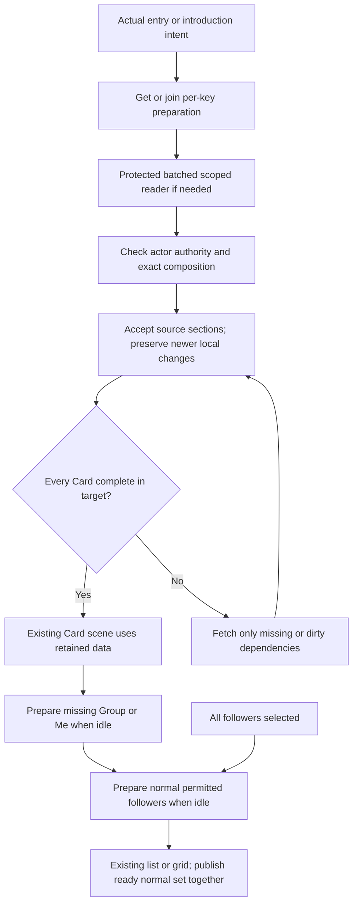

# Loading Architecture — Engineering Plan V3

Date: 8 November 2026. Status: complete engineering proposal for review; **no application implementation authorised**. Final decisions and implementation gates are recorded in section 10.

This document is self-contained. It supersedes V2's implementation recommendations where they differ, while preserving V2 and the supporting documents unchanged. It covers existing Personal/Group Card behaviour and already authorised Personal contributions/Info Card state where applicable; it does not merge another branch, add Group Info Card functionality, reopen media security or change Card identity, ownership, roles or motion.

## 1. Executive recommendation

V3 responds to a different performance baseline. Moving Functions to Dublin reduced current-Card contribution readiness to about **2.35 s Chromium / 1.97 s WebKit on direct entry**, and **1.37 s / 1.15 s on in-app reopening**. The remaining task is principally to stop losing known data and to present complete perspectives, with focused improvements to contribution reads. It is not a justification for a general loading framework.

Implement five connected changes:

1. **Retain existing domain resources in browser-memory maps.** Extend the current Personal store, Group resource and media/reflection controllers with per-key lookup, shared in-flight promises and account clearance. Components subscribe; unmounting a view does not dispose its data. No new Context registry, request-interest framework or persistent private cache.
2. **Prepare every Card in the entered perspective completely.** Group initial selection respects authorised restoration, then role defaults. A composed protected reader returns required learning, previews and existing visible metadata. It does not prepare the whole roster before entry. Full Gallery/video resources remain on demand.
3. **Prepare likely Group views simply.** Me→Group after entry; Group→Me for followers when missing. For normal Groups, automatically start the same permitted-follower batch once primary work is ready and foreground activity permits it. All followers joins that work and retains its approved loading fallback. No per-follower navigation wait after entries appear.
4. **Reconcile by source and explicit dependency.** Preserve newer optimistic edits; accept independent incoming sections. A confidence save does not discard media/reflections. Mark affected summaries dirty and coalesce their refresh after the relevant write lane settles. Preserve revisions, rollback, retries and hard scope rejection.
5. **Coordinate refresh without dismantling Cards.** Keep server permission checks and existing identity safeguards, separate a stale permission observation from a denial, and stop duplicate component polls. Login remains approximately 30 days. The additional session-marker mechanism and elaborate prolonged-offline policy are deferred.

Keep My Decks and Library behaviour. Prepare a Deck on introduction intent and reuse the result; do not add broad viewport observers, speculative budgets, priority lanes or cursor prefetch to this release. A small domain-specific background start/skip check is enough for the two Group follow-up operations.

Default to the existing snapshot transaction pattern with batched helpers. Do not parallelise MongoDB commands inside one transaction or weaken authorisation merely to reduce requests. A measured composed-reader bottleneck can justify a small comparison with independent protected reads; that is not a prerequisite research project.

The normal complete-opening aspiration remains roughly 1–2 seconds; investigate routine results approaching 3–4 seconds, and do not accept six seconds for a normal four-to-six-Card Group. These are targets, not timeouts or permission to reveal incomplete Cards.

## 2. Current architecture and evidence

### 2.1 Dublin is the current baseline

The [region comparison](loading-architecture-region-benchmark-comparison.md) verified all 277 Function entries in deployment `dpl_5NNWNZquEK4gh8Kz7sT7TPgmdAqq` target `dub1`; Atlas was previously verified in Ireland. New Git SHA `4bca8b5` differs from recorded baseline `202f909` only by the independent-review document.

| Existing application journey | Chromium median | WebKit median |
|---|---:|---:|
| Direct entry: stack visible | 1.872 s | 1.492 s |
| Direct entry: current contribution predicate ready | 2.354 s | 1.971 s |
| In-app reopen: stack visible | 0.508 s | 0.346 s |
| In-app reopen: current contributions ready | 1.371 s | 1.151 s |

There were five samples per journey/engine, 20 timed journeys. These are existing warm-path observations, not V3 results or complete all-Card readiness. Historical browser/network differences and the original CLI deployment's missing Git SHA prevent exact causal attribution. No pure deployed-server database round-trip/cold-start split was available. Do not project V3 savings from the old Washington times.

Completed-request medians in the Dublin run, including priming/background traffic: presentation **96/70 ms**, aggregates **104/86 ms**, media metadata **559/840 ms**, reflections **725/856 ms** (Chromium/WebKit). Those are HTTP timings, not isolated queries. Contribution fetching after mount and resource lifetime remain demonstrated problems; the precise cause of each remaining HTTP delay is not established.

### 2.2 What works and what fails today

* Personal working reads supply the whole selected Deck's structure/learning; navigation selects from an existing Card array. Three readable future Cards are a visual stack rule, not a network window. Preserve successful twelve-Card traversal.
* Group bootstrap obtains authority, parallel presentation/perspectives/aggregates, further pages and final authority. It repeats permission/publication reads and loads follower learning before entry, but media/reflections still arrive through mounted components.
* `GroupExperienceDeck` owns/disposes a resource per mount; `useMediaCollection` disposes its controller on unmount; `ReflectionArea` owns its feed locally. The same Card can therefore retain signals while losing its media/notes. Authority invalidation also nulls foreign contexts; transient feed errors can clear known pages.
* `groupResource.load()` rejects its entire result if a save changed `workRevision` or remains pending. Background preparation during editing can therefore discard useful unrelated data. Scalar save finally-handlers also trigger a full load; source-specific reconciliation must replace that behaviour for these paths.
* Personal `workingRequest` checks response actor and then `/api/auth/me`. Existing Group transport checks expected actor/scope. Retaining resources must preserve these protections; a new response header alone is not a substitute for current identity checking.
* Current owner media retrieval resolves fork/source lineage, deduplicates legacy items and combines author-owned Group history. Its cost is not represented fully by simple fixtures. Me cannot be assumed cheap solely because it concerns one user.
* Existing `workingCardStore.infoRecords` already has independent Personal Info attachment revisions. Preserve that independence and existing visibility; do not invent new Info Card views.

Relevant source: `src/lib/cards/{workingCardStore,personalWork,readModels,repository}.ts`, `src/components/group-experiences/{groupResource,GroupExperienceDeck,groupPresentation}.ts[x]`, `src/components/media/useMediaCollection.ts`, `src/lib/mediaCollection/{controller,ownerHistory}.ts`, `src/components/reflections/ReflectionArea.tsx`, `src/lib/reflections/clientState.ts`.

### 2.3 Aggregation and evidence limits

Collective Group learning and follower summaries are separate. Group presentation uses aggregates; Me/inspected presentation does not. The current aggregate reader fetches active follower IDs, selected Step completion/readings and collective learning, not complete follower media/reflections/private dates.

Disposable six-Card measurements: aggregate read **36.2 ms / 10 commands** at 19 members, **51.3 ms / 10 commands** at 100; responses about 4.1 KB. Arithmetic alone was **0.45/1.91 ms**. Adding 600 attachments did not change aggregate query count. Six current media-feed calls used 72 commands; a bare batched Group top-five/count projection used one command. The latter omitted full authorisation/presentation and is not a safe endpoint or a hosted performance prediction.

Five WebKit thumbnail-preparation diagnostic checks remain unattributed. They are a focused verification item, not a confirmed production defect or permission to alter Safari behaviour speculatively.

Supporting evidence: [lifecycle investigation](group-experience-loading-lifecycle-investigation.md), [V2 evidence](loading-architecture-engineering-plan-v2.md), [Claude review](loading-architecture-independent-review-claude.md), [V1](loading-architecture-engineering-plan.md), and [original proposals](proposed-loading-architecture.md). The current user's V3 decisions override conflicting recommendations in those documents.

## 3. Product invariants and preparation boundary

The readiness unit is **one perspective across every selected Card**, including both faces. Each requires:

| Section | Required before first presentation |
|---|---|
| Canonical / instructional | Exact Deck/Card versions, order, Step IDs/content and instructional media/interactive descriptors |
| Learning and date | Relevant progress/confidence, existing visible summaries and permitted date state |
| Reflection | Current-context text or known-empty Add/read-only slot; for Group, collective note and all currently permitted member-carousel entries |
| Media back | Newest five permitted source identities/order/visibility/references and exact total; a real empty collection is explicit |
| Other existing content | Authorised attachment/Info Card metadata, visible badge/count and state already required by the current view; no new permissions or feature integration |
| Permissions / source | Viewer, perspective/subject, source IDs, composition/access revisions and existing action capabilities |

Image bytes may fill reserved positions. Gallery histories/originals, video playback resources and Info Card detail loaded on deliberate opening under existing UX remain on demand. Do not add a new editor/detail wait or silently treat unknown metadata as empty.

Once prepared, navigation, flip/focus, prepared perspective changes and session revisits reuse retained complete data. Normal refresh leaves it present. Real content edits/removals/adoptions may legitimately change layout, but a request being pending must not manufacture a no-media/no-reflection layout. Stable Card keys, gestures, geometry and animation constants remain unchanged.

Keep CardTemplate/CardData reuse and ancestry, Personal history, Group contribution authorship, collective reflection semantics, existing counts/skipped-Step rules and the four accepted iPhone corrections. Only genuine revocation or incompatible account/source/composition removes affected private data. Do not create product caps or shorten authentication sessions.

## 4. Data ownership and preparation lifecycle

### 4.1 Reuse domain stores, with one account-clear operation

Prefer per-key browser module maps around the existing resources. They are instantiated/accessed only on the client; request-scoped server reads never share private user state through process-global maps. Use existing subscriptions/`useSyncExternalStore`; snapshots retain reference identity when unchanged. No new Context provider is required simply to distribute a store handle.

| Data | Owner / retained key | Boundary |
|---|---|---|
| Personal learning/date | Existing `workingCardStore`, actor + Card source; selected-version projection separate | Same Personal CardData across Decks/Groups; no foreign DTO accepted |
| Group state / preparation | Existing `groupResource` instances in a small actor + experience map | Group/Me/subject results remain distinct; composition/access revisions are validation metadata, not React keys |
| Card preview media | Existing collection controller/read result retained by exact owner/Group/subject/Card context | Top-five/count snapshot separate from Gallery/Media Centre cursor and selection |
| Reflections | Extract existing `ReflectionArea` feed/mutation logic into a small per-context retained controller | Personal slot, author/origin slot and collective slot keep their existing identities/revisions |
| Personal Info attachments | Existing `infoRecords` and current attachment mutation path | Independent `personalInfoRevision`; no foreign owner attachments or new Group Info behaviour |
| Canonical content | Exact template/version references retained in the domain result | Shared bytes are not an authority grant; different adopted versions stay separate |
| Pending work | Existing `personalWork`, scalar lanes and reflection operation IDs | Source-owned, survives view unmount; does not become an offline write queue |

Use concrete existing IDs in keys: Group resource `(actor, experience)` with projections `(kind, subject when inspecting)`; media `(actor, Card, owner/Group/subject mode, experience and subject where relevant)`; reflection slots `(owner, Card, Personal)`, `(author, Card, origin Group)` or `(experience, Card, collective)`. A feed also retains its viewer/presentation scope so visibility from one Group cannot leak into another. Exact selected versions, access epochs and composition revisions validate retained projections rather than changing Card React keys on every refresh.

These are source owners, not parallel writable copies. Group Me and Personal views consume the same owner learning source; Group resources retain selection, foreign/collective data and read-only projections onto those sources. Reflection feeds reference their shared source slots. Any assembled perspective is a derived immutable view of accepted domain data, updated through the same source acknowledgements/subscriptions. Do not leave `bootstrap.own` as an independently mutated competitor to `workingCardStore`.

Add a small `clearForAccountChange(actor)` integration calling these domains' clear methods and incrementing their local account generation. Invoke it through existing logout/account-change paths before old resources can be reused; integrate `workingCardStore.clearUser` rather than maintaining a second actor identity. Pending submitted operations retain their original source but cannot publish into a later account's stores. Preserve existing Update/save locks.

Components subscribe/unsubscribe. They do not dispose shared data on Card focus, perspective change or ordinary Deck exit. Leaving the active Group stops its timers and stops starting further background pages; let an already started safe read finish, validate it and retain it. Discard truly wrong-account/denied/incompatible results. There is no interest-count/cancellation priority framework and no persistence in localStorage, IndexedDB or a service worker.

Keep decoded image/canvas/video resources bounded by the existing viewer/preparation lifecycle. Retaining metadata does not mean retaining mounted scenes, every decoded photo, blobs or hidden players. Measure memory before adding eviction rules that would erase a visited perspective.

### 4.2 Minimal preparation state

Each perspective needs a last complete result, optional shared pending promise, error and freshness/dirty metadata. `null`/unknown is distinct from a known-empty reflection slot or media page. Initial publication checks that every selected Card has all required sections. A refresh retains the complete result; no separate writable “complete Card database” is introduced.

For normal follower preparation, keep one task per Group/composition: pending promise, expected roster/manifest, simple page accumulator/cursor and error. A subject's result is complete only when all its Cards are covered. Publish the normal follower set together. This necessary completeness check is not a generic window-coverage or “client sends everything it already knows” protocol.

A repeated request for the same actor/Group/selection/composition joins the pending promise. Do not abort/reissue a whole batch merely because the user selects All followers: join the same operation and start its next page promptly. Existing selection-intent generation prevents a late result from changing the current view after a newer choice. Completed preparation never records navigation/open/view events.

### 4.3 Simple follow-up work, not a general scheduler

After the initial perspective is usable:

1. If Group is missing and the entered view is Me or a restored follower, prepare Group next.
2. If Me is applicable and missing, prepare it after required Group work; for an initial Group this is the first follow-up.
3. Once these primary views are ready, automatically prepare permitted followers for a normal Group.

Start automatic work only when the Group is visible, no relevant save/upload is pending, the user is not actively dragging/swiping/transitioning, and video/Gallery foreground work is not busy. Reuse existing interaction/playback state and `personalWork`; one short post-interaction/idle callback is sufficient. `requestIdleCallback` may help defer parse/merge when available, with a simple fallback; it does not guarantee the network is uncongested. Recheck before each continuation. No browser API or background queue is a security grant.

Use **up to 20 active followers** as the initial automatic-preparation policy, covering the stated normal case. This is an engineering trigger, not a membership/upload cap or measured optimum. Above that size, prepare on explicit All followers intent with the same reader and retained results. Do not first query complete follower histories to decide whether to prefetch. Roster count/inspection capability can be obtained cheaply with Group context.

Saves/playback/new explicit requests never wait for speculative work. A new save or playback suspends *starting* further background work; started responses may finish and reconcile. Avoid depending on cancellation to recover bandwidth already consumed. If one normal follower batch measurably harms foreground responsiveness on iPhone, first reduce its server/parse work or suspend its automatic trigger during contention; report the trade-off instead of adding a scheduler. Explicit All followers remains available.

For a prepared normal set, reopening shows retained entries immediately. A newly joined subject is added only after complete preparation; confirmed removal/policy denial removes affected entries immediately. Routine refresh does not reset the entire set to “Loading followers…”. Large-Group progressive population is deferred in section 11; its backend preparation remains supported without a membership cap.

## 5. Detailed journeys and requests

### 5.1 Personal and initial Group entry

Login authenticates and establishes the existing approximately 30-day session only. Keep My Decks/Library tiles and introduction metadata on their current loading path, reuse server payloads rather than launching duplicate requests, and do not attach deep preparation as a tile-readiness dependency.

Personal preparation uses the existing selected-version/owner resolver plus batched preview helpers. Actual opening still runs `openWorkingDeck` with the user's local date and existing expected-version rules; first missing-date initialisation completes before presentation. A read-only preparation does not create DeckData/CardData, set dates, set active Card or update openedAt. Reuse the helper for an actual-open response instead of resolving the entire Deck again. Preserve existing full-history APIs; the preparation projection itself does not need every historical reflection/media body.

For Group entry, the server validates requested/Progress-return selection, otherwise restores authorised `lastPerspective`, otherwise applies Admin→Group / follower→Me. Prepare all Cards in that selected view. An authorised restored foreign view prepares that subject alone. Invalid/removed selections use the existing authorised fallback, never a wrong-subject cache entry.

Group initial content consists of collective learning, compact computed follower aggregates, shared reflection, Group-visible member carousel and Group top-five/counts. Me consists of owner learning/date, current-Group individual reflection and owner-visible top-five/counts across retained history sources, including private/hidden sources with truthful Group visibility. Inspection includes only that active subject's permitted current-Group learning/reflection/media; no private dates or owner history. Group/carousel contributions can still include eligible Admin/former-member authors who are not selectable active followers.

Known complete current content can be reused subject to the existing identity/authority rules in section 8. Cold entry waits for complete metadata. A direct Group URL should use an authenticated branch to the target Group rather than first building unrelated Personal Decks and every Group tile; keep the same shell/Back interaction and load collection data when needed. Do not rewrite the ordinary Personal/collection route merely to pursue an unmeasured gain.

### 5.2 Group/Me switching and dual-role Admins

A follower entering Me starts Group preparation immediately after Me is usable, before other followers. An Admin without follower enrolment has no Me. A dual-role Admin entering Group starts Me next; their single roster identity maps to the same Me data, not a fabricated second learner.

**Recommendation: do not make complete Me a mandatory part of a cold Group/restored-foreign response.** Cheap own learning/dates already present in a shared query can be retained, and a previously complete Me is reused. But complete Me also needs lineage-aware owner media, current reflection and applicable private attachments across all Cards. That work is not demonstrated cheap by the sparse fixtures and can delay every initial Group opening.

Use the now-authorised fallback: prepare complete Me in the background and, if selected early, apply the same small picker “Loading…” treatment as early Group. Measure the marginal cost of bundling full Me on normal **and heavy-history** fixtures in Checkpoint 2. Only adopt bundling if it avoids a request without material initial-opening regression; this is an engineering measurement choice within the approved fallback, not a reason to hold core work. Do not claim owner resolution is O(1) in history length merely because it is O(1) in roster size.

When a target primary view is pending, keep the current complete Card and selection. Indicate “Loading…” below the requested target's name if it fits, otherwise temporarily replace that name in the existing picker. Commit selection/presentation atomically when complete, then persist navigation. On failure preserve the current view and use existing error/retry treatment. A superseding selection cannot be overridden by a late completion. Ready perspectives switch without waiting for refresh.

### 5.3 All followers and normal automatic preparation

After primary work and foreground activity settle, automatically prepare the permitted normal follower set using the same operation that All followers requests. Both Admin and authorised Shared-inspection follower use the policy; an ordinary Private-mode follower receives no peer data or All followers affordance.

All followers opens the existing list when unfocused and comparison grid when focused. If the normal set is still incomplete, its content is blank with **“Loading followers…”**; the underlying Card stays mounted and complete. Do not show a selectable follower until every Card in their projection is complete; for normal Groups publish the entire set together. Keep existing identity order, Group/Me shortcuts, layout and focus/collapse behaviour. Inspection capability must not disappear because only the Group choice has been loaded.

An explicit request starts/joins preparation immediately; it does not wait for an idle callback or for selecting the first person. Failure gives an error/retry rather than indefinite loading. Closing/reopening joins an existing task or reuses accepted pages/results; it does not clear complete perspectives. Leaving the Group stops further background dispatch; retain valid completed work and let started reads settle. With a ready set, rapid subject changes and all Card traversal use retained data.

For approximately 100 members, support bounded pages and an explicit one-off preparation wait with the same completeness rule for now. Growing the list progressively is permitted in principle but deferred because focus, ordering, partial-error and permission-change UI need their own verification; it is not a trial blocker. No membership cap or per-follower navigation delay is substituted.

### 5.4 Introduction, collection and return

Intro tap starts normal playback first and calls the same initial-perspective preparation function without awaiting it. Explicit Deck opening joins its promise/result. Do not send playback manifests/video files or whole Galleries speculatively. Keep current published-video readiness/authorisation and viewer behaviour; for no playable intro retain the current direct-open interaction.

Do not implement viewport observers, multi-Deck budget lanes or next-Library-page prefetch in this release. Library already returns 20 published Decks with canonical Card/media references and an explicit More Decks control: reuse exact-version content and preserve pagination/publication policy. Generic Library references never authorise Personal/Group histories.

Actual opening preserves existing openedAt/date semantics; wire the existing Group open operation only for a genuine entry, retaining its follower-learning initialisation. Protect later navigation from an older open acknowledgement. Speculative preparation updates neither openedAt nor a viewedAt. New introduction-view timestamp persistence and Library-only analytics are separate optional follow-ups, not prerequisites for intent preparation.

## 6. Server read composition and alternatives

### 6.1 Small shared readers and contracts

Add reusable internal preparation helpers in the existing Personal/Group reader modules and route families. Use concrete existing domain types; endpoint spelling is secondary to one implementation of each projection. Do not implement one HTTP endpoint by calling existing HTTP endpoints or a full public bootstrap for each follower.

| Operation | Required result | Critical-path role |
|---|---|---|
| Personal preparation / actual-open result | Selected content, owner learning/date and all-Card preview sections; actual-open result includes required initialisation | Blocks only unknown first content; retain existing identity transport protection |
| Group `initial` | Effective restored/default selection, role/capability summary, manifest and complete selected perspective | No unrelated follower set or preliminary/final authority HTTP calls |
| Group `perspective` | Group, Me or one authorised subject across all Cards | Background primary preparation; early selection joins same work |
| Group `followers` | Current permitted roster and complete Card projections in bounded pages | Automatic normal preparation or explicit All followers; never per-subject full bootstraps |
| Mutable sections / aggregates | Due current learning/preview/aggregate sections for validated composition | Coalesced refresh; aggregate-only reads do not fetch media/reflections |

Every result identifies viewer, experience where relevant, effective perspective/subject, viewer membership access epoch, structure/adoption revisions, exact selected versions/order and existing section revisions. This metadata validates scope; it is not a new persisted global revision. The server authorises each request and validates continuation scope. Do not trust browser membership hints.

Keep canonical data once in the local accepted composition where possible, but allow a small repeated canonical payload rather than implementing V2's client-coverage/delta protocol. Existing cursors/Card offsets and a simple page accumulator suffice. Unusually large metadata is transport-paged below the existing provider payload limit with headroom; this is not a cap on Cards, uploads or reflection length. All pages needed by a perspective arrive before it becomes ready. Cross-response pages share scope/composition, not a fictitious long-lived Mongo snapshot.

### 6.2 Default: existing snapshot transactions, with genuine batching

Authorise the viewer and subjects, resolve selected canonical versions, then call shared **in-session** learning/media/reflection helpers. Batch across Card IDs and permitted authors; share identity/origin lookups. Owner history preserves current lineage/deduplication/undated ordering, not an approximate newest-items query. A first-page preview can omit arbitrary Gallery-position navigation work, but must preserve exact count/order and existing cursor semantics.

Group aggregates read narrow learning once, calculate current summaries and return compact values. Me does not wait for them. No stored aggregate table, maintenance fan-out or write counter is added. Exclude private dates/media/attachments from foreign learning. Use existing indexes/readiness caches and corruption/default checks; don't turn the previous zero warm metadata commands back into per-request enumeration.

The existing snapshot transaction pattern is the simplest correct initial choice. Keep Mongo operations sequential within the same session; no `Promise.all` there, consistent with the [MongoDB driver transaction constraints](https://www.mongodb.com/docs/drivers/node/current/crud/transactions/). Avoid provider network calls inside retriable transactions. Batch root/version/user/contribution queries so sequential **query count** remains reasonable. Explicit open writes and source save fences stay as currently required; pure reflection GETs do not regain unnecessary write fences.

The response is coherent at its authorised read point; it cannot promise that nobody changes the Group after that point. Handle subsequent changes through narrow renewal, scoped refresh and save-time validation rather than an unconditional final browser authority request. A continuation reporting a changed composition invalidates/reprepares only the incompatible preparation. Ordinary unrelated learning changes use section 7, not an entire bootstrap restart.

### 6.3 Why parallel revision-fenced reads are not the default

Parallel independent protected reads can reduce serial wait, but matching Group structure/access/adoption numbers alone does not snapshot every media hide/delete or reflection/learning change. Additional boundary validation, compatible-section repair and tests would be needed. The Dublin presentation/aggregate medians are already roughly 70–104 ms; the prior transatlantic premise for a broad consistency change no longer holds.

If the batched composed reader is still a measured normal-case bottleneck, compare one implementation slice using independent protected transactions and matching scope/versions. Preserve per-response authorisation and dependent data rules; test policy/member/adoption races and missing source revisions. Do not run concurrent commands on one Mongo session or silently remove single-response snapshot consistency. A design that weakens existing guarantees requires review; otherwise this is a narrow implementation-time experiment, not a new research phase or an Astra escalation now.

All arrows involving server reads are authorised. Reconciliation is defined below; it is not a general dependency engine.

## 7. Targeted reconciliation of reads, saves and derived data

### 7.1 Extend existing source lanes rather than inventing a dependency framework

Use the current `personalWork` operations, `groupResource` field tokens/confirmed values, reflection slot identities/revisions and media/Info revisions. Keep their established save queues, operation IDs, conflict handling and rollback. Add only the small per-source mutation stamps and explicit dirty dependencies needed by the following rules.

Each read captures its scope, request sequence and the relevant local mutation stamps when it starts. Each source retains its last accepted server value and any newer pending local overlay. Starting and settling a mutation advances that source's stamp. An acknowledgement updates the confirmed base without erasing a newer overlay. React renders the reconciled domain snapshot, not a second component-local copy.

1. **Reject incompatible scope first.** Wrong actor/account generation, confirmed denial, wrong subject, or incompatible adoption/composition cannot be repaired by field merging. Reject that payload or its explicitly scoped incompatible projection and re-establish the affected scope. No old-account or private-subject bytes enter another scope's store.
2. **Accept independent valid sections.** A learning save does not invalidate canonical content, media or reflections. Remove the whole-load `writes/workRevision` rejection for ordinary source mutations; retain generation/scope barriers and Update locks. A composition-changing Update remains a different operation.
3. **Protect newer changes at source granularity.** For scalar learning use the existing owner-kind/owner/Card/Step/field lane, not just a Card-wide timestamp. For reflections use immutable source/slot identity; for media use contribution identity and an existing source/window revision where supplied, otherwise the scoped local read/mutation stamps; for Personal attachments use `personalInfoRevision`. Reject lower server revisions where present. Do not invent one global revision across these domains.
4. **Reject stale reads without discarding useful siblings.** A response begun before or during a relevant save cannot replace its newer local value, even after that save has settled. A later response may reconcile that source only if its request/dependency stamps are current and its server revision is admissible. Independently older reads cannot overwrite newer accepted reads. Non-revisioned learning uses the existing ordered lanes plus these read stamps; this is client continuity, not a substitute for server save validation.
5. **Track derived dependencies explicitly.** Dirty metadata is a short typed map/set in the owning resource, not a reactive graph. Readiness considers required dirty dependencies as well as missing fields. Save-time authorisation and revision/fencing rules remain unchanged.

Retain the coarse `personalWork` revision for Update/save barriers where it is still useful. Do not use it to discard all valid preparation sections. Replace affected `invalidateLearning` calls with exact learning acceptance/invalidation rather than deleting the mixed Personal record containing known media/reflection data. Keep deliberate account/composition clearance.

The design uses the established **confirmed base + optimistic overlay** pattern described by [React](https://react.dev/reference/react/useOptimistic), and narrowly targeted invalidation rather than whole-response invalidation, as illustrated by [TanStack Query](https://tanstack.com/query/latest/docs/framework/react/guides/query-invalidation). These are conceptual references: do not install a caching framework or move retained operations into component-lifetime hooks.

### 7.2 Small explicit dependency table

| Mutation | Preserve / update directly | Mark dirty and reconcile |
|---|---|---|
| Personal Step progress | Exact owner Card/Step completion; other fields and preview sections survive | Matching retained Group follower progress/count summaries and relevant Card/Deck progress summaries |
| Personal confidence | Exact owner Card/Step reading | Matching follower confidence summaries; not unrelated progress/media/reflections |
| Collective Group progress/confidence | Exact shared Group field; recompute its own metrics from known collective learning | Any directly dependent collective summaries; follower aggregates are independent |
| Personal reflection | Exact Personal slot and current Personal preview | No Group carousel merely because the CardTemplate is reused |
| Group-origin individual reflection | Exact author/origin/Card slot | That origin Group's permitted member carousel and that author's relevant preview; preserve every other context/history |
| Collective reflection | Exact experience/Card collective slot and independent reflection revision | No member contribution or learning invalidation |
| Media allocation/completion, author deletion, visibility hide | Exact contribution/source identity, pending operation and confirmed metadata | Affected authorised top-five/count windows and Gallery/Media Centre pages; no learning aggregates |
| Personal Info attachment change | Existing owner/Card attachment IDs/state and independent revision | Its permitted attachment summaries only; no new foreign attachments or Group Info functionality |
| Membership, inspection policy or adopted content changes | Re-evaluate authority/composition before displaying affected foreign data | Remove/reprepare affected scopes; these are not ordinary harmless dirty summaries |

Personal CardData reuse matters: an owner Step save may change aggregates in more than one retained Group selecting that Card/Step. Inspect the small set of retained Group manifests to mark matching dependencies. Do not fan out reads to every Group on the server or create a materialised aggregate-maintenance system. Card/Step IDs no longer in one selected version are not deleted from the underlying owner history.

Media hiding removes only Group visibility; the author's history remains. Confirmed author deletion removes the source from all affected retained views. Pending deletions/hides must not be resurrected by older pages. Apply count deltas once per operation; if removing a top-five item requires the next item, request that window rather than inventing a replacement. Genuine mutation can change layout; routine loading must not empty the rest of the Card. Reflection carousel ordering continues to use existing authoritative identity/order rules, not a new client-created timestamp.

Upload allocation alone is not a completed visible contribution. Preserve existing upload feedback, provider completion checks and retry semantics; do not increase completed-media counts or publish an unverified preview merely because an object key was allocated. Apply completed-source acknowledgements to the affected retained windows, then refill/reconcile only those windows. Reflection collection membership/order likewise uses authoritative acknowledgement and known visibility, with a targeted feed repair when those facts are not yet known.

### 7.3 Coalesced dependent refresh

Keep a dirty generation and affected Card IDs for aggregates/summaries in each retained Group. Mark them when a relevant mutation starts. For a burst of confidence/progress edits, wait for the affected existing write lanes to settle, then issue **one aggregate/summary-only read** for the union of affected Cards. Do not issue a request for each drag position. Existing gesture commit/coalescing semantics remain unchanged.

A response clears a dirty flag only if it began after the relevant save settlement and those dependency stamps have not changed. A new edit during that read leaves its dependency dirty and produces one follow-up after the new edit settles. Accept unaffected Cards/sections immediately; do not repeatedly reload the full Group. A normal scheduled refresh and a save-triggered refresh join the same pending scoped read.

Where all permitted inputs are already held, calculate an exact local dependent value using the existing aggregation functions. Do not average rounded averages or retrieve private follower readings just to make an optimistic summary possible. The current aggregate DTO does not always contain enough input to update confidence exactly.

**Before first presentation of a target perspective:** retain valid canonical/media/reflection sections while its required aggregates are dirty, reconcile only the dirty dependencies, then publish a complete perspective. The already visible source perspective stays usable. This prevents an old background aggregate from appearing as the initial Group value after a Me save.

**For an already presented/prepared perspective:** keep the Card and its source data. Do not silently pass a known-invalid aggregate off as current. When an exact permitted local calculation is unavailable, a small pending indication for that aggregate is needed. The preferred proposal is a reserved numeric-slot `…`, with accessible “Updating Group results” text, affecting only the dependent follower counts/confidence and preserving geometry and collective values. Restore exact results atomically after reconciliation; use the existing error/retry surface on failure. This is **decision R1**, a narrow proposed change to post-edit feedback requiring approval before UI implementation. It does not authorise missing aggregates on initial opening, fading values in after entry, or routine pending placeholders during unchanged polling. Do not add private raw inputs to avoid this decision.

On a definite failed save, roll back only its still-current overlay to the confirmed base and reconcile its dependent summaries. If a newer edit exists, preserve it and let its ordered save settle. Keep established conflict/error/retry behaviour and operation identity for uncertain outcomes; never label an unconfirmed save permanently saved. Rapid reflection reopening reads the current reconciled source, not an old feed. The accepted reflection stale-read and rollback protections remain mandatory.

### 7.4 Required deterministic overlap example

1. Group preparation begins while Me is visible; its request captures dependency stamps.
2. The user changes confidence. Show the exact owner value immediately; mark the affected Group confidence summary dirty.
3. Preparation returns. Accept compatible canonical content, media, reflections and unrelated learning. Preserve the newer owner value; do not publish the now-stale dependent summary as ready.
4. The save succeeds. Accept its source acknowledgement and coalesce one narrow aggregate refresh after settlement.
5. The aggregate response matches dependency stamps. Publish the now-complete Group perspective, or update only its pending summary if it was already presented.

Also test save failure, edit B following A, acknowledgement A arriving while B is pending, and an older GET arriving after both acknowledgements. No step may discard unrelated preparation, resurrect a deleted attachment or overwrite a newer source value. Confirmed permission/composition changes still override local optimism.

## 8. Permissions, refresh and connectivity

### 8.1 Server enforcement and identity

Every protected preparation, refresh, continuation and mutation authenticates the actual request and checks current Group/member/policy/publication scope. Cached roles only guide UI/priorities. A shared canonical template does not grant access to another subject's contributions. Inspection includes only permitted current-Group information; Me history and private attachment metadata remain owner-only. Admin/nonfollower and Admin/follower remain distinct capabilities.

Keep the approximately 30-day authentication lifetime, HttpOnly session and current server identity protections. Integrate domain clearance into existing logout/account-change paths before reusing old snapshots. Do not remove `workingRequest`'s current trailing identity check simply because V3 removes separate Group authority bookends. During implementation it can be coalesced only if an equivalent current-actor safeguard is demonstrated; a request's expected-actor header alone does not detect a later cookie change.

On an online entry, return or resume, use one coalesced existing protected data/authority operation to establish current access without clearing same-session complete content. If the actor is genuinely uncertain, use the existing current-session check before restoring protected cached content under an assumed actor. Do not render another actor's retained map while determining who is signed in. Same-tab logout clears immediately. Existing server/auth failures clear protected state and use normal sign-in handling.

There is no claim of instantaneous cross-tab cookie-change detection while another tab is suspended. The existing checks on protected requests/resume remain essential; defer additional readable session markers, signed nonces and cross-tab protocols unless a concrete failing test demonstrates a missing boundary. Such a finding must be reported before weakening safeguards or adding machinery.

### 8.2 One active Group refresh owner

Use the active retained Group resource as coordinator. Card/media/reflection subscriptions do not each install their own Group timers. Stop Group timers when hidden/inactive; resume with one deduplicated verification/refresh. Personal-only controllers retain their appropriate existing refresh behaviour but keep accepted data while refreshing.

| Check / trigger | Purpose and retained behaviour |
|---|---|
| Narrow authority renewal | Retain the existing approximately two-second renewal and five-second freshness rule initially. Read current actor/member/inspection/access/adoption information, not full publication bodies or every follower perspective. A compatible protected content response can satisfy the same freshness need and avoid a duplicate tick. |
| Mutable content refresh | Coalesce due active learning/aggregate/reflection/media sections into a protected refresh, initially at the existing roughly four-second Group cadence. Reuse pending reads and unchanged references. Do not reload canonical versions or all follower histories every tick. |
| Local save/completion/hide/delete | Apply source acknowledgement/optimism and dirty dependency rules from section 7. Request only the sections needing repair; join scheduled work. |
| Focus, visibility, pageshow / online return | Coalesce overlapping events, verify the current identity/scope as needed, refresh active data in the background and retain complete content. A browser-discarded page is a genuine fresh load, not a still-running retained session. |
| Selected follower / retained inactive perspectives | Keep complete snapshots; refresh the active subject and invalidated dependencies. Do not repeat complete follower preparation simply because the list/grid reopened. Confirmed policy/roster changes affect every relevant retained subject. |

Keep the accepted out-of-order authority fix: an older failed renewal cannot erase a newer valid compatible grant. Distinguish expired freshness/network failure from a current confirmed denial; retain existing hard-denial, actor, revision and scope ordering rules. Preserve the request-start basis of its five-second lease; a delayed response must not grant five new seconds simply because it just arrived. Test these rules explicitly rather than suppressing all failures. Freshness expiry may restrict affected editing until verification; it is not permission to hide known media/notes or block Card traversal.

Server mutations still validate permission, expected source/publication revision and operation identity at save time. A separate edit preflight is unnecessary where the existing save already validates these requirements. Genuine Update operations retain their existing locks and atomic adoption semantics. Newly published template versions are not adopted automatically.

### 8.3 Concrete changes and failure cases

| Event | What the user sees / client response | Server boundary |
|---|---|---|
| Follower removed / Group inaccessible | On confirmed denial close affected foreign overlays, remove protected Group snapshots and return through existing authorised fallback; do not preserve them as an offline grant | Every read/save rechecks current membership |
| Shared becomes Private / subject removed | Immediately invalidate inspection capability and affected subjects on confirmation; keep still-authorised Group/Me data and original Card identity | Subject read/mutation policy is checked independently of cached roster |
| Admin role revoked but follower remains | Remove editing/Admin controls and any Admin-only inspection; retain permitted follower views | Save rejects revoked authority even before the next client renewal |
| Group adopts another version | Stop applying old-composition responses, retain source-owned edits/history, prepare compatible complete projection and use existing Update transition | Exact adoption/version fences and conflict response remain |
| Another member changes learning/reflection | Reconcile affected source/summary on refresh; no Group-wide invalidation or transient empty Card | Current scoped read and existing save/revision controls |
| Temporary unreachable server | Previously authorised same-actor complete content stays visible read-only; retain existing error/retry feedback, no new offline write queue | No new protected reads/writes succeed on a browser hint |
| Session expiry / logout / actor mismatch | Normal authentication handling and protected account clearance; no 30-day extension or shorter login period | Existing session verification is authoritative |

Brief network interruption cannot reveal a revocation the device has not received. That unavoidable bounded uncertainty also exists in polling today; it is not permission to ignore a confirmed denial. Do not add a prolonged-offline visibility clock, foreign-data concealment policy or persistent cache to solve the exceptional month-offline case. If trial safeguarding evidence requires a stricter offline policy, bring that specific product choice back separately.

## 9. Implementation checkpoints and verification

### 9.1 Five checkpoints

Each checkpoint includes focused tests before broader integration. Implement within existing domains; do not build a temporary parallel cache or alternate Card scene. Checkpoint 1 delivers retention while Checkpoint 2 replaces transport, so neither implementation is discarded.

| Checkpoint | Work / principal locations | Exit evidence |
|---|---|---|
| **1. Retain resources and protect source changes** | Extend `workingCardStore`, `groupResource`, media controller/hook and reflection source controller with per-key retention/subscriptions/clearance. Replace broad ordinary-write rejection with section/source stamps and explicit dirty dependencies. Preserve existing mutation lanes and rollback. Keep current transport initially. | Personal and Group revisit/remount/focus tests preserve known media/reflections. Deterministic read/save overlaps accept independent sections, protect newer writes, repair aggregates once and enforce scope rejection. Unmount stops view-owned timers without disposing accepted data. R1 is resolved before introducing its UI. |
| **2. Complete composed initial reads, then measure early** | Shared in-session Personal/Group preparation helpers, batched all-Card preview queries, Group-only computed aggregates and existing actual-open initialisation. Remove bootstrap authority bookends/per-Card feed waterfalls from this path. Connect the smallest real Personal/Me/Group browser path to complete preparation. | Six-Card media-rich Personal, follower Me and Admin Group measured end to end against Dublin before extending UI broadly. Query count/payload attribution plus genuine all-Card readiness. Heavy owner histories/long notes tested. Measure marginal dual-role Me bundling; default background if costly/uncertain. Attribute the five WebKit harness failures before relying on extra thumbnail warming. |
| **3. Primary and normal follower preparation** | Retained Group per-perspective tasks; Group/Me follow-up, automatic normal follower preparation, explicit intent joining, existing picker/list/grid integration. Batched permitted follower reader and bounded transport continuations. | Normal 16–20-follower set becomes fully usable together; ready selection/swipe/flip has no blocking metadata wait. Early primary Loading and All followers Loading/error/retry preserve underlying Card. Active saves/playback take precedence and merge safely. Approximately 100-member whole-set preparation remains supported; progressive UI is not a trial gate. |
| **4. Coordinate refresh, resume and introduction intent** | Consolidate active Group timers and source refresh, narrow authority renewal, account/resume integration and intro preparation deduplication. Reuse existing collection/Library content. | Role/member/inspection/adoption changes enforced; temporary verification does not clear Cards. Safari resume, expired session and actor change tests pass. Intro playback starts as before; actual open joins preparation without speculative writes. No duplicated component polling remains on the new Group path. |
| **5. Integrated browser and iPhone acceptance** | Relevant unit/controller/Mongo tests, TypeScript, targeted lint, standard production build, mobile Chromium/WebKit and matched hosted measurements after implementation authorisation. Preserve fixtures. | Complete first presentation, retention, mutation dependency repair, prepared navigation, permissions, media/Gallery/download/video and existing gestures verified. Compare normal/slow network and heavy histories. Physical iPhone acceptance required; no unexplained animation retuning. |

Review an iPhone after Checkpoint 2's first genuine complete path, again after perspective/refresh integration, and at final acceptance. If normal opening approaches 3–4 seconds, attribute the delay before broadly propagating the design. Report a material compromise; do not quietly relax completeness or add navigation waits. No new hosted benchmark or deployment is authorised by this planning document.

### 9.2 Measurement and fixture matrix

Record login completion, usable tiles, introduction start, complete initial perspective, primary preparation, first follower surface readiness and subsequent navigation separately. Distinguish direct entry, in-app entry, intro-prepared entry and retained return. Keep stack-visible markers solely for comparison with old measurements.

| Scenario | Required verification |
|---|---|
| Four-to-six-Card Personal / 3 Admin + 16–20 follower Group | Real photos, Step video/image/interactive descriptors, 3–5 back contributions per Card, reflections; measure all required Card metadata, not the current Card alone |
| Twelve Cards, sparse and media-rich | Preserve existing rapid bidirectional navigation; no network window silently introduced |
| Six Cards / 600 member attachments | Exact authorised top-five/counts, full Group member-carousel previews and bounded payloads; no upload cap |
| Approximately 100 members | Group aggregates, explicit follower operation query/payload/memory cost and readiness; no per-person full bootstrap or membership cap |
| Heavy owner history / reuse | Representative hundreds of legacy/current Personal and Group contributions, multiple origins/adoptions, fork lineage, hidden originals, duplicate/undated legacy entries; compare owner and inspection costs |
| Long reflections / existing private attachments | Representative long multi-byte notes across Cards and author carousel entries, correct preview/full-editor text and attachment permissions; no silent truncation or new history limit |
| Contention and failures | Save while preparing/refreshing, rapid A/B saves, rejection/conflict/uncertain retry, removal, interruption, out-of-order response, account/subject change and session expiry |

Use disposable fixtures for mutations. Do not reset real review data. Measure payload bytes and JSON/merge/render cost as well as HTTP/database work; avoid fetching full provider bytes. Record query count and repeated context/metadata commands, but fewer commands are not alone proof of improved user experience.

Run baseline/current and implemented paths under matched hosted conditions where practical; label local database timings separately. Use repeated samples with individual values, medians/ranges, browser version, network shaping and warm/cold evidence. Do not infer Function cold starts from a single slow sample. Dublin's current contribution marker is not the new complete-all-Card marker, so report both instead of subtracting unlike measurements.

### 9.3 Regression assertions

Extend existing suites rather than duplicate them: `tests/group-experience-client.test.ts` for resource/authority ordering, `tests/reflection-feedback.test.ts` and `tests/phase2/reflections.browser.ts` for source continuity, `tests/media-collection-client.test.ts` and `tests/browser/media-collection.browser.ts` for Gallery/preview behaviour, and the Group perspective/lifecycle integration suites. Reuse `tests/phase2/group-experience-motion.browser.ts` and `group-integrated-acceptance.browser.ts` for existing interaction boundaries; add focused retained-preparation scenarios where those suites do not cover them. Preserve controller disposal tests for real account/scope destruction; ordinary view unsubscription is now a different action.

* Retained complete perspective can render through remount/return without a GET finishing; pending refresh never emits unknown/empty over known data. DOM/Card identity and reserved layout remain stable.
* Every prepared Card in either direction and both faces has its required sections; byte loading stays in reserved positions. Ready perspectives perform no blocking metadata request on selection.
* No initial Group requires peer preparation; Me does not require aggregates. An Admin/nonfollower never obtains fabricated Me; dual-role identity appears once.
* Normal follower entries appear together only when complete. Permission to inspect is separate from data readiness. Unfocused list and focused grid keep their existing interaction.
* Confidence/progress edits preserve unrelated incoming media/reflections and coalesce dependent summary refresh; failure/conflict never falsely confirms optimistic text or learning. All mutable domains in section 7 have targeted tests, including Personal Info attachments where currently supported.
* Existing immediate Personal/Group reflection saves, stale-read protection and revision conflicts; immediate Gallery seed; image/video loading/error/download; author deletion versus Admin visibility-only hiding remain covered independently for Personal and Group.
* Older authority failure after a newer valid grant, real expiry, role/member revocation, Private/Shared change, adoption conflict, account switch and wrong-scope delayed payload have deterministic tests. Retained foreign snapshots do not bypass server permissions.
* Ordinary Personal/Group swipes, flip, focus, comparison, media overlays and Safari background/resume preserve motion/geometry. Document unresolved vibration/jerkiness rather than retuning animation.

The five thumbnail diagnostics get a short attribution step: reproduce unchanged tests, identify fixture/wait/network/browser versus actual application failure, then fix only demonstrated causes within scope. If unresolved, retain the gap explicitly and avoid making successful warming a correctness dependency. Do not turn this into an unrelated Safari programme.

## 10. Decision register

### 10.1 Settled product requirements — do not ask again

| Decision | Status / V3 treatment |
|---|---|
| Complete all Cards in the entered perspective; immediate prepared navigation | Required; no new metadata-dependent swipe/flip delay |
| Initial selection restoration then Admin→Group / follower→Me | Required; only entered perspective blocks initial opening |
| Early Group/Me selection before preparation | Authorised minimal picker Loading; retain current Card and switch atomically |
| Normal automatic follower preparation after primary work | Agreed; simple contention-aware trigger and retained batch, not broad speculative scheduling |
| First All followers wait | Agreed blank Loading followers state in the existing unfocused list or focused grid; all normal entries ready together |
| Large-Group progressive ready-only entries | Accepted in principle, explicitly deferred from trial implementation; no cap substituted |
| Calculated aggregates / no incomplete initial fade-in | Required; narrow learning only, no stored derived values |
| Authentication / additional marker | Keep approximately 30-day login and existing identity safeguards; defer extra marker unless concrete evidence requires it |
| Card history, ownership, permissions, existing UX and four accepted fixes | Preserve; no media-security, Info branch or Organisation work |

### 10.2 Engineering recommendations in this plan

Module-level retained domain maps, shared per-key promises, source-specific merge stamps, a short explicit dependency table, snapshot transactions with batched in-session queries, intro-intent preparation and background complete Me are the recommended implementation choices. They need overall V3 approval, not separate product debates for ordinary implementation detail.

The up-to-20 active-follower automatic trigger is a starting policy matching the stated normal case, not a validated optimum or product limit. Adjust based on measured foreground contention; do not silently remove the agreed normal-Group benefit. Marginal Me bundling can be adopted only if normal and heavy-history measurements show it cheap; the authorised Loading fallback remains valid otherwise.

### 10.3 Genuine remaining decision and measurement gates

| ID | Approval / gate | Recommendation |
|---|---|---|
| **R1 — affected visible aggregate during a local save** | Explicit product approval for a small post-edit pending treatment when exact authorised inputs are unavailable. Existing numeric aggregate UI has no such state. | Use `…` in only the affected reserved numeric slots plus accessible Updating Group results text; keep the Card, collective values and unrelated content. No incomplete initial Group and no routine refresh placeholders. An unchanged stale number presented as final is not recommended. |
| **M1 — complete-opening performance** | Measurement-dependent, not a promised gain. Return for approval if the normal complete path cannot meet reasonable responsiveness without a new delay/completeness compromise. | Measure early in Checkpoint 2 against Dublin; optimise proven contribution/repeated-query work before considering changed user behaviour. |
| **M2 — consistency alternative** | If independent parallel reads would weaken existing authorisation/snapshot guarantees, do not adopt without review. | Use existing snapshot composition first; run a narrow comparison only if it remains a bottleneck. |

No new decision is requested on ordinary early Me Loading, a shorter session, follower upload limits, or whether to merge an Info branch. None is part of V3. **Application implementation still requires explicit authorisation after this document is reviewed.**

## 11. Deferred backlog

* **Large-Group progressive list/grid population:** complete subjects only, indication of more loading, retained ordering/selection and partial-error tests. Compatible with per-subject preparation, but not necessary for normal all-at-once readiness or the first trial.
* **Broad collection prefetch:** viewport observers, eight-Deck/48-Card/512-KiB budgets, priority lanes and next-Library-page fetch. None is a measured optimum; reconsider only if actual post-Dublin intent-prepared journeys justify the cost.
* **General registry / client coverage protocol:** Context interest/cancellation machinery and canonical delta negotiation are not needed by these small domain maps. Add only for a demonstrated maintenance/performance problem.
* **Additional session marker and extended-offline policy:** no new readable signed cookie, cross-tab protocol or month-offline framework. Preserve current security and report concrete boundary failures if found.
* **New operational timestamps / analytics:** separate introduction `viewedAt` and expanded Library/open event persistence can be specified independently. Existing genuine opening/date operations remain mandatory; preparation cannot masquerade as viewing/opening.
* **More elaborate performance infrastructure:** persistent caches, Workers, feature flags, rollout gates and stored aggregates are not proposed. Parallel read experiments require evidence, not a general rewrite.

The separately agreed media-security project, Organisations and unfinished Info Card functionality remain separate work. None is a prerequisite or an excuse to alter ownership and visibility here.

## 12. V2-to-V3 changes and independent review

| V2 / review topic | V3 decision and reason |
|---|---|
| Old cross-region latency premise | Replaced with Dublin measured baseline; no additional region deployment or RTT diagnostic blocks core work |
| Session Context registry, request interests and coverage bookkeeping | Simplified to retained existing domain resources and shared promises; lifetime/scope protection retained without a second state system |
| Viewport-led multi-Deck batches | Deferred; intro-intent preparation reuses the actual reader and current Library content without competing broad speculation |
| Followers only after explicit All followers | Replaced for normal Groups with automatic post-primary preparation plus the same explicit join/loading fallback; latest product decision |
| Large-Group ready-only progressive UI | Review recommendation accepted in principle but deferred because state/UI verification exceeds trial value |
| Cheap dual-role Me in initial response | Modified: reuse cheap learning but prepare full owner view in background by default; measure real owner-history marginal cost before bundling |
| Whole resource rejection when a save overlaps | Replaced with explicit source/dependency reconciliation, coalesced repair and unchanged hard authority boundaries |
| Parallel fenced reads as an optimisation | Not the default: current scope revisions do not fence every mutable source. Retain snapshot consistency and batch first; measure an alternative only if necessary |
| Computed aggregates and complete initial perspectives | Retained; measured arithmetic does not justify stored aggregates or delayed initial values |
| Session marker / prolonged offline machinery | Deferred; 30-day authentication unchanged, existing actor checks/account clearance/server enforcement preserved |
| Heavy histories and failed thumbnail diagnostics | Accepted as focused early verification requirements, not evidence for speculative caps or unrelated Safari redesign |

Claude's simplification and overlap critiques are accepted. Its Me-bundling and large-Group proposals are adapted to the actual owner-history cost and trial scope. Parallelisation is evaluated rather than automatically adopted. The source-specific reconciliation work is essential correctness work, not optional performance tuning.

Before implementation, confirm overall V3 approval and R1. During implementation, require the early complete browser measurements and preserve the decision gates above. No plan section permits incomplete initial Cards, silent prepared-navigation waits, whole-resource clearing on routine revalidation, or reliance on a browser role hint for authorisation.
