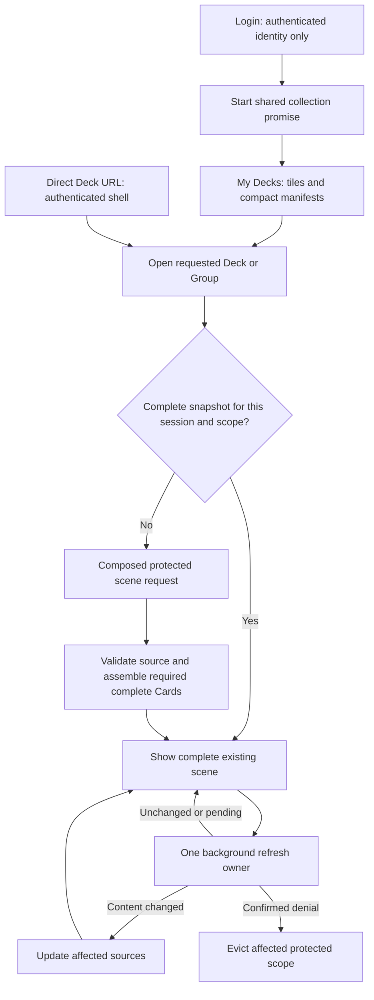
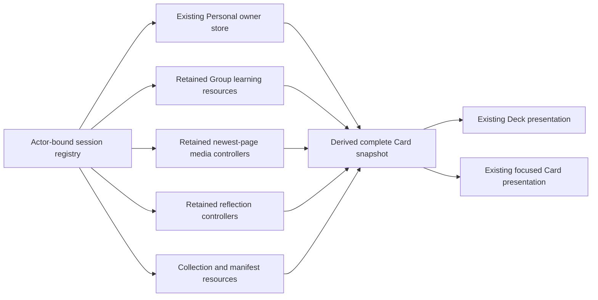

# Switchplay — Loading architecture engineering plan

Status: **proposed design, awaiting approval; no implementation authorised by this document**.

Assessment: Astra, completed 7 November 2026. Source baseline: `feat/group-experience`, `202f909`.

Inputs read in full: [product proposals](proposed-loading-architecture.md) and [loading lifecycle investigation](group-experience-loading-lifecycle-investigation.md). The proposals are ideas to assess, not an approved specification. The four corrections committed in `202f909` remain the implementation baseline.

This plan covers login preparation, My Decks, Personal and Group Deck/Card entry and retained presentation. It does not redesign media delivery, Organisations, Info Cards, learning ownership, Card geometry or gestures. Only this document was created for this task. The two input documents were already untracked and have been left unchanged.

## A. Critical assessment of the proposal

### Recommended decisions

| Proposal | Assessment and recommendation |
| --- | --- |
| Authenticate first; prepare asynchronously | Agree. Do not add Group discovery to the login transaction. The login response already contains the authenticated user, so preparation can start without another `/auth/me` request. |
| One preparation operation shared by login and My Decks | Agree. Give the collection request one browser-session owner. Do not independently fetch the same index in `AuthScreen`, a Server Component and `AppShell`. |
| Load Card structure and all default-view media metadata at My Decks | **Narrow this.** Load the tile data, selected Card IDs/versions/order and compact structure that is economical to produce with tile summaries. Do not make My Decks wait for per-Card media pages, reflection histories or checks on their origins. That would transfer work to the collection and fetch protected information the user may never open. |
| Load full Step structure for every Deck before opening | Step IDs/order needed to calculate summaries are economical; full descriptions, rendering content and back-of-Card contributions are not required by a Deck tile. Return compact manifests, and prepare full canonical content for a selected Deck. |
| Prepare likely Decks in the background | Agree, with a small explicit budget: one speculative scene preparation at a time, after tiles are ready, no media-byte preloading, no opening mutations. Prioritise an explicitly requested Deck over speculation. Do not build a prediction engine or preload every perspective. |
| Remove initial/final Group authority waits | Agree. Authorise inside the data request and use coherent results and explicit response identity. A final check still cannot prevent a change immediately after that check; it is not a reason to delay every opening. |
| Keep several parallel requests if they are faster | Correct principle. Nevertheless, **recommend one composed initial scene request here** because the current modules repeatedly read the same membership, templates and learning. Combining only the HTTP wrappers would not be enough. Compare its actual critical path against concurrent reads before acceptance. |
| Cache a complete Card object in a new universal store | Retain complete presentation, but **do not create another writable copy of every field**. Keep the existing Personal owner store, retain Group resources and contribution controllers in a small session registry, and derive complete snapshots from those sources. |
| Never throw away anything successfully loaded | Too absolute. Preserve valid complete content through routine refresh/unmount; clear it on confirmed denial, logout/account change, session expiry or invalid source identity. Remove only the affected scope where possible. |
| One periodic background mechanism | Agree on one scheduler and request deduplication, not one enormous account-wide refresh. Refresh the visible scene, the current overlay if needed and the current permission scope. Inactive Decks retain data without polling. |
| Keep previously authorised data through prolonged offline periods | Recommend read-only retention in session memory, with explicit safeguarding approval. Revocation cannot be discovered offline. Local logout/account change/known session expiry must still clear protected data without waiting for a successful network request. |
| Implement cache ownership after the new loading paths | Change the sequence. Establish the ownership contract first, build the final server readers, then connect views to both. Do not temporarily create another component cache and replace it later. |

### Important findings beyond the previous report

**Personal opening is a command, not simply a read.** `CardRepository.openWorkingDeck()` (`src/lib/cards/repository.ts:1037`) assigns missing dates using the existing cadence/suggested-date rules, retains assignments, chooses the active Card, and updates `openedAt`. `POST /api/decks-data` then performs `workingDTO()` as another read. Prefetching that POST would incorrectly mark unopened Decks opened and potentially assign dates. Preserve explicit-open semantics.

**Personal entry has its own serial verification tail.** `src/components/decks/updateClient.ts:workingRequest` verifies the actor in the protected response and then calls `/api/auth/me`. Direct entry in `AppShell.open()` first uses this helper for the entire membership list, then for the opening POST: two data requests with two subsequent identity requests. This differs from Group authority checking. Replace that tail only after providing equivalent protection against an account changing while a request is in flight.

**A visible Deck scene is not necessarily one Card.** `CardStack.tsx` renders the active Card, past Cards, and three readable future Cards (`FUTURE_READABLE_COUNT`). `DeckCard.tsx` already distinguishes full content from compressed/semantic surfaces. A plan that prepares only the active Card while visibly incomplete neighbouring backs appear would fail the requirement. Required data must follow the actual scene surfaces; do not quietly redefine “complete” as one arbitrary selector becoming visible.

**One transaction is not a licence to parallelise Mongo operations.** The installed MongoDB driver explicitly disallows parallel operations on one transaction/session (`node_modules/mongodb/src/sessions.ts:383,685`). Reuse common reads, batch queries and keep operations within a snapshot transaction sequential. Use concurrency between genuinely independent requests/transactions, not `Promise.all` inside the same session.

The installed Next.js 16.2.6 guides were also inspected: `node_modules/next/dist/docs/01-app/01-getting-started/06-fetching-data.md` and the authentication guide's data-access guidance. React server request memoisation does not share a promise with browser-side login preparation or retain data across navigation. No new Next cache mode, persistent server permission cache or framework migration is proposed.

## B. Recommended architecture

### 1. Login and the collection

Keep login limited to authentication and session establishment. After success:

1. Establish the browser's current actor/session identity.
2. If the destination is My Decks, start the shared collection request without awaiting it, and navigate immediately.
3. My Decks subscribes to that same request/result. If preparation has not started, it starts it once.
4. For a direct destination Deck, prioritise its scene request. Collection preparation must not precede it; prepare the collection after the requested scene if useful.

Make `/decks` a thin authenticated route boundary. It returns the actor/session identity and existing shell, rather than building every Personal Deck display and every Group tile before a known Deck can open. The collection content is supplied by its shared client loader. This deliberately chooses one data-fetch owner for My Decks; it avoids an additional SSR collection query racing the login prefetch.

On a direct My Decks URL there is an authenticated shell followed by one collection request. That extra HTTP boundary compared with server-side collection hydration is a trade-off, not a claimed automatic speed improvement. Its justification is predictable request reuse across login, collection returns and in-app navigation. Benchmark this path separately. Do not add a second SSR collection implementation unless measurements show a material need.

### 2. Economical My Decks preparation

Return a compact, authenticated `WorkingCollection` containing the current tiles and small manifests:

- Personal membership availability/archive/open state and selected Deck/Card versions.
- Group membership roles, permitted navigation choices and saved selection hints; no claim that those hints remain authoritative forever.
- Existing Deck title, category, cover/intro reference, themes and summary values used by the tile.
- Ordered Card IDs/versions, compact title/Step IDs/counts where already needed by summary projection.
- Explicit unavailable entries, preserving the current behaviour for unavailable publications.

Preserve the existing tile appearance and intro playback. `DeckFrontContents` already accepts a small presentation object; adapt `DeckGrid`/`DeckTile` to receive that object instead of manufacturing full `Deck` instances solely to render their covers.

For ten Decks and thirty Cards, batch the user's memberships, relevant Group memberships/experiences, unique selected template roots/versions and required learning projections. Compute Personal tile summaries from that owner's learning and Group tile summaries from the same collective Group learning used today. Do not retrieve every follower's raw learning to draw the Group tile.

Do **not** add thirty media-feed reads or reflection-origin/history queries to this operation. The collection can know that detailed contribution data is unknown; no visible tile needs it to pretend otherwise. Metadata-only queries still have authorisation and database cost. If a later measured optimisation can reuse an already-returned owner field without another read, that is useful, but it must not be a collection readiness requirement.

After tile readiness, prepare at most one likely scene in the background: an existing last-opened candidate or the visible first candidate, then respond to explicit intent. Do not automatically walk through all ten Decks. Do not speculate into another follower's inspected perspective; saved inspection is restored when requested and authorised. This affects preparation only, not the chosen perspective on opening.

### 3. Deck opening and Card navigation

A new scene request includes the intended Deck/Group, optional target Card and requested perspective. The server determines the effective authorised selection and adopted manifest. It produces the content actually needed by the current scene.

For Group opening, one read transaction authorises the viewer, validates the selected publication, resolves the perspective, retrieves required learning/aggregates and composes media/reflection metadata. No independent browser authority request precedes or follows it.

For Personal opening, preserve the existing explicit-open command, including client-local date and any requested Card-version check. Compose its resulting scene in the same HTTP response. On first use with uninitialised dates, opening must finish before the complete Card is shown. This is required date initialisation, not an authorisation preflight. No date exception is recommended.

If a complete snapshot already exists for the same actor/session, selected version and perspective, show it immediately. A read-only prefetch can also qualify for immediate presentation if the required dates and other content are already initialised. The normal explicit Personal-open command still runs on actual entry to preserve `openedAt`/navigation semantics; do not run it during prefetch or pretend that a GET records opening. If the server reveals changed composition or required initialisation, apply the resulting complete replacement and enforce its current capabilities.

Use the existing scene's visibility rules to decide which Cards need complete data. The conservative first implementation prepares active + past + readable future Cards, because those have existing rendered surfaces. Compressed future traces need only their existing semantic/structural data. This may require several Cards, particularly on a deep link to a later Card, but does not require histories and contributions for every unshown future Card. Share the existing visibility constants; do not retune geometry or infer a different number of visible Cards from the new loader.

The complete-data boundary includes both faces of a Card so its first flip does not initiate reconstruction. For Group collective/member snippets and Personal/current-context reflections it includes the required text/empty state. For media it includes the five-thumbnail arrangement, count, visibility and source identities, not full-resolution bytes.

On an uncached navigation, keep the current complete Card in place while preparing the incoming scene. Once ready, execute the existing transition with unchanged timings and gestures. Add a preparation hook before committing `DeckScene`'s transition, not a rewrite of the motion system. Prefetch the next required scene after the current one settles. A newer navigation intent supersedes an older pending target; late preparation must not move the user back. On a preparation failure use the existing error/retry boundary and retain the current Card.

### 4. Retention and refresh

The verified continuity failure has more than one cause. `GroupExperienceDeck` invalidates verification on visibility/focus transitions; Group/inspected media and reflection contexts then disappear. Independently, media controllers and `ReflectionArea` feed state belong to component lifetimes, so changing between Deck and focused representations can discard them even with valid authority. Signals survive in the Group resource while those sections restart from unknown values presented as empty. Retaining only the Group bootstrap response therefore would not fix the problem. Both the data lifetime and the mapping from verification/loading state to presentation must change.

Retain the session's visited complete snapshots and their underlying sources in RAM across component mounts. Components own UI state such as an open modal or carousel selection; they do not exclusively own loaded media/reflection content. Leaving a view releases its subscription and polling, not its last good data or pending source-bound saves.

One active-view scheduler handles refresh, resume and mutation invalidation. A successful identical refresh preserves object references where possible. A real content change updates the relevant source and derived views. It does not re-key the physical Card, rebuild its scene or clear unrelated sections.





There is no second independent writable “complete Card database” inside the registry. A complete snapshot references the authoritative in-memory sources and is published atomically when its required sections are ready.

## C. Exact request plan

The names below are proposed API paths/contracts, not routes already implemented. Existing mutation and media delivery APIs remain authoritative.

### Entry requests

| User action | Proposed requests and dependencies | Blocks which UI? |
| --- | --- | --- |
| Sign in to My Decks | Existing `POST /api/auth/login`; after success start `GET /api/working-collection` without awaiting it and navigate. | Login waits only for authentication. Tiles wait for the shared collection promise if necessary. |
| Direct `/decks` | Existing server session resolution → client joins/starts `GET /api/working-collection`. | Collection shell can appear; tile content appears together when its data is ready. |
| Return to My Decks in the same session | Use retained collection immediately; background GET if stale or a known change occurred. | No network dependency for known tiles. A confirmed removed membership is removed when reported. |
| Open Group from a tile, no prepared scene | `GET /api/group-experiences/{id}/scene?cardTemplateId=…&perspective=…&subjectUserId=…`; omitted selection is restored server-side. | First scene waits for this complete authorised result only. No `/authority` bookends. |
| Open Group with prepared/visited scene | Render exact-scope snapshot immediately; join/start the same scene GET in background. | Editing may wait after resume/known uncertainty; existing content does not. |
| Direct Group URL | Authenticated shell → same scene GET. No preceding My Decks collection or tile construction. | Initial scene only. Optional collection preparation follows. |
| Explicit Personal Deck opening | `POST /api/decks-data/{deckId}/scene` with `localDate`, optional target Card and expected version. Preserve `openWorkingDeck` semantics and return composed scene. | First uninitialised scene waits. Previously complete content can remain visible while the explicit opening is recorded. |
| Personal read-only preparation/refresh | `GET /api/decks-data/{deckId}/scene?cardTemplateId=…`. It must not initialise dates, update openedAt, materialise content or select navigation. | Prefetch never blocks My Decks. Uninitialised results cannot be marked complete for presentation. |
| Direct Personal URL | Authenticated shell → the explicit Personal scene POST, without first fetching all memberships. | First required scene; no trailing `/auth/me` once the replacement session guard is in place. |
| Navigate to a new Card/perspective | Same scope-specific scene GET for the required target window; cached complete result is reused immediately. | Only an unprepared target waits. The current Card stays visible; existing transition begins after readiness. |
| Focus/unfocus or flip | No content request required once that Card's snapshot is complete. | No data-related wait or blanking. |

Request query values describe the desired view, not an access grant. The server rejects or explicitly resolves an invalid selection under the established default/restoration rules. It must not silently return one person's private data under another requested perspective key.

### Remaining/background requests

| Work | Treatment |
| --- | --- |
| Active Group changes/revocation | Reuse the protected scene GET on the coordinated schedule in E. It carries current authority and visible content; no separate heartbeat is required in parallel. |
| Personal active scene refresh | Same Personal GET on resume, known mutation invalidation and a slower active-view cadence. Do not POST open on every focus. |
| Follower comparison | Reuse the existing bounded perspective reader for the current Card when comparison needs data not already available. The scene may reuse peer learning already read to calculate its visible aggregates, but does not fetch all followers' details for all Deck Cards. Additional pages do not block the first Card. Keep the focused Card mounted while comparison prepares. |
| Media Gallery | Preserve opening from the known selected item/page. Existing metadata paging and byte requests continue; no scene wait before the viewer opens. |
| Media Centre | Preserve existing rails and metadata loading on opening. This request does not define initial Card readiness. |
| Update discovery | Existing Admin-only explicit Update reviews run after scene readiness. Never hold the Card for availability discovery. Defer unrelated Card update reviews until their controls are relevant; retain the same available-update behaviour when those Cards become active. |
| Save/upload/remove | Existing source-specific commands, revisions, operation IDs, fences and provider validation. Apply acknowledgements to retained sources, then coalesce any necessary targeted refresh. |
| Navigation preferences | Preserve current serialised/coalesced navigation writes in background after an accepted navigation. Failure does not erase Card data; confirmed access denial does revoke the affected scope. |

### Current versus proposed Group entry

```text
Current direct entry:
  SSR: auth → Personal memberships → Group tile construction
  browser: authority → [presentation || perspectives || aggregates] → authority
  render partial Card → [media feeds || reflection feed || update checks]

Proposed direct entry:
  authenticated shell → protected scene read → complete required Cards
  then background refresh / optional collection and next-scene preparation

Proposed normal in-app entry:
  complete prepared scene exists: present it immediately; refresh in background
  otherwise: one protected scene read; present complete required Cards
```

The initial authority request currently establishes a common revision reference. The final request checks whether membership, structure or adoption changed while separately authorised pages were loading. Neither atomically binds those separate reads or prevents revocation after its response. A snapshot transaction makes the new initial payload internally coherent; response scopes and write-time checks handle later changes. Consequently both separate waits can be removed.

Retain the low-level permission and projection functions. Retire the old five-request bootstrap caller. Remove unused bootstrap-only routes only after checking all call sites; Progress/management and existing independently protected endpoints are not removed merely because the Card scene no longer uses them. Do not leave an automatic fallback that silently runs the old five-request sequence if the new endpoint fails.

### Server composition and concurrency

For a Group scene: authenticate once, open a snapshot read transaction, read membership/experience once, resolve selected publications once, obtain needed learning/identities, then contribution previews using the same authorised context/session. Batch reflection reads across the required Cards. Share uploader/origin identity reads. Keep bounded media queries and existing source/cursor ordering; do not load complete histories into Node to find five items.

The first newest-five page can derive “older items exist” and its starting position from the validated total and returned page rather than running navigation queries intended for arbitrary Gallery pages. This is a narrow opportunity to reuse the ordering/cursor helpers, not permission to rewrite pagination. Verify it against legacy undated Personal items and inherited sources before adopting it.

Personal scene opening should reuse the records read by `openWorkingDeck`, expose an in-session result/helper and compose required contributions without resolving the same whole Deck again via `workingDTO`. Keep the transaction's writes and read-after-initialisation result together. Do not call provider APIs inside a retriable Mongo transaction.

One endpoint is recommended because duplicated database reads dominate these modules. It is **not** a performance guarantee. A naive composed endpoint that serially calls every existing repository entry point would retain duplicated transactions and may be slower than today's parallel requests. Benchmark query counts and elapsed critical path. If necessary, bounded independently authorised reads can run concurrently and be assembled by matching scope/version, with repair only on an actual mismatch; no final routine authority request is required. Do not switch to that alternative without recording the measured reason.

## D. Data contracts and cache ownership

### 1. Lightweight collection contract

Illustrative contract; use existing ID/version/value types during implementation:

```ts
type WorkingCollection = {
  viewerUserId: string;
  sessionMarker: string | null; // null only for the legacy-session compatibility path
  sessionExpiresAt: string; // ISO timestamp derived from the verified session
  entries: Array<{
    key: { kind: 'personal'; deckTemplateId: string }
       | { kind: 'group'; experienceId: string; deckTemplateId: string };
    availability: 'available' | 'unavailable';
    tile: DeckFrontPresentation; // existing visible cover/summary contract
    selectedDeckVersion: number;
    cards: Array<{ cardTemplateId: string; version: number;
      title: string; stepIds: string[] }>;
    navigation: { activeCardId: string | null; lastPerspective?: PerspectiveSelection };
    personalMembership?: { membershipRevision: number; openedAt: string | null; archivedAt: string | null };
    groupAccess?: { isAdmin: boolean; isFollower: boolean; canInspectFollowers: boolean;
      accessEpoch: number; structureRevision: number; adoptionRevision: number };
  }>;
};
```

Unavailable entries must use the existing unavailable representation and must not include inaccessible title/content/manifest fields. Use a discriminated available/unavailable union in real types; the sketch abbreviates that distinction. Return only necessary identity attributes, not raw membership documents, write fences or private user records.

Deduplicate canonical payloads by exact `(cardTemplateId, version)` when useful within a response/session. A reference to a template does not grant access: every returned association must pass its Personal/Group policy. Two Groups may select different versions of the same Card; never collapse them to the highest version.

### 2. Complete scene and Card contract

```ts
type CardViewScope =
  | { kind: 'personal'; viewerUserId: string; deckTemplateId: string; cardTemplateId: string }
  | { kind: 'group'; viewerUserId: string; experienceId: string; cardTemplateId: string;
      perspective: 'group' | 'self' }
  | { kind: 'group'; viewerUserId: string; experienceId: string; cardTemplateId: string;
      perspective: 'follower'; subjectUserId: string };

type SceneResult = {
  viewerUserId: string;
  sessionMarker: string | null;
  sessionExpiresAt: string;
  effectiveSelection: /* existing Card / perspective selection */ unknown;
  manifest: /* selected versions, order and existing presentation metadata */ unknown;
  authority: /* roles, accessEpoch, structureRevision, adoptionRevision */ unknown;
  cards: Array<{
    scope: CardViewScope;
    selectedVersion: number;
    presentation: /* front, Steps, signals, progress, permitted date */ unknown;
    media: MediaCollectionPage; // newest five, count, exact sources and capabilities
    reflection: /* current-context slot OR collective + visible member entries */ unknown;
    capabilities: /* action-specific server-derived permissions */ unknown;
    revisions: /* existing source-specific revisions, not a new global sequence */ unknown;
  }>;
  requiredCardIds: string[];
  initialization: 'complete' | 'explicit-personal-open-required';
};
```

Final implementation should use concrete existing domain types, not `unknown`; these placeholders identify which current projections are composed. Do not copy full `CardData`, owner histories, raw follower documents or unrelated assessment histories into the new response.

The reflection contract carries full text for the displayed/current editable slot so the existing editor can open without replacing its content. The member carousel retains its permitted current-Group entries and ordering. Other-context author history remains retrievable through the existing history foundation, without being a prerequisite for a current-context snippet. No reflection migration, duplication or loss of history is involved.

Known-empty media is a valid page with `items: []` and `total: 0`. A known-empty reflection is a typed empty slot with the proper Add/read-only capability. An unrequested, pending or failed section is not either of these. A visible snapshot is published only when every required section is known and compatible. Partial future-prefetch results cannot replace the last complete snapshot.

### 3. One owner for each kind of state

| Data | Owner and key | Rules |
| --- | --- | --- |
| Account/session lifetime | Small browser `loadingSession` registry, bound to `(viewerUserId, sessionMarker)` | Clears on account/session change; no protected content in persistent storage. Registry retains resources and shares promises; it is not a new general state framework. |
| Collection index and Deck manifests | Registry-owned resources, Personal Deck ID or Group experience ID | Summary data cannot mark a Card complete. Returned versions/permissions are hints until a protected view has been loaded. |
| Canonical Card content | References by exact CardTemplate ID/version inside the actor's session | No owner learning, foreign information or permission grants in the template object. Keep Deck labels/order separately. |
| Personal learning/date and legacy Personal fields | Existing `workingCardStore`, owner/CardTemplate identity | Reuse across Personal Decks and own Group views. Preserve its ban on accepting foreign Group DTOs. Add narrowly typed owner-learning merges rather than feeding it an entire Group snapshot. |
| Collective Group learning | Retained `groupResource` by actor/session/experience; per CardTemplate records | Independent from Personal learning. One collective source shared between Admins. Selected-version projection stays separate from underlying source identity. |
| Inspected follower learning | Explicit viewer/experience/subject/Card scope within Group resource | Never merged into the viewer's Personal store. Can be evicted without deleting own or collective learning. |
| Newest-five media/counts | Retained existing collection controllers keyed by owner/group/subject/Card/viewing Group | Preserve source identity, visibility and permissions. The same owner's bytes may have different visibility/removal capabilities in different Group contexts; do not share those capability objects across contexts. |
| Reflections | Extracted existing feed/mutation controller, retained by exact source/view scope | Same optimistic patch/revision/rollback logic. Personal slot, author/context slot and collective Group slot remain separate. |
| Gallery/Media Centre navigation | Existing overlay-local controllers, seeded from retained page | Selection and paging belong to the interface; opening Gallery must not overwrite the Card strip with an older page. Share invalidation/source updates, not one mutable cursor for all views. |
| Pending saves | Existing `personalWork`, field queues and operation IDs | Owned by immutable source, not selected visual perspective. Unmounting does not cancel acknowledged/submitted work or let another actor inherit its retry. |

Retained data and transport lifetime need separate methods: release a view subscription, stop polling or abort an obsolete GET without erasing the good snapshot; clear the scope only for an explicit invalidation reason. Do not turn `dispose()` into a misleading no-op. Preserve disposal semantics for truly destroyed overlay controllers and account clearance.

For the small MVP retain visited metadata/text for the current JS session; do not introduce an LRU that unexpectedly evicts a recently viewed Card. Do not retain decoded media bytes, blobs, hidden video players or live React scenes to achieve data continuity. If memory becomes measurable, address it using evidence rather than a speculative persistent cache.

### 4. Saving and reconciliation

Use field/source-specific mutation generations, not a single global “newer data” timestamp:

1. Capture actor/session, exact source, expected revision and operation ID at submission.
2. Patch the retained source immediately; every authorised subscribed representation derives the change. Do not show an owner's private reflection in another view merely because the CardTemplate matches.
3. A read started before that mutation, or during an unresolved write to that source, cannot overwrite it. Reuse existing `personalWork` scope revisions, reflection request generations and scalar field tokens.
4. Reconcile the source's acknowledgement directly. Preserve reflection revision/allocated ID, collective independent revision and current source-specific retry handling.
5. On rejection roll back only the failed mutation if a newer edit has not superseded it; preserve the draft/error and the existing explicit retry path. Do not silently report unsaved text as persisted.
6. A successful signal write updates the corresponding owner/collective learning and marks affected summaries stale. It must not delete the complete Personal record, its media or reflection solely to force a read. Replace the relevant uses of broad `invalidateLearning()` with typed retained-source updates/staleness, retaining its epoch protection for old reads.

Personal learning has no new universal revision in this plan. Do not invent one or use `updatedAt` as a total order across different fields. Merge only the stable Step/signal IDs actually returned by a scoped projection; a Group-selected older template must not erase the owner's additional learning associated with another selected version. Use the existing learning projection/default/fork rules.

Responses with unchanged data retain references. A complete replacement caused by actual adoption is committed atomically; it must not expose an intermediate mixed-version Card. Version numbers and scope revisions are validation metadata, not React keys for ordinary refresh.

## E. Safeguarding and consistency

### Session/account protection without repeated identity GETs

The current Personal post-response `/auth/me` protects against a cookie changing while an earlier request was in flight. A response's actor header alone does not cover that case: the old request can correctly return the old actor after another tab signs into a new account.

Recommend a small **non-authorising session marker** maintained alongside the existing session cookie:

- On successful login create a random marker; clear it on logout. Expose only this marker to browser code in a same-site cookie with the session's lifetime. Keep the real authentication token HttpOnly and unchanged in purpose.
- Include the marker and known session expiry in the authenticated shell/scene envelope. Obtain expiry from the verified session token; do not return that token to browser code. The marker is an invalidation identity, never a credential, role, permission claim or server authorisation input.
- Bind retained resources and requests to the captured actor/marker. Before displaying a retained scope or accepting a response, compare with the current browser marker; a mismatch/missing marker clears old protected data.
- Notify active same-origin tabs on login/logout using `BroadcastChannel` where available. On resume compare the cookie too, so correctness does not rely solely on receiving a transient cross-tab message.
- Existing sessions without a marker remain usable through the current fresh-identity check and do not qualify for optimistic protected re-entry across remounts. Their next ordinary login creates the marker. Do not force logout, add a session-migration endpoint, or pretend one successful identity check detects every subsequent account switch. This compatibility path is determined by the actual session format, not a feature flag.

This needs explicit architectural approval because it touches the session boundary. It uses no new service/database, stores no private content and does not alter server permissions. Once present, the new scene transport can remove repeated trailing `/auth/me` calls. Leave unrelated consumers of `workingRequest` unchanged until their own boundary is audited; do not remove a shared safeguard globally as collateral work.

If this marker is not approved, retain a targeted fresh identity request before cached protected presentation when the account could have changed. That is a concrete case where an additional check has a purpose; it has a latency/continuity cost. Relying only on a local actor prop or a best-effort cross-tab message is not the recommended substitute.

### Refresh schedule and edit state

Recommended initial policy, subject to approval:

- **Active Group:** one scene refresh approximately every five seconds measured between starts, never overlapping for the same scene. It checks membership and current visible data in one operation. No simultaneous four-second full bootstrap, two-second authority loop, five-second reflection loop and per-thumbnail fifteen-second loop.
- **Active Personal scene:** refresh on resume/known invalidation and a fifteen-second active cadence to retain eventual cross-device changes. Opening a Gallery/Media Centre also uses its existing protected data requests.
- **Hidden/inactive scenes:** no periodic reads. Keep data. On return, coalesce `focus`, `pageshow` and visibility events into one refresh; show known content immediately for the same verified session.
- **Pending writes:** continue permission checks, but do not let refresh overwrite affected optimistic fields. Request completion or source changes can invalidate one follow-up refresh, not a fan-out of events and full Deck rebuilds.
- **Transient failures:** retain content, disable affected new write actions, and retry at a bounded cadence such as 5, 10 then 30 seconds. Reconnection/focus/explicit Retry can trigger one immediate coalesced attempt. Do not queue new offline writes or create an offline sync engine.

Continuous foreground use does not toggle controls off merely because five seconds elapsed while a normal check is pending. Saves are authoritatively validated by the server. After resume, a known scope conflict or loss of contact, temporarily disable the affected writes until a fresh protected response establishes current capability. Reading and normal Card navigation continue. Source conflicts affect that editor; a Group role check need not disable the user's unrelated Personal actions.

The existing five-second rule ceases to be a deadline for deleting displayed content. This is a deliberate proposed policy change, not a claim that the old rule is secretly preserved. The corrected ordering remains: an older transient failure cannot override a newer matching success. Confirmed denials and actor/source conflicts still trigger the appropriate clearance.

Five-second active polling gives healthy online revocation detection within approximately one polling interval plus request time. It is not an instantaneous guarantee, particularly while the browser is suspended. The old two-second check was more frequent. Approve this explicit trade-off; if two-second online detection is required, measure the cost of scheduling the same narrow protected check only when a suitable content response has not recently provided it. Do not reintroduce both unconditional loops.

### Failure and change matrix

| Event | What the user sees / client action | Server protection |
| --- | --- | --- |
| First request still pending | Existing loading boundary; no half-built Card. | Authorise and return only the requested valid scope. |
| Already visited Card refreshes | Same complete Card; no empty media/feed substitution. | Each new request still checks current actor and content rights. |
| Temporary timeout/5xx | Known content remains read-only where contact is required; existing error/retry treatment. Initial unknown content remains unavailable. | A transport error does not grant access or prove revocation. Writes remain server-checked. |
| Viewer removed or no longer authorised | Clear affected Group snapshots/overlays promptly when confirmed; exit inaccessible view. | Membership check rejects all further protected reads/writes. Owner history remains independently available where allowed. |
| Admin loses role but remains follower | Remove Admin controls; retain authorised read views; normal follower default only if current selection is invalid. | Save, upload, management and adoption APIs enforce current role, not cached UI capability. |
| Shared inspection becomes Private | Evict affected inspected scopes and comparison rows; preserve own and collective content. | Check `allowFollowerInspection`, current role and active subject in every foreign read. Private Personal fields never enter the foreign DTO. |
| Subject leaves | Remove that active inspected perspective when reported. Do not delete their author-owned contributions or infer that leaving hides all shared contributions. | Follow existing member/contribution visibility semantics independently. |
| Media hidden/deleted | Update that source and applicable counts/visibility; preserve creator-owned copy after Admin hiding. | Existing visibility/delete APIs and media-delivery checks remain. No storage/security redesign. |
| Another member updates a signal/reflection | Reconcile changed fields without reconstructing unrelated sections. | Existing independent source revisions and snapshot projection. |
| Creator merely publishes a newer Deck | Existing Card continues; authorised Admin may see Update discovery. | Selected Group versions remain pinned until explicit acceptance. |
| Admin accepts update during a read | Complete coherent older snapshot may be briefly displayed if no newer scope is yet known. A later known adoption replaces it atomically; affected edits wait or fail safely. Do not combine old/new structural sections. | Snapshot reads are coherent at their read point; writes validate current selected version/adoption and use existing fences. No mandatory final client check. |
| Requested Card no longer in current composition | Do not present a new result for that Card as current. Apply current manifest/default selection via complete preparation, retaining history in storage. | Selected-Card guard and explicit unavailable/conflict response. |
| Account changes while an old request returns | Reject old marker/actor generation before handling its payload/error. Clear prior account resources. | Authenticated actor from the actual session; expected-actor headers still checked. |
| Known session expiry while offline | Clear protected session display at the known expiry boundary; require sign-in. | Server JWT/session validation rejects expired requests. Offline retention is not permission to exceed known expiry. |
| Older transient failure after newer success | Ignore the stale failure for capability/display; keep the latest valid data. | Preserve the accepted request-order protection and scope checks. |
| Confirmed same-scope denial after success | Quarantine/clear that affected scope; a genuinely fresh authorised request can restore it. Do not treat a denial as a harmless timeout. Old-account errors cannot clear the new account. | Retain conservative confirmed-denial semantics of the accepted fix. |
| Failed/uncertain save or rapid second edit | Keep source-bound draft/retry state, avoid overwriting a newer edit, and do not label uncertain content saved. | Existing operation IDs/replay and revision/fence guards. No blind new-operation retry. |
| Full Safari process discard | Genuine first load, using the efficient entry path and complete readiness boundary. | Reauthenticate normally; no persistent private snapshot restoration. |

### Offline recommendation and its limit

Retain previously authorised complete content read-only in the same live session through temporary **and prolonged** connection failures, until confirmed denial, logout, account/session change or known expiry. Do not start uncached private views offline, fetch new protected bytes without their normal authorisation or accept offline writes. Browser-cached image bytes may be available; new playback/download resources are not promised offline.

The safeguarding trade-off is explicit: a user removed remotely can continue seeing data already received on that still-running device until contact resumes or a local clearing condition occurs. An expiry timer could conceal the UI sooner but cannot recall copied data. For this MVP, recommend the stated retention policy, with product approval. No stronger offline revocation claim is made.

Server-side permission rules, creator ownership, Group visibility and moderation enforcement do not change. No new safeguarding role or moderation interface is introduced.

## F. Performance expectations and measurements

### Current measured baseline

These are the existing read-only measurements from the lifecycle investigation, not new timings claimed by this plan:

| Journey | Chromium | WebKit | Meaning |
| --- | --- | --- | --- |
| Repeated direct Group URL, stack visible | 4.059–4.070 s | 4.120–4.595 s | Incomplete initial Card. |
| Same direct URL, initial contributions complete | 5.068–5.128 s | 5.299–5.506 s | Required metadata/text observed; not full media bytes. |
| In-app leave/reopen, stack visible | 2.371 s | 3.857 s | No new document render; still rebuilds Group resource. |
| Same in-app reopen, contribution completeness | 3.477 s | 4.673 s | No complete session reuse today. |

Representative direct entry spent roughly 1.7 s completing page data, 0.54 s on initial authority, 1.03 s on the longest of the parallel content reads, and 0.63 s on final authority, followed by contribution loading. These overlap where documented; do not add all parallel durations.

Warm bootstrap still executes 41 repository commands, plus five authentication lookups. Current-Card media/reflection feeds add another 26 including their authentication. The My Decks path and other rendered Cards/update checks are outside those counts. The previously removed 55 repeated metadata commands remain removed.

**Personal timings are not established by those Group measurements.** Source establishes the current normal-entry and direct-entry request chains and the trailing `/auth/me` calls; it does not establish their elapsed hosted cost. Existing Personal entry browser tests already measure visible-versus-editable timing and can be extended to complete media/reflection readiness. Do not execute real Personal opening POSTs merely to obtain a planning benchmark, because they alter dates/open/navigation state. Capture the baseline with disposable fixtures during the first authorised checkpoint.

### Expected improvements, without invented timings

- Cached revisit becomes independent of network completion by construction. “Immediate” means no data-request prerequisite; existing rendering and animation still take their normal time.
- The Group's two serial authority requests disappear from initial entry. Their measured approximately 1.16 s of combined wait is an opportunity, **not** a guaranteed net saving: composed contributions add necessary work.
- Direct Group entry no longer waits for unrelated Personal membership displays and Group tile construction.
- Personal direct entry no longer retrieves all memberships or performs trailing identity requests once the replacement guard is established. The genuine explicit-open command remains.
- Batched scene reads share authority/templates/learning; collection reads stop constructing full private working Decks for tiles. Command-count reductions must be measured rather than promised.
- One refresh owner and stable source references reduce repeated requests, mount effects and irrelevant rerenders. No claim is made that this resolves every previously unattributed animation symptom.

Record these milestones separately: login acknowledgement, tiles usable, initial complete scene, initial editable scene, cached revisit complete, first Gallery visible. Include request counts, payload sizes, section readiness, failed saves and scope denial. “Stack visible” alone is no longer an acceptance measure.

### Required measurement work

No further live mutation is needed to approve this design. Before changing behaviour, record a disposable baseline for Personal and Group normal entry/direct URL, including a ten-Deck/thirty-Card fixture with reuse and mixed roles. Record empty/populated media, initial date assignment, returning to a later Card and an inspected perspective. After composition, measure the same routes with warmed connections and cold workers separately where available.

Count shared canonical/permission reads once; identify remaining per-Card bounded media work. If one composed transaction is slower than independent protected reads under equivalent latency, inspect the query reuse and batching first. Compare an actual concurrent alternative before asserting that fewer endpoints is inherently better. Do not introduce a global data-change revision, Redis, materialised summary workers or new indexes without a measured need.

### Infrastructure experiment, separate from this plan's application work

The prior inspection found Vercel Function compute in `iad1` and Atlas in AWS `EU_WEST_1`. Request edge region `dub1` is not proof of local Function compute. Repeated serial database round trips can be amplified by that distance, while the browser's region can favour a different route. The exact effect remains unmeasured.

A controlled same-build comparison near the existing Atlas region is worthwhile, subject to configuration approval and the existing Vercel plan's support. Use equivalent accounts/data and warm/cold samples, record Function region and request/DB durations, then restore or adopt the setting explicitly. Do not move Atlas, create another deployment architecture or change regions during this planning task. This experiment cannot fix component-owned data being discarded.

## G. Implementation checkpoints

The checkpoints below are a proposed execution sequence after approval. None authorises autonomous deployment or database changes. No runtime feature flags or temporary duplicate loading paths are required.

### Checkpoint 1 — Baseline, session boundary and ownership contracts

- Record the missing Personal/disposable entry baselines and strengthen complete-Card assertions.
- Define the concrete collection/scene contracts, required scene window and typed unknown/empty/readiness states.
- Add session lifecycle ownership around existing resources and source-specific reconciliation APIs; do not yet wire views through an interim legacy fetch wrapper.
- Implement the approved account/session marker guard, expiry handling and clear/reset semantics, with deterministic cross-tab/in-flight tests.
- Specify which old expiry tests change from hiding content to restricting writes. Preserve actual denial and the four accepted regression fixes.

Acceptance: source-bound updates, session clearance and retained resource lifetimes pass without changing UI geometry. No private data in the marker or persistent browser storage. This is the foundation later checkpoints use directly, not a disposable prototype.

### Checkpoint 2 — Final composed reads and batched collection

- Add the scene endpoints and read-model helpers using the existing Mongo transaction pattern.
- Extract only the internal in-session helpers needed to share membership, selected content, owner projection, contribution and identity reads. Avoid a generic permission framework.
- Keep Personal GET preparation side-effect-free; keep explicit-open initialisation on POST and compose its result.
- Build compact My Decks reads and tile presentation. Preserve current summaries/unavailable entries/intro semantics.
- Add integration tests for permission projections, versions, source ownership and no prefetch mutations; measure commands/critical-path latency.

Acceptance: final contracts can supply complete initial scene data and independently authorise requests, with no browser authority bookends. Cold readiness/index checks and all existing write guards still operate. No Atlas provisioning/migration is expected.

### Checkpoint 3 — Personal and Group presentation integration

- Connect `AppShell` and Group/Personal adapters to the final session resources and scene requests.
- Make media/reflection hooks subscribe to retained sources. Remove component-driven initial refetch/clear behaviour where the scene already supplied that content.
- Add readiness at first scene publication and before an unprepared navigation transition; preserve physical Card identities, gesture algorithms and motion constants.
- Keep Gallery's immediate selected-item seed and its independent paging; keep the Media Centre and reflection editor interfaces.
- Retain complete snapshots through focus, perspective/Deck navigation and live-page resume. Update saves through shared retained sources.

Acceptance: both browser engines show no empty-section frame for visited Cards and no incomplete first Card. Personal date/reflection/media regressions pass independently of Group tests. **First physical iPhone review here**, before performance tuning obscures lifecycle failures.

### Checkpoint 4 — Login preparation, shared collection request and bounded prefetch

- Thin `/decks` server entry to authentication/shell; share the one collection promise between login preparation and My Decks.
- Bypass the collection for direct Deck URLs. Preserve direct-link expected Card version and Progress return semantics.
- Add the single speculative preparation budget and next-scene preparation after current readiness. Never issue Personal opening mutations from prefetch.
- Remove the obsolete global membership reread from Personal direct entry. Use the new guarded transport without altering unrelated `workingRequest` consumers.

Acceptance: login/tiles do not wait for per-Card contributions, no duplicate index request across navigation, explicit clicks take priority, and ten-Deck/thirty-Card loading is bounded by useful work rather than per-Card API fan-out.

### Checkpoint 5 — Coordinated refresh and final acceptance

- Install the approved active-scene cadence and coalesced resume/invalidation handling.
- Remove old duplicate scene/authority/reflection/thumbnail polling from these consumers; do not leave both schedulers active.
- Apply typed transient-failure/confirmed-denial recovery, offline policy and action-level edit restrictions. Maintain pending mutation/retry state across views.
- Run broad regressions, standard typecheck/lint/build and matched timing comparisons. Inspect recurring network activity and unchanged-content rerenders.
- **Final physical iPhone review:** complete first presentation, repeated openings, focus/flip, resumed Safari, account switching, permissions and real Gallery/media behaviour. Evaluate the separate region experiment only if approved.

Acceptance: no routine permission check dismantles the Card; confirmed denial is still enforced; implementation/report distinguish measurable latency gains from structural improvements. Commit/push/deploy require the implementation task's explicit authorisation, not this plan.

### Planned file inventory

| Area | Existing files / proposed additions | Purpose |
| --- | --- | --- |
| Auth/session | `src/lib/auth.ts`, login/logout routes, `AuthScreen.tsx`, `OverviewMenu.tsx`; proposed `src/lib/cards/loadingSession.ts` | Session invalidation identity, shared collection promise and retained resource registry; no credential/permission cache. |
| Collection route/read | `src/app/decks/page.tsx`, `AppShell.tsx`; proposed `src/app/api/working-collection/route.ts`, `src/lib/cards/collectionReads.ts` | Thin authenticated shell, compact batched read and one client request owner. |
| Tile adapter | `DeckGrid.tsx`, `DeckTile.tsx`, `deckFrontPresentation.ts`, `myDecksLayout.ts` | Consume compact tile DTO while retaining appearance, intro controls and ordering. |
| Scene contracts/readers | Proposed `src/lib/cards/sceneContracts.ts`, `src/lib/cards/sceneReads.ts`, `src/lib/groupExperiences/sceneReads.ts` | Typed scope/readiness contracts and composed existing projections. These are specific read models, not a general cache framework. |
| Scene routes | Proposed `src/app/api/decks-data/[deckTemplateId]/scene/route.ts`, `src/app/api/group-experiences/[experienceId]/scene/route.ts` | Personal GET/POST semantics and protected Group GET. |
| Shared repository helpers | `cards/repository.ts`, `cards/readModels.ts`, `groupExperiences/presentationReads.ts`, `learningReads.ts`, `publicVersions.ts`, media/owner-history/reflection readers | Reuse authorised in-session results; batch required data; preserve current independent endpoints where used. |
| Personal retained data | `workingCardStore.ts`, `workingEntry.ts`, `personalWork.ts`, `deckMutations.ts`, `useWorkingDeck.ts` | Preserve source values during staleness, update shared owner fields, keep existing save queues and adoption barriers. |
| Group retained data | `groupResource.ts`, `GroupExperienceDeck.tsx`, `groupPresentation.ts`, `GroupCardBack.tsx`, `GroupUpdateControls.tsx` | Scene request, retained lifetime, action freshness, targeted changes and background discovery. |
| Contributions | `useMediaCollection.ts`, `mediaCollection/controller.ts`, `transport.ts`, `ReflectionArea.tsx`, `reflections/clientState.ts`; small reflection controller extraction if needed | Keep controller data beyond component mounts; seed composed results; distinguish failure types and preserve optimistic behaviour. |
| Scene readiness | `DeckScene.tsx`, `DeckCard.tsx`, Personal/Group render adapters; existing `constants/cardStack.ts` read only | Await required incoming data before existing presentation transition. Do not change constants or rewrite stack style calculations. |
| Tests/docs | Existing entry, owner-store, Group resource, media/reflection, integration and mobile suites; checkpoint handoff | Add behavioural coverage and exact performance evidence. |

Names of new files may be consolidated where that reduces indirection, but their responsibilities and single ownership must remain clear. Do not alter unrelated Info Card code when evolving the existing store; preserve its independent fields and interfaces.

For the abbreviated existing filenames in this inventory: Deck components are under `src/components/decks/`; `AppShell.tsx` and `OverviewMenu.tsx` under `src/components/layout/`; `AuthScreen.tsx` under `src/components/auth/`; Group components under `src/components/group-experiences/`; `useMediaCollection.ts` under `src/components/media/`; and `ReflectionArea.tsx` under `src/components/reflections/`. Repository/read helpers, media collection and reflection state modules are under `src/lib/`. The owner store, entry and pending-work modules are under `src/lib/cards/`; `deckMutations.ts` is directly under `src/lib/`. Existing authentication routes are `src/app/api/auth/login/route.ts` and `src/app/api/auth/logout/route.ts`.

## H. Regression plan

### Unit/controller tests

- Extend `tests/working-entry.test.ts`: complete retained Personal scenes remain present through stale freshness/pending unrelated saves; uninitialised dates still prevent first presentation; actual wrong actor, unavailable membership and adoption conflict do not qualify.
- Extend `tests/group-experience-client.test.ts`: no initial/final authority round trips; complete result validation; source/actor generation guards; old transient failure cannot invalidate a newer grant; actual denial clears the correct scope; existing queued writes complete against their original source after navigation.
- Extend `tests/media-collection-client.test.ts`: shared thumbnail resource survives representation changes; Gallery cursor stays separate; known page retained during transient refresh; denial/removal/source changes handled precisely; new uploads still update newest five and total.
- Extend `tests/reflection-feedback.test.ts` and extracted controller tests: immediate Personal/own-Group/collective feedback, revision reconciliation, late reads, failed-save rollback, rapid reopen/edit and exact source identity across retained projections.
- Add session marker tests: account A request resolves after account B login; same user signs in anew; logout while a request is pending; missed cross-tab notification recovered by marker comparison; expiry offline; legacy/missing marker does not become a permission bypass.
- Verify identical refresh keeps stable source references and no readiness state changes from known to unknown without an explicit invalidation reason.

### Disposable MongoDB integration

Use existing disposable databases/mock providers and current integration suites: `personal-lifecycle.integration.ts`, Group lifecycle/perspective/API suites, `group-reflections.integration.ts`, `media-collection.integration.ts` and adoption tests.

Cover:

1. Prefetch/collection GETs write nothing: no dates, openedAt, active Card, visibility, contribution or reflection changes.
2. Explicit Personal opening preserves cadence, suggested dates, existing dates, shared CardData reuse and expected-version checks. Full history/fork ancestry remains unchanged.
3. Group snapshot grants only allowed Group/Me/inspection fields. Neither own media/reflection history nor private dates enter foreign projections.
4. Multiple Groups using the same Card/version and different selected versions remain correctly scoped; learning source reuse does not overwrite private content or adopt versions automatically.
5. Member/role/sharing changes and adoption race a snapshot or save. Returned snapshot is internally coherent; saves enforce current permission/fences; known newer scope cannot be replaced by older responses.
6. Media ownership/hiding/deletion and collective versus member reflection semantics remain unchanged. Keep independent collective reflection/learning/assessment revisions.
7. Scene query counts show common reads reused; zero repeated warm schema metadata checks; no database index/migration changes introduced merely to support caching.

### Mobile Chromium/WebKit

- Ten Decks/thirty Cards, sparse and populated contributions: measure login → tiles separately from normal tile → complete scene and direct URL → complete scene.
- Delay each required section independently. The Card never appears in a temporary no-media/no-reflection arrangement. Missing dates are not silently deferred.
- Repeat visit/focus/unfocus/flip/Card navigation/Deck return/perspective return with held network requests. Existing complete content remains; private content never appears under another scope.
- Delay incoming uncached preparation and issue another navigation: old target cannot activate later; current Card stays mounted and transition constants are unchanged.
- Resume via focus/visibility/pageshow, with duplicate events, slow responses, offline mode, reconnected mode, genuine denial and known expiry. Test reading and editing separately.
- Preserve the fixed reflection widths/stagger, manual member carousel, current-context individual notes, media count/icon, visibility eyes, By/In labels, Gallery playback/download/share and read-only signal gesture interception.
- Keep comparison grid/Card node identity, scroll, focus and gestures stable. Do not accept a successful screenshot as proof of object constancy: sample DOM/content/readiness throughout the transition.
- Test Personal independently of Group: first date assignment, save/reopen, Gallery opening and ordinary Deck navigation. The prior Group-only coverage was insufficient to protect shared behaviour.

Use `tests/phase2/working-entry.browser.ts`, `reflections.browser.ts`, `media-ux.browser.ts`, `group-experience-motion.browser.ts` and existing perspective/adoption suites. Adapt assertions that currently require blanking after an arbitrary freshness expiry only after the policy is approved; retain actual denial assertions.

### Build and physical checks

Run the relevant unit/integration/browser selections, `npm run typecheck`, targeted `npm run lint -- …` and standard `npm run build`. Record commands/counts/failures and the final branch diff. Do not run mutating suites against Atlas.

Physical iPhone review should include: first complete open; opening an already visited Card with connectivity briefly unavailable; Safari resume after a short and longer pause; distinguishing a live resume from a process reload; Joe/Admin and follower perspectives; cross-account logout/login; reflection saves and failures; real-photo/video Gallery; comparison and normal Personal gestures. Permission mutations use disposable or explicitly authorised review records.

## I. Decisions requiring approval

1. **Approve the architecture and scope:** compact batched collection, composed scene reads, retained source controllers, a complete initial scene boundary and one refresh owner. This includes small changes to shared Personal entry/state handling, not only the Group component. Recommendation: approve; it addresses the demonstrated causes without changing storage ownership or adding infrastructure.
2. **Approve prolonged offline visibility:** retain previously authorised complete content read-only in the same live session until confirmed denial, local session/account change, logout or known expiry. Recommendation: approve for the MVP, acknowledging that remote removal cannot conceal already-loaded information while offline. Alternative: a fixed concealment timeout, which would sacrifice continuity without recalling copied data.
3. **Approve the small session-marker mechanism:** a non-authorising browser-readable marker cookie plus optional cross-tab notification, while real authentication remains HttpOnly/server-validated. Recommendation: approve so account-change protection can replace repeated post-request `/auth/me` waits. Without it, retain an identity check in uncertain-account re-entry cases; do not silently discard that protection.
4. **Approve the active Group refresh trade-off:** start with one five-second active-scene cadence, deduplicated resume checks and no display-expiry timer. Recommendation: approve and measure; online revocation is observed on the next successful check, not guaranteed instantaneously. If two-second detection is required, say so before implementation and measure the narrower conditional alternative.
5. **Optional separate approval:** a controlled Vercel region comparison using the same existing database/build. Recommendation: worthwhile; keep its measurement/configuration result separate from the application redesign. It does not block designing or testing the lifecycle changes.

**No exception to complete-first-Card presentation is recommended.** Dates, signals, reflection previews and the media layout remain required. Only image bytes inside reserved positions, full Gallery/video resources and genuinely unshown views may load later. No approval is requested to weaken object constancy.

No application code, database content, configuration, deployment or Git history was changed for this plan. Implementation remains pending explicit authorisation.
