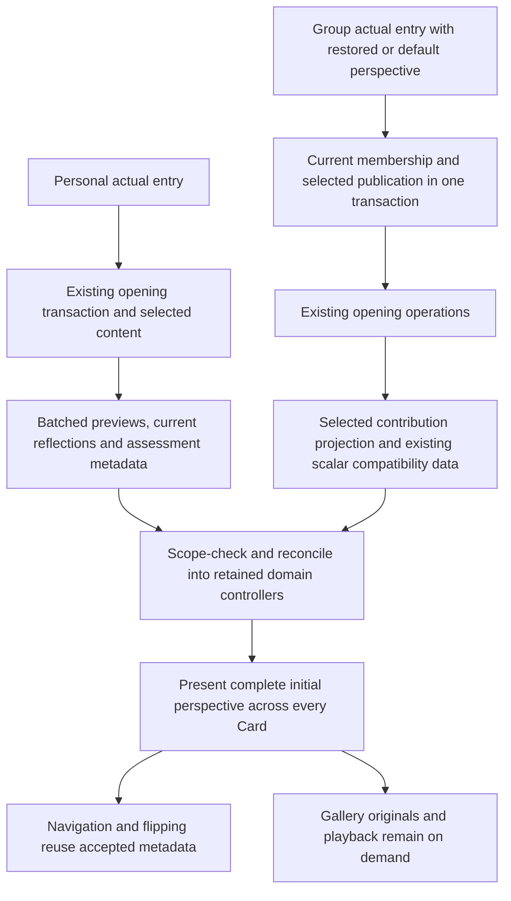

# Loading Architecture V3 — Checkpoint 2 handoff

Status: implemented and automated verification complete, subject to the existing unrestricted-build diagnostic limitation below. Physical iPhone acceptance is pending. Branch: `feat/group-experience`; starting baseline: `cd5e260258b20470a3329aafb2eccc60fe848e8b`. The starting tree was clean. This checkpoint does not implement CP3 or deploy anything.

## 1. Implementation and complete readiness

- Added protected Personal and Group preparation readers. Each selected perspective includes canonical content, learning, permitted dates, exact newest-five media windows/counts, current reflection previews, Group collective/member notes where applicable, and existing visible attachment metadata. Every selected Card is included, including both faces. Empty windows/slots are explicit; missing sections fail readiness.
- Mongo queries share the existing snapshot transaction and execute sequentially within it. Media and reflection queries batch Card IDs, identities and origin lookups. Owner media reuses the existing valid-item filtering, legacy deduplication/undated ordering and live source lineage. Cursor/source identities match the Gallery readers.
- Personal assessment history is projected in one existing eligibility/provenance pass for all Cards so its visible badge is ready too. A previously prepared badge stays visible but non-interactive while entry authority is pending.
- GET preparation does not create records, assign dates, update active Card, record views or update openedAt. Actual Personal POST opening reuses its resolved canonical content and updated dates inside the existing opening transaction. Actual Group entry reuses the authorised composition and existing opening helper. Later navigation waits for an older opening write before persisting, while visual navigation stays immediate.
- Initial Group entry uses one composed response instead of initial authority → parallel scalar reads → final authority. A lease that actually expires during an unusually slow read still needs narrow renewal. The five-second request-start lease, independent renewal and accepted out-of-order protection remain.
- Hydrate existing retained media/reflection controllers before publishing the scene. Their account/session/scope checks and source stamps prevent older preparation from overwriting new saves or resurrecting removals. Personal working-store acceptance uses the captured source epoch/session rather than rejecting useful independent sections after an unrelated save.
- Identical in-flight initial entries share work; different perspective/Card entry intents serialize and receive their own preparation. The first scene checks the entered perspective against retained domain data. This is an initial-entry gate, not CP3 picker integration.
- Composed owner reflection previews contain the exact current source, not all historical reflection bodies. The existing full-history API remains unchanged. Partial owner previews preserve independently retained owner history; full feeds still reconcile deletion/visibility. Foreign feeds cannot use that partial-history retention rule.

### Existing compatibility retained deliberately

The current picker/comparison implementation still consumes its scalar follower learning matrix, collective learning and compact aggregate response. CP2 retains that dataset, including aggregates when entering Me, to avoid introducing CP3 switching/loading behaviour. Only the entered perspective receives complete media/reflection preparation. There is no automatic Group/Me/follower preparation. First switching to another unprepared perspective retains the existing behaviour until CP3; it is not covered by the new initial-entry completeness guarantee. Already prepared views reuse their domain snapshots. Narrowing this scalar dependency belongs with CP3 integration; its present cost is included in measurements.

Initial/refreshed Personal compositions and explicit Group adoption/settings revalidation use complete preparation. Existing periodic Group refresh and per-component polling remain for CP4 coordination. No motion constants, gesture thresholds, geometry, media providers, ownership rules or deployment configuration changed.

## 2. Request and data flow



Personal transport retains its existing response-actor and trailing `/api/auth/me` checks. Group protected reads/writes still use current server membership/publication checks. The client records higher authority revisions observed by renewal so a delayed older composed result cannot restore a superseded scope. Confirmed denial clears affected data; ordinary transient refresh failures retain known content.

G and F semantics from CP1 are unchanged. Player learning invalidates its applicable F dependencies; collective G edits do not invalidate F. Existing queues, rollback, source revisions, retry operation IDs and coalesced reconciliation remain. The approved `…` applies only to an already displayed affected aggregate, never initial readiness.

## 3. Early measurements and interpretation

### Historical hosted baseline — not a new deployment

The existing Dublin observations were direct-entry current-Card contribution readiness 2.354 s Chromium / 1.971 s WebKit, and in-app reopen 1.371 s / 1.151 s. Those markers did not establish complete all-Card readiness. No hosted deployment or matched hosted comparison was authorised or performed here; local numbers must not be subtracted from those values as a claimed speedup.

### Local composed readers

Early six-Card fixtures established a real complete path before broad integration: ordinary reads were approximately 44–65 ms, with 31 Personal, 28 Me and 21 Group commands, including commit and zero warm metadata commands. These early fixtures had two followers. They are retained as development evidence, not mislabeled as the 19-member case.

A subsequent real 3-Admin/16-follower fixture measured five warm reads per operation, including 600-contribution and approximately 100-member comparisons. Those raw records are in `/tmp/cp2-performance-final.log`. The run shared the development machine with browser/build work, producing substantial heavy-history timing variation. The final current-source reflection projection removes unnecessary historical bodies. Five warm final-reader samples, with three Admins and sixteen followers:

| Complete reader | Median (range), local ms | Commands incl. commit | JSON bytes | Warm metadata commands |
|---|---:|---:|---:|---:|
| Personal | 74.16 (58.32–89.75) | 25 | 41,018 | 0 |
| Me | 72.73 (57.56–87.89) | 21 | 36,827 | 0 |
| Group | 72.77 (53.68–91.20) | 21 | 63,332 | 0 |

Node JSON parsing was approximately 0.28–0.81 ms for those payloads. Raw final-reader samples: `/tmp/cp2-final-reader-measurements.log`. The older approximately 41-command bootstrap excluded the mounted contribution work; the new counts include composed preview/reflection work, so this is not a like-for-like total-operation percentage claim.

The stress Group projection remained 21 commands with 600 media records, about 63.5 KB for ordinary notes. With 96 long reflections it returned about 1.95 MB; the 100-member comparison returned about 2.11 MB. Those Group results remain relevant after owner-history compaction because foreign Group carousel projection was unchanged. Bandwidth can dominate these exceptional long-note cases; no incomplete-Card shortcut or content cap was introduced. No precise hosted gain is claimed.

The isolated heavy-owner trace used six Cards with 1,500 Personal attachments each. Personal preparation took 685.93 ms, including 478 ms in the exact owner media-window aggregate and 75 ms in owner-document reads. Me took 503.32 ms, including 447 ms in that media-window aggregate. This is local driver round-trip attribution, including Mongo work, not Atlas/Vercel RTT. The owner-history validation/deduplication/sort is the dominant cost, not provider access or aggregation arithmetic. Busy-machine repeats reached several seconds; normal fixtures remained much cheaper. No accuracy shortcut or data migration was introduced.

The marginal dual-role Me projection was measured separately from Group. That early probe included full owner reflection history; its elapsed time is not claimed as the final narrow Me cost. Heavy owner history adds the owner-media scan, so complete Me is not bundled into initial Group. The default remains separate preparation in CP3; CP2 introduces no automatic follow-up.

### Optimized browser measurements

Mobile viewport: 390×844, touch/mobile contexts, Chromium and WebKit from the existing Playwright installation. Tests hold the composed response to prove no scene appears early, inspect every Card in the payload, block mounted contribution reads, then focus/flip/traverse all six Cards and verify previews/reflections. Artificial hold and traversal durations are not reported as Deck-opening time.

Warm direct-navigation measurements use one priming navigation plus three measured navigations per engine/role. They include page/server work and client entry, unlike a server-only query timer. Native `response.json()` body-read/parse duration and response-end-to-observation time are recorded separately; the latter includes identity checks, scheduling and rendering, not pure React CPU. Final optimized local measurements, milliseconds, with all selected Cards prepared before the scene:

| Engine | Initial perspective | Complete opening median (range) | Preparation HTTP median |
|---|---|---:|---:|
| chromium | Personal | 445 (423–504) | 87.6 |
| chromium | Me | 533 (513–804) | 94.4 |
| chromium | Group | 528 (523–567) | 65.3 |
| webkit | Personal | 389 (353–405) | 64 |
| webkit | Me | 355 (344–369) | 61 |
| webkit | Group | 450 (445–471) | 57 |

Native JSON body-read/parse was generally 0–a few milliseconds; it is not an isolated parser CPU benchmark. Data-ready response-end-to-observation includes the existing identity request where applicable and presentation scheduling. Raw requests, bytes and individual samples: `/tmp/cp2-final-browser-measurements.log`. These are warm direct navigations on a development machine, without controlled slow-4G shaping, not hosted production figures. In-app retained reopening is verified independently by holding/failing the real entry requests; no precise hosted retained-open latency is invented.

## 4. Verification and diagnostic findings

- Full unit run: **586 passed**. Deterministic entry-scope sharing, source reconciliation, account clearance, known-empty boundaries, optimistic reflections, G/F dependencies and existing Personal Info revision tests are included.
- Relevant Mongo suites: 64 passed across preparation, media collection, reflections, perspectives and lifecycle, plus focused final opening/lineage checks. Final compact-owner/initialisation/lineage checks passed: ten focused tests, with the final-reader measurement run separately. Full-history retrieval remains unchanged while composed owner previews exclude unrelated historical bodies.
- Complete optimized browser/retention run: **12 passed**, followed by **10 focused final compact-response cases passed** and **2 final measurement cases passed**. Includes Personal/Me/Group in both engines, all six Cards, exact previews, no blocking contribution fetch, remounts, Safari-style focus/pageshow and offline retention. Retained Personal assessment badges are checked while writes are disabled.
- Existing perspective/motion suite: eight functional passes, one fixture-skipped Personal case. The 50-switch paint-budget case initially measured 136 ms p95 on a busy machine, then passed in an isolated rerun at 80 ms against the unchanged 100 ms threshold. Scene, stack, Card and signal-trace identity assertions passed. No animation was retuned. New complete-loading tests independently cover Personal focus/flip/traversal.
- Five historical WebKit thumbnail diagnostics: all five pass after fixture corrections. Four failures were caused by missing mobile viewport metadata, preventing expected lazy loads; the fifth counted cancelled StrictMode attempts instead of six distinct authorised assets. A temporary no-StrictMode reproduction also passed. Only fixture viewport/font loading/assertion code changed, not production thumbnail behaviour.
- Optimized disposable production build passes with the existing scoped build configuration. Standard `npm run build` compiles with Turbopack, then fails at the known ignored SDK-union diagnostic in `phase2-test-results/deployment-checkpoint-1/inventory.ts`. Unrestricted TypeScript also reports the previously known ignored provider/video probes. These files and the application build configuration were not changed. Scoped source/tests/scripts TypeScript and targeted lint pass. The external temporary typecheck configuration includes generated Next route globals; no ignored diagnostics were edited to obtain that result.

The optimized HTTP loopback fixture copies its signed Secure cookie as non-Secure for WebKit because it uses HTTP rather than deployed HTTPS. This is test transport only. Application cookie settings and the 30-day lifetime are unchanged.

## 5. Limitations and checkpoint boundaries

- Physical iPhone review is pending. Hosted latency, Vercel cold starts and real-service video playback were not retested; no deployment occurred.
- The current complete reader has been exercised with 600 media contributions, 9,000 owner references and long reflections. Very large initial responses beyond the measured cases still need provider-limit verification/transport continuation coverage before deployment; CP3 explicitly includes bounded transport work. No Card/member/media cap was introduced.
- Group compatibility scalar reads and existing refresh overlap remain, as noted above. CP3 primary/follower readiness and CP4 refresh/resume/intro consolidation have not been implemented.
- Isolated thumbnail diagnostics establish fixture attribution, not universal physical Safari playback success. Existing unexplained physical animation symptoms must still be observed on iPhone; this checkpoint makes no speculative motion claim.
- No Atlas, Cloudflare, Vercel, real review database or existing fixture server was reset or modified.

## 6. Combined CP1 and CP2 iPhone review

The existing review server remains intact. A separate source-identical disposable checkout runs on port 4184, with its own memory database and mock providers. The LAN address was smoke-tested with a mobile Chromium Admin session; six Cards and the Galway U18 picker rendered.

Group:

```text
http://192.168.1.38:4184/decks?openExperience=9b4b7e68-7807-47c1-8ef6-399e7df77f68
```

Personal:

```text
http://192.168.1.38:4184/decks?openDeck=cf3ca1c3-61c4-4747-9174-d899e0079b46
```

Accounts are disposable: **phase2 / local-test-only** (Group Admin, not follower); **Aoife Kelly / local-test-only** (follower). These do not replace Joe/Eamonn or change the hosted Preview. Keep the Mac running on the same Wi-Fi as the phone. Development routes are prewarmed; their first compilation is not a production timing.

1. Enter Personal as Aoife, browse all six Cards in both directions, focus/flip and check media/notes are already arranged. Image bytes may fill their reserved positions.
2. Return to My Decks and reopen; repeat after putting Safari in the background. Known media/reflections should stay present during checks and temporary network failure.
3. Save a Personal note, then a Me note in Galway U18; reopen and move Cards quickly. Submitted text should remain immediate and persist. Check the same source via another Deck where applicable.
4. Enter Group as phase2; browse/flip all Cards and open Gallery/Media Centre. Check the collective note and member carousel remain separate, and comparison opening/closing preserves the focused Card.
5. Change collective G progress/confidence; F must not blank or be marked dirty solely by that collective edit. As Aoife, change own learning; only dependent F values should reconcile. If `…` appears, the Card and unrelated values must remain stable; exact local recalculation can make the placeholder unnecessary.
6. Switch accounts and confirm roles, private owner content and read-only inspection remain correct. Observe any stack vibration or Personal gesture jerkiness and report it; geometry and timing are unchanged.

Mock images/uploads support this local review; live Stream playback is not enabled in the disposable provider. Stop/restart commands, PIDs and fixture IDs are in `/tmp/switchplay-cp2-phone-review/phase2-test-results/review-server.json`; the process log is `/tmp/cp2-phone-review.log`.

## 7. Exact file inventory and Git

Only the following authorised checkpoint files are changed. V3/V2 and supporting investigation documents remain unchanged. No package, production configuration, provider or CSS files changed.

- `docs/engineering/features/group-experience/loading-architecture-v3-checkpoint-2-handoff.md`
- `scripts/test-phase2.ts`
- `src/app/api/decks-data/[deckTemplateId]/preparation/route.ts`
- `src/app/api/group-experiences/[experienceId]/preparation/route.ts`
- `src/components/assessments/useAssessmentHistory.ts`
- `src/components/decks/DeckDetail.tsx`
- `src/components/decks/types.ts`
- `src/components/group-experiences/GroupExperienceDeck.tsx`
- `src/components/group-experiences/groupResource.ts`
- `src/components/layout/AppShell.tsx`
- `src/components/media/useMediaCollection.ts`
- `src/components/reflections/ReflectionArea.tsx`
- `src/lib/cards/preparation.ts`
- `src/lib/cards/preparationClient.ts`
- `src/lib/cards/readModels.ts`
- `src/lib/cards/repository.ts`
- `src/lib/cards/resolvers.ts`
- `src/lib/frameworks/readModels.ts`
- `src/lib/groupExperiences/preparation.ts`
- `src/lib/groupExperiences/presentationReads.ts`
- `src/lib/groupExperiences/repository.ts`
- `src/lib/mediaCollection/controller.ts`
- `src/lib/mediaCollection/ownerHistory.ts`
- `src/lib/mediaCollection/preparation.ts`
- `src/lib/reflections/collective.ts`
- `src/lib/reflections/controller.ts`
- `src/lib/reflections/reads.ts`
- `tests/card-preparation-client.test.ts`
- `tests/card-preparation.integration.ts`
- `tests/deck-video-preparation.spec.ts`
- `tests/group-experience-client.test.ts`
- `tests/helpers/groupReviewFixture.ts`
- `tests/helpers/mediaReviewFixture.ts`
- `tests/media-collection-client.test.ts`
- `tests/phase2/complete-card-preparation.browser.ts`
- `tests/phase2/loading-retention.browser.ts`
- `tests/reflection-controller.test.ts`

Automated CP2 exit evidence is met for the tested normal and stress datasets. The known standard-build diagnostic is reported rather than hidden; provider-limit coverage beyond the tested payloads and the combined physical review remain outstanding. No CP3 work has started.

Implementation commit: `fca0e05` — `feat: compose complete initial Card preparation`, with parent `cd5e260`. This handoff receives a separate documentation-only follow-up recording that implementation hash. The exact final working-tree status and both commit hashes are supplied in the handoff message. No push, merge or deployment occurred.
